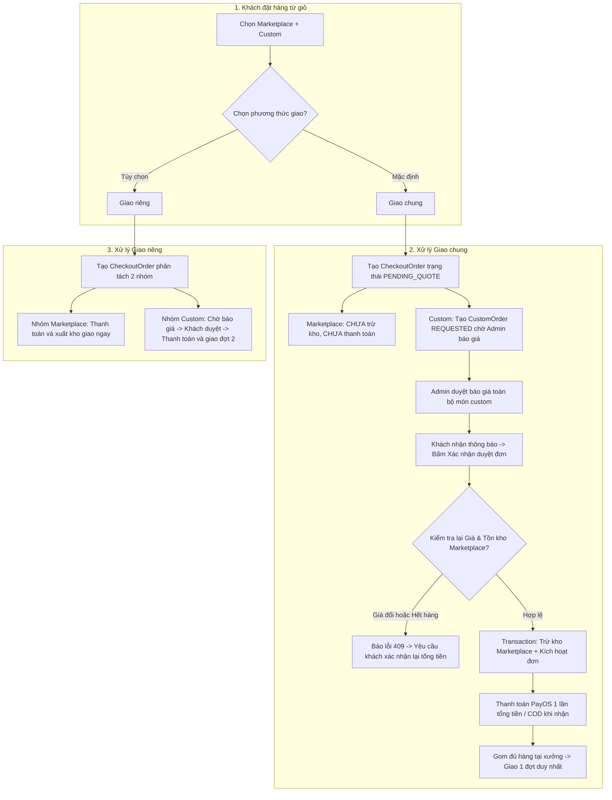

# Kế hoạch xử lý thiết kế custom, giỏ hỗn hợp, báo giá và giao hàng

Cập nhật: 14/10/2026. Đây là kế hoạch kiến trúc và triển khai tổng thể giữa Frontend (`exe-fe`) và Backend (`PrintHub_3D`).

---

## 1. Mục tiêu và quyết định nghiệp vụ đã chốt

1. **Phân định cơ chế định giá**:
   - Chỉ có **thước thẳng chuẩn** (chiều dài 15, 20, 30 cm) là có công thức tính **giá ước tính (Estimated Price)** tự động trên Frontend và được lưu tạm vào giỏ hàng.
   - **Tất cả các mẫu thước phức tạp khác** (thước tam giác tỷ lệ, thước đo độ, eke, thước cong may mặc...) bắt buộc phải qua quy trình **Yêu cầu báo giá thủ công từ Admin/Xưởng in** trước khi thanh toán.
2. **Chế độ Chỉnh sửa & Lưu từ giỏ hàng (Edit & Save Mode)**:
   - Khi khách bấm *"Chỉnh sửa"* từ giỏ hàng, 3D Studio nhận `cartItemId` và mở đúng bản thiết kế đó.
   - Nút chính chuyển thành **"Lưu thay đổi vào giỏ"** (cập nhật đè đúng dòng cũ, giữ nguyên số lượng và định danh dòng).
   - Có hành động phụ **"Lưu thành thiết kế mới"** nếu khách muốn nhân bản thành 1 món riêng.
   - **Xử lý khi đổi mẫu:** Nếu khách đang sửa cây thước trong giỏ nhưng bấm đổi sang mẫu phức tạp (chưa có giá sẵn), nút không bị khóa thụ động mà tự động chuyển thành **"📋 Chuyển sang yêu cầu báo giá"**. Khi bấm: tạo yêu cầu báo giá mới gắn với file thiết kế và xóa/rút dòng thước cũ khỏi giỏ hàng.
3. **Giỏ hàng hỗn hợp (Marketplace + Custom) và Checkbox chọn món**:
   - Giỏ hàng tách biệt 2 khu vực: **Sản phẩm có sẵn (Marketplace)** và **Thiết kế in 3D (Custom)**.
   - Có checkbox cho phép khách chọn từng dòng để thanh toán; không bắt buộc phải mua cả giỏ.
   - Tổng tiền thanh toán tạm tính không cộng gộp giá ước tính của custom. Món custom chưa chốt giá hiển thị nhãn **"Cần báo giá"**, tuyệt đối không hiển thị 0đ.
4. **Hai hình thức giao hàng của Đơn cha (Checkout Order)**:
   - **Giao chung (Mặc định)**: Gom cả món Marketplace và Custom vào 1 đơn cha. Không trừ kho Marketplace vô thời hạn khi đơn chưa xác nhận. Chờ xưởng báo giá xong toàn bộ món custom -> Khách duyệt báo giá -> Backend kiểm tra lại giá và tồn kho Marketplace trong Transaction -> Trừ kho và thanh toán tổng đơn (PayOS 1 lần hoặc COD khi nhận hàng).
   - **Giao riêng**: Marketplace xác nhận, thanh toán và giao trước; Custom tiếp tục chờ báo giá và thanh toán/giao sau theo từng đợt riêng.
5. **Kiểm tra biến động giá và tồn kho khi khách chấp nhận báo giá**:
   - Khi khách duyệt báo giá custom, Backend kiểm tra lại giá bán và số lượng tồn kho của các món Marketplace trong đơn cha.
   - Nếu Marketplace bị tăng giá/đổi khuyến mãi: Bắt buộc khách xem và xác nhận lại tổng tiền mới.
   - Nếu Marketplace bị hết hàng: Thông báo khách bỏ món đó hoặc quay lại chọn món khác; không âm thầm xóa món.

---

## 2. Chi tiết 3D Studio và Giỏ hàng (Frontend)

### 2.1. Nhận diện ngữ cảnh và Chuyển đổi nút bấm trong Studio
- Khi mở `/custom` từ giỏ hàng: truyền `cartItemId`, `revision` và snapshot thiết kế `rulerDesign`.
- **Nếu `cartItemId` không tồn tại (Tạo mới)**:
  - Thước thẳng (15/20/30 cm): Hiện nút **"Thêm thiết kế vào giỏ"** (màu xanh lá, bấm được).
  - Mẫu khác: Hiện nút **"Yêu cầu báo giá"** (kèm nhãn *"Cần xưởng thẩm định và báo giá"*).
- **Nếu `cartItemId` tồn tại (Chế độ Chỉnh sửa - Edit Mode)**:
  - Thước thẳng: Nút chuyển thành **"💾 Lưu thay đổi vào giỏ"**. Khi bấm: gọi API cập nhật đè dòng cũ, giữ `quantity`. Có nút phụ bên cạnh: **"Lưu thành thiết kế mới"**.
  - Đổi sang mẫu khác (cần báo giá): Nút chuyển thành **"📋 Chuyển sang yêu cầu báo giá"**. Khi bấm: tạo `CustomOrder` trạng thái `REQUESTED`, xóa dòng cũ khỏi giỏ và chuyển khách sang trang `/quotations`.
- Cho phép lưu nháp trên thiết bị (`localStorage`) độc lập với việc cập nhật giỏ hàng. Khi rời Studio mà có thay đổi chưa lưu vào giỏ: hiển thị popup cảnh báo xác nhận *"Tiếp tục sửa"* hoặc *"Bỏ thay đổi"*.

### 2.2. Giao diện Giỏ hàng ([`CartPage.tsx`](file:///d:/semester%207/EXE/exe202-printhub3d-fe/exe-fe/src/pages/CartPage.tsx))
- **Phân nhóm rõ rệt**:
  - Nhóm 1: *Sản phẩm Marketplace (Giao ngay)*.
  - Nhóm 2: *Thiết kế in 3D Custom (Chờ xưởng báo giá & in)*.
- **Checkbox chọn món**: Khách có thể tick chọn riêng các món Marketplace để thanh toán ngay, món Custom vẫn nằm an toàn trong giỏ.
- **Tùy chọn phương thức giao hàng**:
  - Radio button: **Giao chung (Mặc định)** hoặc **Giao riêng**.
  - Hiển thị dự kiến thời gian giao và phí vận chuyển của từng phương thức.
  - Nếu giỏ có sản phẩm từ nhiều seller khác nhau: Giao chung bị vô hiệu hóa kèm giải thích rõ lý do, tự động chọn Giao riêng.

---

## 3. Quy trình Đơn chung và Hai phương thức giao hàng



---

## 4. Thiết kế Backend, API và Hệ thống Mã lỗi (`/common/exception`)

### 4.1. Cấu trúc Thực thể Database mới & Cập nhật
1. **Cập nhật Bảng `cart_items`**:
   - `client_line_id` (`UUID`, NOT NULL): Định danh duy nhất của dòng giỏ hàng giữa FE và BE.
   - `revision` (`BIGINT`, NOT NULL, default 1): Số phiên bản phục vụ Optimistic Locking (chống xung đột ghi đè giữa 2 thiết bị).
   - `custom_design` (`TEXT`): Chuỗi JSON cấu hình 3D studio.
   - `custom_name` (`VARCHAR(255)`): Tên thước custom.
   - `custom_price` (`DECIMAL(18,2)`): Giá ước tính (nullable, do BE xác thực).
   - `thumbnail_url` (`TEXT`): Ảnh render phối cảnh 3D.
   - `product_id` (`UUID`, nullable): Cho phép null khi là dòng custom.
2. **Tạo Bảng mới `checkout_orders`**:
   - `id` (`UUID`, PK): ID đơn cha.
   - `user_id` (`UUID`, FK `users`): Chủ sở hữu đơn.
   - `shipping_address` (`TEXT`): Địa chỉ nhận hàng đầy đủ.
   - `shipping_mode` (`VARCHAR(30)`): `COMMON` (Giao chung) hoặc `SEPARATE` (Giao riêng).
   - `status` (`VARCHAR(30)`): `PENDING_QUOTE`, `QUOTED`, `PARTIALLY_CONFIRMED`, `CONFIRMED`, `PROCESSING`, `COMPLETED`, `CANCELLED`.
   - `total_amount` (`DECIMAL(18,2)`): Tổng tiền sau khi đã có báo giá và xác nhận.
   - `shipping_fee` (`DECIMAL(18,2)`): Phí vận chuyển.
   - `created_at`, `updated_at` (`TIMESTAMP`).
3. **Liên kết**:
   - Bảng `orders` bổ sung `checkout_order_id` (FK `checkout_orders`).
   - Bảng `custom_orders` bổ sung `checkout_order_id` (FK `checkout_orders`).

---

### 4.2. Hệ thống Mã lỗi Backend (`com.fpt.printhub_3d.common.exception`)

Tuân thủ nghiêm ngặt chuẩn kiến trúc Exception hiện tại của dự án: Kế thừa interface `ErrorCode`, có mã số `code` (Domain riêng biệt), `HttpStatus`, thông điệp tiếng Việt `message` và `errorKey` phục vụ đa ngôn ngữ.

#### A. Cập nhật [`CartErrorCode.java`](file:///d:/semester%207/EXE/PrintHub_3D/src/main/java/com/fpt/printhub_3d/common/exception/CartErrorCode.java) (Domain: `CART`, dải mã 25000)
| Tên Enum | Mã lỗi | HTTP Status | Thông điệp hiển thị (`message`) | `errorKey` |
| :--- | :---: | :---: | :--- | :--- |
| `PRODUCT_NOT_FOUND` | 25001 | 404 NOT_FOUND | Sản phẩm không tồn tại hoặc đã bị xóa | `cart.product_not_found` |
| `PRODUCT_INACTIVE` | 25002 | 400 BAD_REQUEST | Sản phẩm hiện không còn hoạt động hoặc đã ngừng bán | `cart.product_inactive` |
| `INVALID_QUANTITY` | 25003 | 400 BAD_REQUEST | Số lượng sản phẩm không hợp lệ (1-999) | `cart.invalid_quantity` |
| `DUPLICATE_PRODUCT` | 25004 | 400 BAD_REQUEST | Sản phẩm bị trùng lặp trong giỏ hàng | `cart.duplicate_product` |
| `CART_NOT_FOUND` | 25005 | 404 NOT_FOUND | Không tìm thấy thông tin giỏ hàng | `cart.not_found` |
| **`LINE_NOT_FOUND`** *(Mới)* | **25006** | **404 NOT_FOUND** | Dòng sản phẩm trong giỏ không tồn tại hoặc đã bị xóa | `cart.line_not_found` |
| **`VERSION_CONFLICT`** *(Mới)* | **25007** | **409 CONFLICT** | Dữ liệu giỏ hàng đã được thay đổi từ thiết bị khác. Vui lòng tải lại trang | `cart.version_conflict` |
| **`INVALID_CUSTOM_DATA`** *(Mới)* | **25008** | **400 BAD_REQUEST** | Dữ liệu thiết kế 3D custom không đúng định dạng hoặc vượt quá dung lượng | `cart.invalid_custom_data` |

#### B. Tạo mới `CheckoutOrderErrorCode.java` (Domain: `CHECKOUT_ORDER`, dải mã 28000)
```java
package com.fpt.printhub_3d.common.exception;

import lombok.Getter;
import lombok.RequiredArgsConstructor;
import org.springframework.http.HttpStatus;

@Getter
@RequiredArgsConstructor
public enum CheckoutOrderErrorCode implements ErrorCode {

    CHECKOUT_ORDER_NOT_FOUND(28001, "Đơn thanh toán không tồn tại hoặc đã bị hủy", HttpStatus.NOT_FOUND, "checkout.not_found"),
    EMPTY_SELECTION(28002, "Vui lòng chọn ít nhất 1 sản phẩm từ giỏ hàng để tạo đơn", HttpStatus.BAD_REQUEST, "checkout.empty_selection"),
    SELLER_MISMATCH_FOR_COMMON_SHIPPING(28003, "Giao chung chỉ áp dụng khi các sản phẩm thuộc cùng một xưởng/người bán. Vui lòng chọn Giao riêng", HttpStatus.BAD_REQUEST, "checkout.seller_mismatch_common_shipping"),
    CUSTOM_NOT_ALL_QUOTED(28004, "Đơn hàng vẫn còn sản phẩm in 3D đang chờ xưởng thẩm định và báo giá", HttpStatus.BAD_REQUEST, "checkout.custom_not_all_quoted"),
    MARKETPLACE_OUT_OF_STOCK(28005, "Sản phẩm bán sẵn trong đơn không còn đủ tồn kho. Vui lòng kiểm tra lại", HttpStatus.BAD_REQUEST, "checkout.marketplace_out_of_stock"),
    MARKETPLACE_PRICE_CHANGED(28006, "Giá sản phẩm bán sẵn đã thay đổi kể từ khi tạo đơn. Vui lòng xem và xác nhận lại tổng tiền", HttpStatus.CONFLICT, "checkout.marketplace_price_changed"),
    CONFIRMATION_VERSION_CONFLICT(28007, "Phiên bản xác nhận đơn hàng không khớp. Vui lòng làm mới trang để cập nhật tổng tiền mới nhất", HttpStatus.CONFLICT, "checkout.version_conflict"),
    INVALID_PAYMENT_STATE(28008, "Đơn hàng chưa ở trạng thái sẵn sàng để tạo giao dịch thanh toán", HttpStatus.BAD_REQUEST, "checkout.invalid_payment_state"),
    CANNOT_CANCEL_CONFIRMED_ORDER(28009, "Không thể hủy đơn hàng đã bước vào giai đoạn sản xuất hoặc giao hàng", HttpStatus.BAD_REQUEST, "checkout.cannot_cancel_confirmed");

    private final int code;
    private final String message;
    private final HttpStatus status;
    private final String errorKey;

    @Override
    public String getDomain() {
        return "CHECKOUT_ORDER";
    }
}
```

#### C. Bổ sung mã lỗi vào [`PaymentErrorCode.java`](file:///d:/semester%207/EXE/PrintHub_3D/src/main/java/com/fpt/printhub_3d/common/exception/PaymentErrorCode.java)
- **`CHECKOUT_PAYMENT_FAILED`** (26010, "Không thể tạo liên kết thanh toán PayOS cho đơn hỗn hợp", HttpStatus.BAD_REQUEST, "payment.checkout_failed").
- **`PAYMENT_AMOUNT_MISMATCH`** (26011, "Số tiền thanh toán không khớp với báo giá đã được duyệt", HttpStatus.BAD_REQUEST, "payment.amount_mismatch").

---

### 4.3. Đặc tả Danh sách API RESTful mới và Cập nhật

1. **Giỏ hàng đơn lẻ**:
   - `PUT /api/cart/items/{clientLineId}`: Cập nhật nội dung thiết kế, số lượng của 1 dòng giỏ hàng. Header/Body gửi kèm `revision`. Nếu revision trong DB > revision gửi lên -> Ném `CartErrorCode.VERSION_CONFLICT` (409).
   - `DELETE /api/cart/items/{clientLineId}`: Xóa đúng 1 dòng được chọn, không xóa các dòng khác.
2. **Khởi tạo Đơn cha**:
   - `POST /api/checkout-orders`:
     + Request: `{ selectedLineIds: UUID[], shippingMode: "COMMON" | "SEPARATE", recipientAddress: {...}, idempotencyKey: string }`.
     + Logic: Trong Transaction, tạo record `checkout_orders`, chuyển các dòng custom thành `custom_orders` (`REQUESTED`), snapshot thông tin marketplace, xóa các dòng đã chọn khỏi `cart_items`.
3. **Theo dõi và Xác nhận Đơn cha**:
   - `GET /api/checkout-orders/{id}`: Trả về trạng thái tổng thể, báo giá của từng dòng custom, tổng tiền tạm tính và tình trạng sẵn sàng.
   - `POST /api/checkout-orders/{id}/confirm`:
     + Request: `{ summaryVersion: number, paymentMethod: "PAYOS" | "COD" }`.
     + Logic: Khóa bi-quan (`Pessimistic Lock`) kiểm tra giá và tồn kho Marketplace. Nếu khớp và tất cả custom đã có `quotedPrice`, chuyển trạng thái sang `CONFIRMED`, trừ tồn kho marketplace và tạo link thanh toán PayOS. Nếu không khớp ném `CheckoutOrderErrorCode.MARKETPLACE_PRICE_CHANGED` hoặc `MARKETPLACE_OUT_OF_STOCK`.

---

## 5. Kế hoạch Kiểm thử và Nghiệm thu (Verification Matrix)

| Kịch bản kiểm thử | Hành động | Kết quả bắt buộc | Mã lỗi kỳ vọng khi fail |
| :--- | :--- | :--- | :--- |
| **1. Sửa thiết kế từ giỏ** | Bấm *"Chỉnh sửa"*, đổi màu, bấm *"Lưu thay đổi vào giỏ"* | Cập nhật đúng dòng cũ, giữ nguyên số lượng `quantity`, cập nhật thumbnail 3D mới | `CartErrorCode.LINE_NOT_FOUND` nếu dòng bị xóa |
| **2. Đổi sang mẫu cần báo giá** | Từ thước thẳng trong giỏ đổi sang Thước tam giác | Nút đổi thành *"Chuyển sang yêu cầu báo giá"*, tạo đơn custom `REQUESTED`, xóa khỏi giỏ | N/A |
| **3. Xung đột 2 tab cùng sửa giỏ** | Mở 2 tab cùng sửa 1 cây thước, tab A lưu trước, tab B lưu sau | Tab B bị chặn và thông báo dữ liệu đã thay đổi trên thiết bị khác | `CartErrorCode.VERSION_CONFLICT` (409) |
| **4. Checkbox mua riêng Marketplace** | Giỏ có 1 thước bán sẵn + 1 thước custom; chỉ tick chọn thước bán sẵn | Tạo đơn thường mua ngay, cây thước custom vẫn ở lại trong giỏ hàng | N/A |
| **5. Đơn hỗn hợp Giao chung** | Chọn cả 2 loại, chọn Giao chung | Tạo 1 đơn cha `PENDING_QUOTE`, Marketplace chưa trừ kho; Admin báo giá xong mới cho xác nhận | `CheckoutOrderErrorCode.CUSTOM_NOT_ALL_QUOTED` |
| **6. Marketplace hết hàng khi duyệt báo giá** | Khi khách bấm duyệt báo giá, món marketplace vừa bị người khác mua hết kho | Chặn transaction xác nhận, giữ yêu cầu custom, báo khách chọn sản phẩm khác | `CheckoutOrderErrorCode.MARKETPLACE_OUT_OF_STOCK` (400) |
| **7. Marketplace đổi giá khi duyệt báo giá** | Món marketplace đổi giá từ 50k lên 60k trong thời gian chờ xưởng báo giá | Chặn transaction, cập nhật tổng tiền mới, yêu cầu khách xem và xác nhận lại | `CheckoutOrderErrorCode.MARKETPLACE_PRICE_CHANGED` (409) |
| **8. Thanh toán PayOS đơn chung** | Quét mã VietQR cổng PayOS cho đơn Giao chung | PayOS Webhook xác nhận tổng tiền đơn cha, chuyển đơn sang `PAID`, phân bổ vào các đơn thành phần | `PaymentErrorCode.PAYMENT_AMOUNT_MISMATCH` |
| **9. Hủy giao dịch PayOS** | Bấm hủy trên cổng PayOS | Giữ nguyên đơn ở trạng thái chờ thanh toán để khách quét lại mã; không xóa giỏ hàng | N/A |

---

## 6. Lộ trình Triển khai (Execution Order)

1. **Bước 1 (Backend - Database & Exceptions)**:
   - Thêm `CartErrorCode.LINE_NOT_FOUND`, `VERSION_CONFLICT`.
   - Tạo mới `CheckoutOrderErrorCode.java` trong `com.fpt.printhub_3d.common.exception`.
   - Viết migration bảng `checkout_orders` và bổ sung `client_line_id`, `revision` cho `cart_items`.
2. **Bước 2 (Backend - Services & APIs)**:
   - Triển khai `CartServiceImpl.updateCartItem` và `deleteCartItem` đơn lẻ.
   - Triển khai `CheckoutOrderService` (`create`, `get`, `confirm`).
   - Cập nhật `PaymentServiceImpl` hỗ trợ `CHECKOUT_ORDER`.
3. **Bước 3 (Frontend - Studio & Giỏ hàng)**:
   - Nâng cấp `RulerStudio.tsx`: Chế độ Edit mode ("Lưu thay đổi vào giỏ" / "Chuyển sang yêu cầu báo giá").
   - Cập nhật `useCart.ts`: Hỗ trợ `clientLineId`, `revision` và hàm cập nhật đơn lẻ.
   - Nâng cấp `CartPage.tsx`: Checkbox chọn món, chia nhóm Marketplace / Custom, tùy chọn Giao chung / Giao riêng.
4. **Bước 4 (Frontend - Kết quả thanh toán & Quản lý đơn)**:
   - Cập nhật `PaymentResultPage.tsx` và `OrderList.tsx` hiển thị tiến độ đơn cha.
