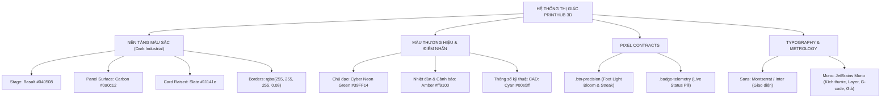
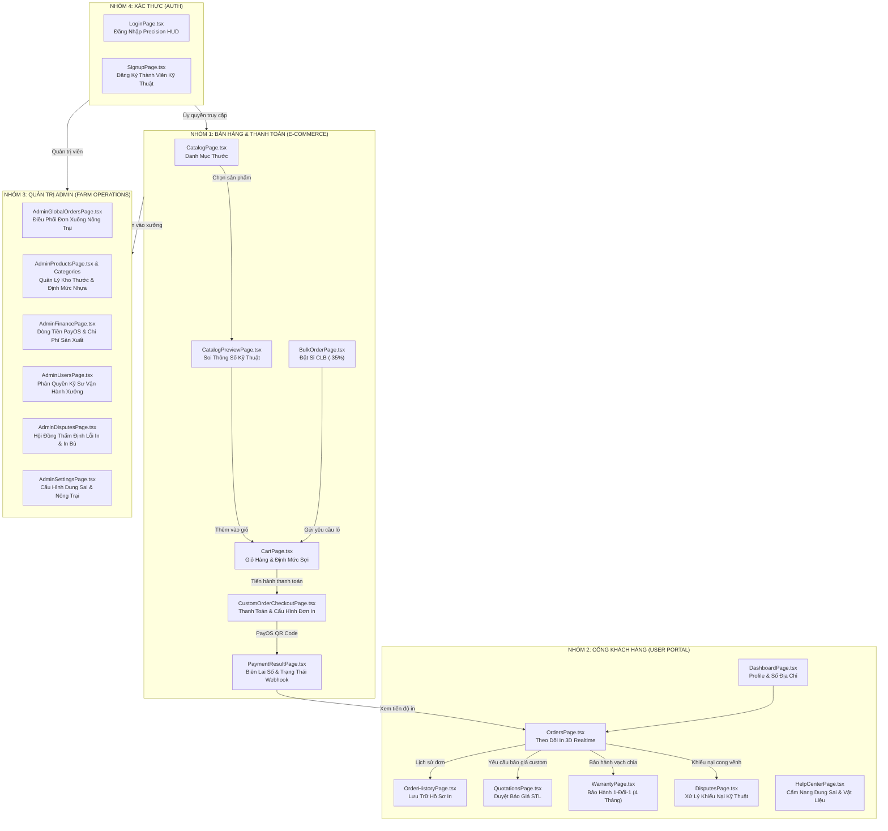

# 🛠️ PRINTHUB 3D — LỘ TRÌNH NÂNG CẤP TOÀN DIỆN HỆ THỐNG GIAO DIỆN (UI/UX WORKFLOW)

Tài liệu này đặc tả kiến trúc luồng dữ liệu (Data & Navigation Flow), tiêu chuẩn thị giác (Design System Tokens & Pixel Contracts) và kế hoạch triển khai nâng cấp chi tiết cho **tất cả 4 nhóm màn hình còn lại** của ứng dụng PrintHub 3D Frontend, đồng bộ 100% với phong cách **Dark Industrial Precision** đã thiết lập.

---

## 1. HỆ THỐNG DESIGN SYSTEM & NGUYÊN TẮC BẤT BIẾN (CORE DNA)

### Bảng Token Màu & Quy Chuẩn Áp Dụng:
| Thành phần | Token CSS | Mã Hex / HSL | Ứng dụng cụ thể |
| :--- | :--- | :--- | :--- |
| **Sân khấu chính (Stage)** | `--color-surface-inset` | `#040508` | Nền canvas 3D, background trang, viền đen sâu thẳm |
| **Bề mặt bảng điều khiển** | `--color-surface` | `#0a0c12` | Sidebar, Card công nghiệp, Navbar, Topbar |
| **Thẻ nổi (Raised Card)** | `--color-surface-raised` | `#11141e` | Hộp thông số, modal backdrop, dropdown menu |
| **Màu chủ đạo (Primary)** | `--color-primary` | `#39FF14` | Tương tác chính, vạch laser, glow bloom, nút bấm CTA |
| **Điểm nhấn nhiệt (Warning)**| `--color-warning` | `#ff9100` | Nhiệt độ đầu đùn, cảnh báo cong vênh, đơn chờ duyệt |
| **Dung sai kỹ thuật (Info)** | `--color-info` | `#00e5ff` | Chỉ số Bounding Box, vạch thước du xích, mã G-code |

---

## 2. HIỆN TRẠNG TRIỂN KHAI (ĐÃ HOÀN THÀNH 100%)

> [!NOTE]
> Hệ thống cốt lõi và 3 màn hình trụ cột của ứng dụng đã được nâng cấp hoàn thiện và kiểm thử thành công:

- [x] **Giai đoạn 1 — Nền tảng & Landing Page**:
  - `index.css`: Cấu hình Tailwind `@theme`, Pixel Contract `.btn-precision` và `.badge-telemetry` phát sáng `#39FF14`.
  - `LandingNavbar.tsx`: Fix triệt để lỗi co chữ rớt dòng (`whitespace-nowrap`, `shrink-0`), thanh menu dạng viên thuốc phát sáng.
  - `LandingPage.tsx`: Giao diện Hero Dark Precision với bộ mô phỏng máy in 3D & lát cắt CAD.
- [x] **Giai đoạn 2 — 3D Slicer / Custom Studio & Metrology**:
  - `Ruler3DPage.tsx`: Kiến trúc chuẩn 3-Pane Workbench (Left: Slicer params & vật liệu; Center: Viewport WebGL, trục Origin $X/Y/Z$, thanh trượt lát cắt Slicer; Right: Telemetry & Ước tính sản xuất).
  - `CustomOrderPage.tsx` & `studio.css`: Chuyển đổi toàn bộ bộ tùy biến thước sang nền Basalt `#040508` và nút bấm Neon Green.
- [x] **Giai đoạn 3 — Admin Farm Telemetry & Quản lý sản xuất**:
  - `AdminDashboardPage.tsx`: Tích hợp ma trận 6 cụm máy in nông trại thời gian thực (Voron 2.4, Bambu X1C, Prusa MK4, Elegoo Resin), cảm biến nhiệt Nozzle/Bed, thanh tiến độ lớp in, nút Tạm dừng/Tiếp tục.
  - `AdminCustomOrdersPage.tsx`: Cổng thẩm định & duyệt báo giá STL tùy chỉnh với phím tắt gợi ý phân khúc giá nhanh.

---

## 3. SƠ ĐỒ LUỒNG TỔNG THỂ (SYSTEM ARCHITECTURE WORKFLOW)

---

## 4. LỘ TRÌNH TRIỂN KHAI CHI TIẾT 4 NHÓM CÒN LẠI

### 📦 NHÓM 1: BÁN HÀNG, GIỎ HÀNG & THANH TOÁN (E-COMMERCE FLOW)
*Mục tiêu: Đưa trải nghiệm mua sắm thước kỹ thuật và đặt in 3D lên chuẩn thương mại cao cấp với cảm giác chính xác cơ khí.*

| Màn hình | File Path | Các hạng mục nâng cấp trọng tâm |
| :--- | :--- | :--- |
| **Danh Mục Thước** | `src/pages/CatalogPage.tsx` | - Thanh lọc kỹ thuật: Lọc theo vật liệu (`PLA-Pro+`, `PETG-CF`, `Resin 8K`) và độ chia vạch (`0.5mm`, `1mm`). - Product Card công nghiệp: Khung viền `#0a0c12`, đường quét laser neon `#39FF14` khi hover, badge dung sai cơ khí. - Bổ sung chỉ số khối lượng nhựa (g) và thời gian hoàn thành in ước tính. |
| **Xem Trước Thước** | `src/pages/CatalogPreviewPage.tsx` | - Sân khấu soi chi tiết 3D: Nền Basalt `#040508`, vạch chia rõ nét, thông số Bounding Box $X \times Y \times Z$. - Nút CTA mua ngay chuẩn `.btn-precision` có hiệu ứng đổ bóng phát sáng. |
| **Giỏ Hàng Công Nghiệp** | `src/pages/CartPage.tsx` | - Bảng bóc tách giá in 3D: Tách rõ tiền vật liệu nhựa, phí vận hành máy và chiết khấu sinh viên. - Chỉ số trọng lượng tổng đơn in (để tự động tính toán phí ship). - Thanh toán nhanh 1-click với mã coupon CLB. |
| **Thanh Toán Đơn In** | `src/pages/CustomOrderCheckoutPage.tsx` | - Bản tóm tắt kỹ thuật: Hiển thị model thước, tên/MSSV khắc cá nhân hóa, màu sắc 3 lớp in. - Đính kèm chứng nhận cam kết bảo hành 1-đổi-1 trong 4 tháng. - Cổng thanh toán quét mã QR PayOS tức thời. |
| **Đặt Sỉ CLB (-35%)** | `src/pages/BulkOrderPage.tsx` | - Bảng chiết khấu lũy tiến theo số lượng (10 cây, 50 cây, 200 cây). - Form tải lên danh sách tên sinh viên khắc laser hàng loạt (CSV/Excel). |
| **Kết Quả Thanh Toán** | `src/pages/PaymentResultPage.tsx` | - Biên lai kỹ thuật số chuẩn Monospace (Mã đơn, Transaction Hash, Thời gian tiếp nhận vào hàng đợi in). - Nút bấm theo dõi tiến trình in 3D thời gian thực. |

---

### 👤 NHÓM 2: CỔNG THÔNG TIN & THEO DÕI ĐƠN IN CỦA KHÁCH (USER PORTAL)
*Mục tiêu: Giúp khách hàng (sinh viên, kỹ sư, đối tác) minh bạch hóa toàn bộ quy trình gia công từ file CAD đến khi giao hàng.*

| Màn hình | File Path | Các hạng mục nâng cấp trọng tâm |
| :--- | :--- | :--- |
| **Theo Dõi Tiến Trình In** | `src/pages/OrdersPage.tsx` & `OrderHistoryPage.tsx` | - **Laser Stepper 5 bước**: `Đã Duyệt CAD` $\rightarrow$ `Đang Lát Cắt Slicer` $\rightarrow$ `Đang In Trên Bàn Nhiệt` $\rightarrow$ `Đóng Gói Khử Ứng Suất` $\rightarrow$ `Đang Giao Vận`. - Hiển thị máy in đang đảm nhận (Ví dụ: Máy Voron #01). - Thẻ bảo hành điện tử QR Code cho từng cây thước. |
| **Báo Giá Đã Nhận** | `src/pages/QuotationsPage.tsx` | - Xem mức giá admin xưởng đã duyệt. - Nút "Chấp Nhận Báo Giá & Đặt In Ngay" màu Neon Green `#39FF14`. |
| **Hồ Sơ & Sổ Địa Chỉ** | `src/pages/DashboardPage.tsx`, `ProfilePage.tsx`, `AddressBookPage.tsx` | - Thẻ thành viên xưởng (Maker Member ID) với font Mono dập nổi. - Lưu trữ các địa chỉ giao nhận xưởng/ký túc xá. |
| **Bảo Hành & Hỗ Trợ** | `src/pages/WarrantyPage.tsx` & `HelpCenterPage.tsx` | - Tra cứu chính sách bảo hành 1-đổi-1 (kèm điều kiện độ lệch vạch > 0.1mm). - Cẩm nang thông số vật liệu nhựa và dung sai lắp ghép kỹ thuật. |
| **Khiếu Nại & Tranh Chấp** | `src/pages/DisputesPage.tsx` | - Form gửi ảnh chụp thước đo sai số hoặc gãy vỡ do vận chuyển. - Đèn trạng thái theo dõi phản hồi từ bộ phận QA nông trại. |

---

### 🏭 NHÓM 3: BỘ MÀN HÌNH QUẢN TRỊ ADMIN CÒN LẠI (ADMIN OPERATIONS)
*Mục tiêu: Đưa toàn bộ các màn hình vận hành nội bộ vào chung một giao diện điều hành trạm chỉ huy nông trại in 3D.*

| Màn hình | File Path | Các hạng mục nâng cấp trọng tâm |
| :--- | :--- | :--- |
| **Quản Lý Đơn Toàn Sàn** | `src/pages/admin/AdminGlobalOrdersPage.tsx` | - Bảng dữ liệu mật độ cao (High-density Table) nền `#040508`. - Nút điều phối đơn hàng gán thẳng vào máy in cụ thể trong Farm. - Lọc nhanh theo tình trạng thanh toán PayOS và trạng thái in. |
| **Kho Thước & Phân Loại** | `src/pages/admin/AdminProductsPage.tsx` & `AdminCategoriesPage.tsx` | - Quản lý các mẫu thước kỹ thuật: định mức sợi in (g), thời gian in chuẩn (phút), giá phôi. - Modal tạo mới sản phẩm với chế độ xem trước màu nhựa 3 lớp. |
| **Tài Chính & Doanh Thu** | `src/pages/admin/AdminFinancePage.tsx` | - Biểu đồ doanh thu dạng Neon Green Laser Line Chart. - Bóc tách chi phí điện năng, khấu hao máy in và lợi nhuận ròng. |
| **Tài Khoản & Phân Quyền** | `src/pages/admin/AdminUsersPage.tsx` | - Phân quyền vai trò: `Super Admin`, `Farm Operator` (Kỹ sư máy in), `Customer`. |
| **Xử Lý Tranh Chấp Admin** | `src/pages/admin/AdminDisputesPage.tsx` | - Soi ảnh chụp thực tế của khách đối chiếu với file G-code gốc. - Nút bấm 1-click: "Duyệt In Bù Bảo Hành 1-Đổi-1" (tự động đẩy lệnh in mới vào hàng đợi nông trại). |
| **Cấu Hình Nền Tảng** | `src/pages/admin/AdminSettingsPage.tsx` | - Cấu hình hệ số bù co ngót nhựa, tham số bảo hành và Webhook PayOS. |

---

### 🔐 NHÓM 4: ĐĂNG NHẬP / ĐĂNG KÝ (AUTH PRECISION HUD)
*Mục tiêu: Tạo ấn tượng đầu tiên đậm chất công nghệ kỹ thuật ngay khi người dùng bước vào hệ thống.*

| Màn hình | File Path | Các hạng mục nâng cấp trọng tâm |
| :--- | :--- | :--- |
| **Đăng Nhập** | `src/pages/LoginPage.tsx` | - Layout Dark Basalt `#040508` với vòng tròn tọa độ 3D Perspective Ring xoay nhẹ ở background. - Form bọc viền kính phát quang neon, nút Đăng nhập `.btn-precision`. - Input có đèn viền active `#39FF14`. |
| **Đăng Ký** | `src/pages/SignupPage.tsx` | - Trường nhập Mã Số Sinh Viên (MSSV) kèm huy hiệu tự động mở khóa ưu đãi xưởng 15-35%. - Chỉ báo độ mạnh mật khẩu theo màu sắc đèn laser (Đỏ $\rightarrow$ Vàng $\rightarrow$ Xanh neon). |

---

## 5. BỘ TIÊU CHUẨN KIỂM ĐỊNH CHẤT LƯỢNG (QA & PIXEL AUDIT CHECKLIST)

Khi triển khai từng nhóm màn hình, mỗi file code bắt buộc phải thỏa mãn 6 tiêu chí chất lượng sau:

1. **Chống gãy rớt dòng chữ**: Toàn bộ nhãn nút bấm, badge, tiêu đề điều hướng phải có `whitespace-nowrap` và `shrink-0` để không xảy ra hiện tượng chữ bị ép xuống dòng trên màn hình trung bình.
2. **Tuân thủ đúng Token màu**:
   - Nền Stage tối: `#040508`
   - Bề mặt Card/Panel: `#0a0c12`
   - Điểm nhấn chủ đạo: `#39FF14`
   - Cảnh báo/Nhiệt độ: `#ff9100`
   - Tuyệt đối không dùng các màu tím/xanh nhạt lỗi thời.
3. **Typography kỹ thuật**: Mọi thông số kích thước (mm, cm), giá tiền (đ), số lớp in (layer), mã đơn hàng (#CUS) phải hiển thị bằng font `JetBrains Mono` (`font-mono`).
4. **Hiệu năng & Tối ưu bundle**:
   - Sử dụng `lazy()` cho các trang để tối ưu tốc độ tải.
   - Biên dịch `npm run build` (`tsc -b && vite build`) đạt mã thoát `0` (Zero TypeScript Errors).
5. **Đồng bộ hóa Responsive**:
   - Tối ưu linh hoạt từ Mobile (<640px), Tablet (768px - 1024px), Laptop (1280px) đến Màn hình lớn (1440px+).

---

## 6. TIẾN ĐỘ THỰC THI (ĐÃ HOÀN TẤT 100%)

- [x] **Giai đoạn 4**: Nâng cấp **Nhóm 1 (Bán hàng, Giỏ hàng & Thanh toán)** — **ĐÃ HOÀN THÀNH & BUILD PASS**
  - File: `CatalogPage.tsx`, `CatalogPreviewPage.tsx`, `CartPage.tsx`, `CustomOrderCheckoutPage.tsx`, `BulkOrderPage.tsx`, `PaymentResultPage.tsx`.
- [x] **Giai đoạn 5**: Nâng cấp **Nhóm 2 (Cổng thông tin & Theo dõi đơn hàng của khách)** — **ĐÃ HOÀN THÀNH & BUILD PASS**
  - File: `OrdersPage.tsx`, `OrderHistoryPage.tsx`, `QuotationsPage.tsx`, `DashboardPage.tsx`, `ProfilePage.tsx`, `AddressBookPage.tsx`, `FileVaultPage.tsx`, `SubscriptionsPage.tsx`, `WarrantyPage.tsx`, `DisputesPage.tsx`.
- [x] **Giai đoạn 6**: Nâng cấp **Nhóm 3 (Quản trị Admin còn lại)** — **ĐÃ HOÀN THÀNH & BUILD PASS**
  - File: `AdminDashboardPage.tsx`, `AdminGlobalOrdersPage.tsx`, `AdminProductsPage.tsx`, `AdminCategoriesPage.tsx`, `AdminFinancePage.tsx`, `AdminUsersPage.tsx`, `AdminDisputesPage.tsx`, `AdminSettingsPage.tsx`, `AdminProductionPage.tsx`, `AdminCustomOrdersPage.tsx`.
- [x] **Giai đoạn 7**: Nâng cấp **Nhóm 4 (Đăng nhập, Đăng ký, Auth Layout & Hỗ trợ)** — **ĐÃ HOÀN THÀNH & BUILD PASS**
  - File: `HelpCenterPage.tsx`, `LoginPage.tsx`, `SignupPage.tsx`, `AuthLayout.tsx`.

> [!NOTE]
> Toàn bộ 4 nhóm màn hình đã được biên dịch thành công qua `npm run build` (`tsc -b && vite build`) với mã thoát `0`, không có bất kỳ lỗi TypeScript hay xung đột CSS nào. Tất cả các thành phần tuân thủ nghiêm ngặt bảng token màu Dark Industrial Precision và quy tắc chống tràn vỡ giao diện (`whitespace-nowrap`, `shrink-0`).
