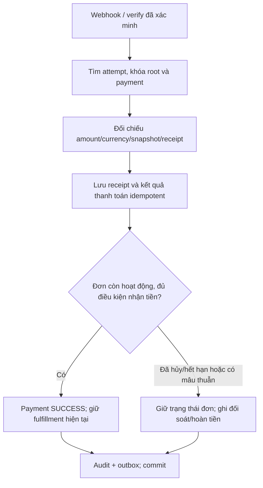

# Flow sửa chuyển trạng thái order của admin — Backend → Frontend

Ngày lập: 26/10/2026. Đây là kế hoạch sửa chi tiết, chưa phải xác nhận đã sửa mã nguồn hoặc đã chạy kiểm thử nghiệp vụ.

Frontend: `D:/semester 7/EXE/exe202-printhub3d-fe/exe-fe`. Backend: `D:/semester 7/EXE/PrintHub_3D`.

Tài liệu nền: [Tách giỏ marketplace/custom](./PLAN_SPLIT_MARKETPLACE_CUSTOM_CART_ORDER.md). Phụ thuộc: [Giá và thanh toán](./FLOW_FIX_01_CUSTOM_PRICING_PAYMENT.md), [Tồn kho/checkout/hủy](./FLOW_FIX_02_INVENTORY_CHECKOUT_CANCEL.md), [Giá bulk/custom](./FLOW_FIX_05_BULK_QUOTE_PRICING.md).

## 1. Kết quả cần đạt

- Admin chỉ xử lý đơn khi đáp ứng điều kiện tiền và điều kiện nghiệp vụ phía server; ẩn nút ở frontend không thay thế kiểm tra quyền.
- PAYOS chưa SUCCESS không được chuẩn bị, in, giao hoặc hoàn thành. COD phải được khách xác nhận hợp lệ; hoàn thành đồng thời ghi nhận đã thu đúng tổng tiền đã chốt.
- Webhook, verify payment và confirm legacy không được kéo tiến trình từ PRINTING/SHIPPING/COMPLETED về PAID; không biến đơn con CANCELLED thành đơn hoạt động.
- Hai màn quản lý tổng đơn/custom và màn báo giá dùng chung hành động được server cho phép, không còn bảng `nextStatus` riêng mâu thuẫn nhau.
- Retry, hai admin thao tác cùng lúc, webhook đến muộn và request hoàn thành trùng không chuyển trạng thái/thưởng điểm/thu COD hai lần.
- Luồng mới tách marketplace và custom; custom luôn báo giá trước. Đơn CheckoutOrder cũ vẫn đối soát được, không bị xóa hoặc yêu cầu khách trả tiền lại.

Mọi API/schema mới bên dưới là đề xuất triển khai. Tên phương thức và hiện trạng ở mục 2 đã được đối chiếu với workspace; chưa kiểm tra dữ liệu production.

## 2. Lỗi hiện tại và vị trí phải sửa

Đường backend trong bảng tương đối với `PrintHub_3D/src/main/java/com/fpt/printhub_3d/`.

| Vị trí | Hiện trạng | Hậu quả |
| --- | --- | --- |
| `service/impl/OrderServiceImpl.java`, `updateOrderStatus` | Cho PAID và PENDING chuyển PREPARING hoặc PRINTING mà không buộc PAYOS SUCCESS | API có thể đưa đơn chưa trả tiền vào sản xuất dù UI chặn một phần |
| `service/impl/CustomOrderServiceImpl.java`, `updateCustomOrderStatus` | Cho ACCEPTED/PAID sang PREPARING hoặc PRINTING; ACCEPTED PAYOS chưa đồng nghĩa đã trả | Khách chấp nhận báo giá nhưng chưa thanh toán vẫn có thể được in/giao |
| `service/impl/PaymentServiceImpl.java`, `settle` | Khi nhận tiền, đặt order/custom thành PAID; nhánh cha đặt mọi đơn con PAID | Kéo lùi tiến trình và hồi sinh con đã CANCELLED |
| `service/impl/CheckoutOrderServiceImpl.java`, `confirmCheckoutOrder` | Có thể gọi lại ngoài trạng thái ban đầu; đặt custom khác PAID thành ACCEPTED | Confirm lặp làm sai cả tồn kho và tiến trình |
| `OrderServiceImpl.completeRewards` | Kiểm tra rewardProcessed và cộng wallet bằng đọc/sửa không khóa đồng nhất | Hai request hoàn đơn có thể thưởng trùng hoặc ghi đè balance |
| `OrderServiceImpl.mapOrderToDTO` | Payment không thấy thì mặc định PAYOS/PENDING; chỉ tra payment của order con | Admin có thể thấy sai phương thức/trạng thái với đơn legacy thanh toán qua cha |
| `CustomOrderServiceImpl.toDTO` | Tra payment theo custom riêng; không chiếu thanh toán cha | Đơn custom đã trả qua cha có thể trông như chưa thanh toán |
| `entity/Enumeration/CustomOrderStatus.java` | Enum chưa bao phủ PREPARING/SHIPPING/EXPIRED đang cần dùng | Chuỗi trạng thái giữa service, DTO và frontend không thống nhất |
| `dto/order/OrderStatusUpdateRequestDTO.java`, `dto/custom_prints/CustomOrderStatusRequestDTO.java` | Nhận string trạng thái; chưa có version/idempotency | Client cũ hoặc thao tác trễ có thể ghi trên trạng thái đã thay đổi |
| `exe-fe/src/features/orders/OrderList.tsx` | Hai hàm `nextStateMarketplace`, `nextStateCustom`; custom ACCEPTED luôn có PREPARING | UI tự đoán quyền thực hiện; không thống nhất với điều kiện thanh toán |
| `exe-fe/src/features/custom/CustomRequests.tsx` | Hàm `next` bỏ qua PREPARING, đưa PAID/ACCEPTED COD thẳng PRINTING | Cùng đơn nhưng màn khác có tiến trình khác, PREPARING không có nút tiếp tục |
| `exe-fe/src/pages/admin/AdminGlobalOrdersPage.tsx`, `AdminCustomOrdersPage.tsx` | Trang tổng bọc OrderList; trang custom có cách tải/form riêng | Phải kiểm tra cả trang đang dùng, không chỉ sửa một component cũ |

Controller hiện đã có `@PreAuthorize` và service có kiểm tra vai trò ở một số nhánh. Đây là lỗi thiếu guard nghiệp vụ và tính nhất quán; không kết luận mọi endpoint admin hiện đang công khai.

## 3. Hợp đồng trạng thái đích

### 3.1. Tách tiến trình và tiền

Đối với đơn mới:

```text
Marketplace fulfillment:
  PENDING -> PREPARING -> SHIPPING -> COMPLETED

Custom fulfillment:
  REQUESTED -> QUOTED -> ACCEPTED -> PREPARING -> PRINTING -> SHIPPING -> COMPLETED
  QUOTED -> REQUESTED khi khách yêu cầu chỉnh sửa hợp lệ

Các trạng thái kết thúc không tiếp tục sản xuất:
  CANCELLED / EXPIRED

Payment:
  NONE trước khi có xác nhận thanh toán
  PENDING -> SUCCESS / FAILED / CANCELLED / EXPIRED
  SUCCESS -> REFUND_PENDING -> REFUNDED qua quy trình hoàn tiền
```

- Không thêm `PAID` vào tiến trình đơn mới. Nhận tiền đổi paymentStatus, không đặt fulfillment thành PAID.
- Marketplace mới là hàng có sẵn, không có bước PRINTING bắt buộc. Marketplace legacy đang PRINTING vẫn được tiếp tục giao/hoàn thành qua policy legacy; không tự đổi dữ liệu của chúng.
- Trước PREPARING, kiểm tra snapshot được xác nhận, phương thức thanh toán, số tiền và trạng thái giữ tồn nếu loại đơn cần tồn.
- Payment SUCCESS chỉ đủ điều kiện khi thuộc đúng đối tượng/snapshot và không có cờ đối soát/ngăn xử lý. Một receipt chưa phân bổ của cha không tự là SUCCESS của mọi con.
- REFUND_PENDING/REFUNDED, cancellation claim và reconciliation hold chặn bắt đầu các bước thực hiện mới. Không bỏ cờ để admin tiếp tục bằng cách sửa trạng thái trực tiếp.
- Thay đổi quote/quantity/design/address ảnh hưởng tiền thuộc flow báo giá, không là một trường tùy ý trong request chuyển trạng thái.

### 3.2. Bảng quyền và guard

| Hành động | Chủ thể | Điều kiện cần kiểm tra trong service |
| --- | --- | --- |
| Báo giá REQUESTED → QUOTED | ADMIN | Snapshot hợp lệ, đúng version, giá do server tính; quote chưa bị khóa |
| Chấp nhận QUOTED → ACCEPTED | Chủ CustomOrder | Quote còn hạn, đúng quoteVersion, phương thức COD/PAYOS, không nhận giá client |
| Marketplace PENDING → PREPARING | ADMIN | Đơn còn hiệu lực; COD đã xác nhận hoặc PAYOS SUCCESS; reservation đúng trạng thái theo file 02; không có hold |
| Marketplace PREPARING → SHIPPING | ADMIN | Đã chuẩn bị hàng, có thông tin người nhận/giao hàng; payment guard vẫn đúng |
| Custom ACCEPTED → PREPARING | ADMIN | Đã accept đúng snapshot; COD đã xác nhận hoặc PAYOS SUCCESS; không có hold |
| Custom PREPARING → PRINTING | ADMIN | Đúng file/thông số đã chốt, không đổi snapshot/giá, payment guard vẫn đúng |
| Custom PRINTING → SHIPPING | ADMIN | Đã in và đóng gói, địa chỉ hợp lệ, payment guard vẫn đúng |
| SHIPPING → COMPLETED | ADMIN | Đã giao; PAYOS vẫn SUCCESS hoặc COD có xác nhận thu đúng grandTotal |
| Hủy đơn chưa xử lý/chưa thu tiền | Chủ đơn hoặc ADMIN theo policy | Đúng ownership, chưa PREPARING, xác minh/đóng attempts an toàn, release tồn qua file 02 |
| Ghi nhận payment SUCCESS | Webhook/verify đã xác minh hoặc COD completion service | Đúng receipt/amount/currency/attempt/đơn; actor được phép; không do payload UI quyết định |
| Hoàn tiền | Vai trò được cấp riêng | Đi quy trình refund; không dùng nút đổi trạng thái sản xuất để thay thế |

Mọi quyền lấy từ principal phía backend. Với khách chỉ được phép các hành động của chính đơn; ADMIN không được thay khách accept báo giá qua endpoint tiến trình thông thường. Không cho bỏ qua PREPARING hoặc PRINTING custom trong flow mới.

## 4. Backend bước 1 — Chuẩn hóa policy và dữ liệu

### 4.1. Policy chung

Tạo một lớp/policy dùng lại, tên gợi ý `OrderTransitionPolicy`, nhận:

```text
orderType + orderStatus + orderVersion
paymentMethod + paymentStatus + paymentSnapshotVersion
quoteAcceptedVersion / customerConfirmedAt
reservationState nếu marketplace
legacyMode + reconciliationStatus + cancellationClaim
actor + requestedAction
```

Policy trả kết quả được phép hoặc reasonCode. Cùng policy phục vụ `allowedActions` của response và kiểm tra bắt buộc trong command service. Response chỉ là gợi ý theo snapshot đã đọc; khi command đến vẫn phải đọc và kiểm tra lại dưới khóa.

Không chia sẻ một map frontend làm nguồn có thẩm quyền. Không giữ các service cũ ghi `setStatus` trực tiếp mà bỏ qua policy.

### 4.2. Trường và constraint bổ sung

- Thêm version lạc quan cho Order/CustomOrder và cập nhật DTO. Thay đổi payment ảnh hưởng khả năng thao tác phải khiến lần đọc tiếp theo có version/điều kiện mới, không chỉ thay badge.
- Chuẩn hóa enum/string hợp lệ và validator ở DTO; phân biệt status mới và legacy. Kiểm tra độ dài cột trước migration.
- Thêm OrderStatusHistory: orderType, orderId, fromStatus, toStatus, action, actorId/actorType, timestamp, reason, commandId và payment/quote snapshot liên quan.
- Có idempotency record duy nhất theo actor + scope + key, chứa requestHash, trạng thái xử lý và response. Không dùng đơn thuần `nextStatus == currentStatus` để suy ra retry hợp lệ.
- Ghi domain event/outbox trong transaction trạng thái. Notification gửi sau commit, retry độc lập.
- Payment aggregate và PaymentAttempt theo file 01; không tạo thêm một bản ghi payment con giả là đã trả để che việc trả qua cha.
- Tên trường canonical của payment là `status` (DTO hiển thị `paymentStatus`), attempt dùng `state`; `reconciliationStatus=NONE|REQUIRED|RESOLVED`. Hold trong policy là điều kiện suy ra từ trạng thái đối soát/claim, không là một payment status hoặc một nguồn sự thật mới.
- Khóa/unique reward ledger theo business key `(orderType, orderId, event=COMPLETED_REWARD)` cho các loại đơn đã có chính sách thưởng. Không tự bổ sung công thức thưởng custom chưa được xác định.

## 5. Backend bước 2 — Command chuyển trạng thái an toàn

### 5.1. Trình tự thực hiện

1. Xác thực principal, role và quyền với đối tượng yêu cầu. Không trả response idempotency của người khác.
2. Tra/claim idempotency key và hash **trước khi** kiểm tra version/trạng thái. Retry request đã commit phải trả response cũ dù version hiện đã tăng.
3. Nếu cùng key khác payload thì 409; nếu cùng key đang được xử lý thì trả trạng thái processing/Retry-After theo hợp đồng chung, không thực thi command thứ hai.
4. Trong transaction, khóa business root và đọc lại Order/CustomOrder, payment, quote/reservation liên quan theo một thứ tự chung.
5. So version request với version hiện tại. Nếu khác và đây không phải replay đã nhận diện thì trả conflict; không áp dụng vào đơn mới hơn.
6. Chạy policy: cạnh trạng thái hợp lệ, role/ownership, payment, quote, deadline, reservation, hold, địa chỉ và dữ liệu giao hàng.
7. Ghi fulfillment mới, audit và các side effect database cần thiết. Nếu COMPLETED COD thì xác nhận số tiền/receipt và ghi SUCCESS đúng một lần trong cùng transaction.
8. Xử lý reward đủ điều kiện qua service khóa order/wallet/unique ledger như mục 8. Nếu tách outbox reward thì ghi event duy nhất và thể hiện reward đang xử lý đúng sự thật.
9. Tăng version, lưu response idempotency và outbox trong cùng transaction; commit.
10. Trả DTO mới với allowedActions; dispatcher gửi thông báo sau commit. Lỗi notification không khiến order đã commit bị tạo/chuyển/thưởng lại.

### 5.2. Thứ tự khóa thống nhất với inventory/payment

```text
Đơn mới: business root Order hoặc CustomOrder
Legacy: CheckoutOrder -> các child order theo ID ổn định
  -> Payment aggregate -> PaymentAttempt
  -> InventoryReservation theo thứ tự ổn định
  -> Product theo UUID tăng dần
```

Đây là thứ tự dùng chung cho admin action, cancel, webhook/verify và expire job; chỉ khóa tài nguyên thực sự cần dùng. Read discovery có thể tìm rootId trước nhưng phải đọc lại dữ liệu sau khi khóa. Đường có existing order không quay lại lấy khóa cart ở phía sau; checkout claim idempotency trước, khóa cart rồi tạo các order chưa commit trước khi xử lý stock như file 02.

Không giữ transaction/khóa qua HTTP đến gateway. Hủy/cancel attempt dùng ba pha: claim dưới khóa để chặn thao tác cạnh tranh → verify/cancel gateway ngoài transaction → khóa lại và finalize khi điều kiện còn đúng. Webhook đến đồng thời phải khiến finalize nhìn thấy SUCCESS và chuyển đối soát phù hợp, không mù quáng hủy/release tồn.

### 5.3. Những đường cũ phải cùng dùng guard

- `OrderServiceImpl.updateOrderStatus` và `CustomOrderServiceImpl.updateCustomOrderStatus` chuyển sang command service chung.
- Endpoint status cũ nếu giữ tương thích phải gọi cùng service, không có bypass từ route admin hoặc route user.
- `CheckoutOrderServiceImpl.confirmCheckoutOrder` chỉ được xác nhận một lần tại trạng thái cho phép của legacy; không `setStatus(ACCEPTED)` lại cho mọi custom khác PAID.
- Cron/job/script vận hành không được ghi trực tiếp trạng thái bỏ qua guard/audit.
- Mọi nhánh gọi `completeRewards` hoặc cập nhật payment COD phải quy về một service, không để hai logic riêng có số tiền/cách khóa khác nhau.

## 6. Backend bước 3 — Webhook không thay tiến trình, không hồi sinh đơn con

### 6.1. Nhận tiền cho Order/CustomOrder mới



- Tiền đến khi order PREPARING/PRINTING/SHIPPING/COMPLETED không kéo lùi tiến trình. Receipt lặp không làm phát sinh side effect mới.
- Tiền đến khi CANCELLED/EXPIRED phải được ghi nhận trung thực và tạo bản ghi đối soát. Không chỉ throw exception làm rollback mất bằng chứng nhận tiền; không tự chuyển thành ACCEPTED/PENDING/PAID.
- Cần lưu rõ receipt thành công nhưng chưa áp dụng cho fulfillment bằng cờ/record reconciliation của payment flow, không dùng SUCCESS đơn thuần để mở nút sản xuất.
- Nếu amount không khớp hoặc trả hai attempts của cùng đơn, giữ thông tin receipt và đưa vào đối soát theo file 01; không gộp nhầm vào số tiền đã trả hợp lệ.

### 6.2. Nhận tiền CheckoutOrder legacy

1. Ngừng tạo mixed parent mới theo kế hoạch tách giỏ; vẫn tiếp nhận callback các link cũ.
2. Xác định đúng payment/attempt cũ, snapshot mà khách được phép trả và danh sách con đã được tính tiền. Không dùng tổng hiện tại có thể thay đổi để tự suy ra phân bổ.
3. Khóa cha, các con theo thứ tự, payment/attempt rồi kiểm tra trạng thái từng con.
4. Con CANCELLED/EXPIRED giữ nguyên; con PRINTING/SHIPPING/COMPLETED giữ tiến trình hiện tại. Không có vòng lặp `child.setStatus("PAID")`.
5. Chỉ chiếu số tiền đã được phân bổ và xác minh cho con đủ điều kiện. Không tạo thanh toán lại ở con nếu số tiền của con đã thuộc payment cha.
6. Nếu có con bị hủy, custom chưa chốt giá hoặc cha đã thu sai/thiếu/thừa: lưu tiền nhận, giữ hold và tạo đối soát; không tự đánh dấu tất cả con payment SUCCESS.
7. Admin chỉ được thao tác con khi policy xác nhận nguồn thanh toán hợp lệ/đã đối soát. Không mở nút chỉ vì payment của cha có SUCCESS.
8. Nếu không đủ dữ liệu để xác định snapshot/phân bổ, yêu cầu xử lý thủ công có audit. Không đoán và không xóa parent để tránh lỗi.

## 7. API đề xuất và DTO cho cả admin/user

### 7.1. Endpoint command

Đề xuất mới, prefix `/api`:

| Endpoint | Phạm vi |
| --- | --- |
| `POST /admin/orders/{id}/transitions` | Tiến trình marketplace, actor ADMIN |
| `POST /admin/custom-orders/{id}/transitions` | Tiến trình custom, actor ADMIN |
| `POST /custom-orders/{id}/accept` | Chủ đơn accept báo giá đúng version, theo file 01/05 |
| Endpoint cancel order tương ứng | Chủ đơn/ADMIN, gọi cùng cancellation service của file 02/01 |

Ví dụ đưa custom vào PREPARING:

```json
{
  "idempotencyKey": "uuid-command-prepare",
  "expectedVersion": 9,
  "action": "START_PREPARATION",
  "reason": "Da kiem tra file va vat lieu"
}
```

Ví dụ hoàn COD:

```json
{
  "idempotencyKey": "uuid-command-complete",
  "expectedVersion": 13,
  "action": "COMPLETE_DELIVERY",
  "deliveryConfirmed": true,
  "codCollection": {
    "confirmed": true,
    "collectedAmount": 230000,
    "collectionReference": "ma-bien-nhan"
  }
}
```

Server so `collectedAmount` với grandTotal snapshot đã chốt, không dùng số tiền client làm tổng mới. COD record là thao tác của actor được quyền xác nhận đã thu; không gọi gateway để chứng minh một khoản tiền mặt. `createdAt` của payment gốc không bị ghi mới mỗi lần complete retry.

### 7.2. Response thống nhất

```json
{
  "id": "uuid-custom-order",
  "orderType": "CUSTOM_ORDER",
  "orderStatus": "ACCEPTED",
  "version": 9,
  "paymentMethod": "PAYOS",
  "paymentStatus": "PENDING",
  "grandTotal": 230000,
  "quoteVersion": 2,
  "legacyMode": false,
  "reconciliationStatus": "NONE",
  "allowedActions": [],
  "blockedActions": [
    { "action": "START_PREPARATION", "reasonCode": "PAYMENT_REQUIRED" }
  ]
}
```

Khi SUCCESS hợp lệ, allowedActions có START_PREPARATION. List/detail/admin/user đều lấy projection payment từ nguồn có thẩm quyền; không mặc định PAYOS/PENDING chỉ vì không tìm thấy bản ghi con. Nếu dữ liệu cũ không xác định được payment thì read model trả `paymentStatus: null` kèm `needsReview: true` và lý do, chặn hành động và hiển thị cần kiểm tra; không thêm UNKNOWN vào enum ghi tiền và không giả SUCCESS hoặc COD.

`allowedActions` được tính theo actor, nên DTO trả cho buyer khác ADMIN. Không cache chung response hành động giữa các vai trò.

### 7.3. Lỗi và cách UI phản ứng

| HTTP / reasonCode | Ý nghĩa | FE |
| --- | --- | --- |
| 403 / FORBIDDEN | Không đủ vai trò hoặc không sở hữu đơn | Không đổi trạng thái; hiện lỗi |
| 409 / ORDER_VERSION_CONFLICT | Có thao tác mới hơn | Tải DTO mới; yêu cầu xem lại, không tự gửi action kế tiếp |
| 409 / PAYMENT_REQUIRED | PAYOS chưa SUCCESS hoặc payment không hợp lệ | Hiện “Chưa đủ điều kiện thanh toán để xử lý” |
| 409 / PAYMENT_RECONCILIATION_REQUIRED | Receipt/legacy/cancel đang cần đối soát | Hiển thị hold, link thao tác hỗ trợ được cấp |
| 409 / INVALID_TRANSITION | Sai cạnh hoặc đã kết thúc | Tải allowedActions mới |
| 409 / RESERVATION_INVALID | Marketplace không có reservation hợp lệ | Dừng xử lý; không chỉ sửa badge |
| 409 / IDEMPOTENCY_CONFLICT | Cùng key khác payload | Không retry bằng key đó với nội dung mới |
| 422 / COD_COLLECTION_MISMATCH | Thiếu xác nhận hoặc tiền thu không khớp | Giữ form để sửa, chưa hoàn đơn |
| 503 / timeout chưa rõ kết quả | Chưa biết command commit chưa | Retry cùng key hoặc đọc trạng thái command; không tạo key mới ngay |

Các mã là hợp đồng gợi ý cần thống nhất với exception handler chung; không trả HTTP 200 với thông báo thành công cho command thất bại.

## 8. Hoàn thành đơn, thu COD và điểm thưởng đúng một lần

Hợp đồng triển khai chi tiết điểm/ví dùng [flow 06](./FLOW_FIX_06_REWARD_POINTS_LIFECYCLE.md): cùng một WalletService, source-event ledger, order/payment/inventory chain trước rồi User → Wallet. Điểm PENDING qua worker không được hiển thị như đã cộng; không giữ khóa operation/outbox rồi quay lại lấy root. Nội dung mục này là integration tại completion, không tạo thêm một đường thưởng độc lập.

1. Khi COMPLETED, khóa order và payment, kiểm tra version/guard trước khi ghi thu COD.
2. Với COD, ghi nhận collection duy nhất theo order; amount là grandTotal đã chốt theo file 05. Không lấy `quotedPrice` mơ hồ làm số tiền trọn lô hay đơn giá.
3. Với PAYOS, không tạo một payment SUCCESS mới từ nút complete; chỉ kiểm tra receipt hiện có đã hợp lệ.
4. Áp dụng chính sách reward hiện có, không tự thay công thức trong đợt sửa trạng thái. Với đơn cũ, kiểm tra lịch sử thưởng trước khi ghi ledger mới.
5. Trong transaction reward: khóa order, claim unique completed-reward event và khóa wallet trước cộng. Tất cả writer của wallet, gồm earn/redeem/gift điểm, dùng cùng quy tắc khóa wallet để không mất balance.
6. `rewardProcessed` có thể giữ làm projection nhưng không là cơ chế chống trùng duy nhất. Unique ledger và transaction ngăn hai request cùng cộng.
7. Nếu reward nằm trong cùng transaction hoàn thành thì mọi failure phải rollback thống nhất. Nếu xử lý qua outbox thì commit trạng thái + unique event trước, worker cộng idempotent và UI hiện reward pending; không hiển thị đã cộng khi chưa có ledger.
8. Hoàn tiền sau COMPLETED không tự sửa/xóa giao dịch EARN cũ; policy hoàn/trừ điểm là quy trình điều chỉnh có lịch sử, không bị trộn vào webhook hoàn thành.

Wallet nằm ngoài chuỗi khóa inventory khi command không cần inventory; nếu một flow cần cả hai phải ghi rõ mở rộng thứ tự khóa dùng chung để không có writer khóa wallet rồi quay lại chờ order.

## 9. Frontend từng bước

### 9.1. Chuẩn hóa service và type

- Mở rộng `exe-fe/src/services/orderService.ts` và `quotationService.ts` để nhận orderStatus/paymentStatus/version/allowedActions/blockedActions. Type mới có mapper legacy tường minh.
- Xóa giả định trạng thái PAID là “đang chuẩn bị” của tất cả đơn; timeline công việc và badge thanh toán hiển thị tách biệt.
- Tạo helper/service command chung: payload action + expectedVersion + idempotencyKey. Giữ key cho cùng lần bấm đến khi biết kết quả, khác thao tác mới dùng key mới.
- Không gửi paymentMethod khi chuyển sản xuất để lách PAYOS thành COD. Thay phương thức nếu được hỗ trợ là hành động riêng có guard của payment flow.

### 9.2. Một bảng hành động cho mọi màn admin

Tạo component gợi ý `AdminOrderActions` và hook `useOrderTransition`, dùng ở:

- `features/orders/OrderList.tsx` qua `pages/admin/AdminGlobalOrdersPage.tsx`.
- `pages/admin/AdminCustomOrdersPage.tsx`, kể cả trang này hiện đang dùng form/tải dữ liệu trực tiếp.
- `features/custom/CustomRequests.tsx` ở chế độ admin và các dialog/detail tương ứng.

Các bước:

1. Đọc DTO từ server; render nút theo allowedActions, lý do bị khóa theo blockedActions.
2. Xóa `nextStateMarketplace`, `nextStateCustom`, hàm `next` và các mapping khác tự quyết định quyền tiến trình.
3. START_PREPARATION custom phải là cùng một nút và guard ở cả trang tổng và trang custom; PREPARING luôn có START_PRINTING khi đủ điều kiện.
4. Bấm một action khóa nút của chính đơn đang gửi; không cần vô hiệu toàn bảng. Không optimistic đổi trạng thái nghiệp vụ trước khi server commit.
5. COMPLETE_DELIVERY mở xác nhận đã giao; với COD hiển thị grandTotal từ server và form xác nhận đã thu. Chỉ đóng/hiện thành công khi response thành công.
6. Response thành công cập nhật row/detail theo version trả về rồi invalidate danh sách/tổng đếm liên quan. GET cũ không được ghi đè response mới.
7. Conflict tải lại trạng thái/allowedActions, hiện lý do; không tự bấm lại bằng một expectedVersion khác mà khách chưa xem.
8. Network timeout giữ key và cho “Kiểm tra kết quả / Thử lại”; không nói “Thất bại chắc chắn” nếu server có thể đã commit.
9. Legacy có hold hiển thị “Cần đối soát” và không có nút in/giao chỉ vì trạng thái cha PAID.

### 9.3. Màn user và danh sách

- User xem tiến trình từ orderStatus và tiền từ paymentStatus. Đơn ACCEPTED PAYOS/PENDING hiển thị “Đã chấp nhận báo giá — chờ thanh toán”, không nói đã in.
- Payment SUCCESS tại PRINTING giữ timeline PRINTING. CANCELLED nhận tiền muộn vẫn hiển thị đã hủy + tiền cần đối soát/hoàn, không là đơn hoạt động.
- Bộ lọc, badge số lượng và lịch sử thống nhất với các trạng thái mới. Đảm bảo EXPIRED và custom đều có trang chi tiết/lịch sử có thể reload.
- Link từ notification mở đúng loại đơn; không tạo order mới khi khách mở lại notification.

### 9.4. Ranh giới giỏ hàng giữ nguyên

Không thay đổi popup giỏ hoặc nút header mở popup cho bản sửa trạng thái. Trang giỏ hai tab và popup cùng dùng instance dữ liệu ở App như tài liệu tách giỏ; nút vào trang nằm trên menu. Command trạng thái chạy từ order screen không restore/xóa hai giỏ; việc release tồn thuộc backend, không do FE tự cộng số lượng.

## 10. Dữ liệu cũ và rollout

### 10.1. Kiểm kê trước migration

Xuất báo cáo có ID và lý do cho:

- Order/custom có fulfillment PAID nhưng thiếu receipt hợp lệ hoặc payment thuộc cha.
- PAYOS đã PREPARING/PRINTING/SHIPPING/COMPLETED mà payment chưa SUCCESS.
- Con CANCELLED/EXPIRED nằm trong cha đã nhận tiền.
- Parent/child cùng có payment, amount không khớp snapshot hoặc đã thu hai lần.
- Marketplace legacy đang PRINTING; custom ở chuỗi trạng thái thiếu trong enum; record thiếu phương thức/địa chỉ.
- COMPLETED có rewardProcessed không khớp ledger hoặc nhiều EARN cho cùng completion.

Không bulk đổi status từ tên chuỗi mà không kiểm tra bằng chứng payment/audit/đơn giao hàng. Một record PAID hiện tại không chứng minh tiền thật đã nhận vì chính đường lỗi có thể đã ghi trạng thái đó.

### 10.2. Mapping có kiểm soát

- Bổ sung schema/version/history theo hướng additive, chưa xóa status/cột liên kết legacy.
- PAID cũ + receipt xác minh + chưa xử lý: projection hiển thị marketplace PENDING hoặc custom ACCEPTED và payment SUCCESS, có ghi dấu migration; không tự chạy bước PREPARING.
- PAID thiếu receipt hoặc chỉ có parent tổng chưa phân bổ: giữ nguyên raw data, thêm hold/needsReview; xử lý thủ công thay vì tự cho sản xuất.
- Marketplace legacy PRINTING tiếp tục SHIPPING → COMPLETED theo policy legacy có payment guard; không kéo về PREPARING chỉ vì luồng marketplace mới bỏ in.
- Đơn đã tiến triển nhưng chưa thanh toán thật phải hold và báo vận hành; không tự hủy hay kéo lùi, vì hàng có thể đã sản xuất/giao.
- Giao dịch của cha giữ danh tính/attempt/link cũ. Backfill phân bổ chỉ khi có bằng chứng, giữ raw audit để truy cứu.

### 10.3. Thứ tự phát hành

1. Sửa guard PAYOS và bỏ ghi đè PAID trong settle/confirm trước, có test hồi quy cho đơn con hủy.
2. Triển khai schema/policy/command/audit và payment/inventory service thống nhất phía BE; endpoint cũ cùng đi qua guard.
3. Cập nhật response DTO/mapper legacy cho list/detail để FE nhìn đúng dữ liệu.
4. Triển khai common admin actions và UI user; bảo đảm không còn màn tự gọi cạnh bị cấm.
5. Bật flow mới theo feature flag sau khi dữ liệu legacy được phân loại; quan sát log reasonCodes và đối soát.
6. Rollback UI vẫn phải giữ guard phía server. Không rollback bằng tắt PAYMENT_REQUIRED hoặc phục hồi vòng lặp setStatus PAID.
7. Chỉ loại bỏ endpoint/status legacy khi mọi client, đơn và payment callback cũ đã hết phụ thuộc.

## 11. Kiểm thử cụ thể BE → API → FE

### 11.1. Unit test policy

| Ca | Kết quả bắt buộc |
| --- | --- |
| Marketplace PENDING/PAYOS/PENDING → PREPARING hoặc PRINTING | Bị chặn PAYMENT_REQUIRED/INVALID_TRANSITION |
| Custom ACCEPTED/PAYOS/PENDING → PREPARING/PRINTING | Bị chặn, không đổi trạng thái |
| PAYOS SUCCESS hợp lệ → đúng bước kế tiếp | Được phép; không được nhảy bước |
| COD chưa được khách xác nhận | Bị chặn bắt đầu xử lý |
| COD xác nhận đủ → PREPARING | Được phép nhưng payment còn PENDING |
| COD SHIPPING → COMPLETED thiếu xác nhận tiền/sai amount | 422, không hoàn đơn hoặc ghi SUCCESS |
| User gọi command sản xuất của chính hoặc đơn người khác | 403 |
| ADMIN accept báo giá thay khách bằng endpoint tiến trình | Bị chặn |
| CANCELLED/EXPIRED → mọi trạng thái hoạt động | Bị chặn |
| Hold/refund/cancellation claim đang mở | Không có action bắt đầu bước mới |

### 11.2. Test transaction và concurrency trên database

- Hai admin cùng version chuyển một đơn: một command thành công, command còn lại conflict; history không có hai cạnh trái nhau.
- Retry cùng key sau khi commit trả đúng response, không conflict chỉ vì version đã tăng. Cùng key khác action/hash bị từ chối.
- Webhook SUCCESS đồng thời admin START_PREPARATION: hoặc admin đọc trước và bị chặn, hoặc đọc sau và được phép; không có trạng thái SUCCESS giả.
- START_PREPARATION đồng thời cancel: khóa/claim bảo đảm chỉ một luồng thắng hợp lệ; không vừa sản xuất vừa release reservation.
- Webhook nhận tiền trong khi cancel gọi gateway ngoài transaction: receipt được lưu; không finalize hủy mù, không hồi sinh đơn đã hủy.
- Webhook lặp khi custom PRINTING/SHIPPING/COMPLETED: chỉ payment/audit idempotent, fulfillment không đổi.
- Cha nhận tiền với một con CANCELLED: con vẫn CANCELLED; ghi đối soát/phân bổ hợp lệ, không set tất cả PAID.
- Hai complete COD cùng key/khác key: một collection, một completion history và một reward ledger.
- Complete reward đồng thời redeem/earn đơn khác: wallet không mất cập nhật; unique ledger ngăn trùng.
- Lỗi giữa lưu status và outbox/reward trong cùng transaction: rollback toàn bộ phần transactional; retry không cộng gấp đôi.
- Gateway chậm không giữ khóa DB; không deadlock khi webhook/cancel/expire cùng chạy theo lock order.

### 11.3. API và UI

- Gọi trực tiếp endpoint status cũ với PAYOS chưa trả vẫn bị chặn, kể cả UI ẩn nút.
- allowedActions khác nhau theo actor và đủ lý do cho nút bị khóa; DTO legacy payment không tự đoán từ null.
- Trang admin tổng đơn, trang custom và feature CustomRequests cho cùng một đơn có cùng nút; PREPARING không bị kẹt.
- Toast/dialog chỉ báo thành công khi mutation thành công; lỗi/timeout không âm thầm đổi row.
- Response GET cũ không kéo UI về trạng thái trước mutation. Refresh/back/direct URL thể hiện cùng dữ liệu.
- Màn user không hiện PAYMENT_SUCCESS như một bước in/giao; số tiền COD và tổng hiển thị lấy đúng snapshot.
- Popup giỏ không có diff ngoài phạm vi dữ liệu chung đã được đặc tả; không xuất hiện restore giỏ từ command admin.

## 12. Checklist hoàn thành và file cần sửa

Backend cần rà: `OrderServiceImpl`, `CustomOrderServiceImpl`, `PaymentServiceImpl`, `CheckoutOrderServiceImpl`; các entity/enum/version, repos khóa, DTO status/response, controller/API, exception handler, reward/wallet service và outbox dispatcher. Các file được tạo thêm cho policy/command/history là đề xuất, chưa tồn tại sẵn.

Frontend cần rà: `features/orders/OrderList.tsx`, `features/custom/CustomRequests.tsx`, `pages/admin/AdminGlobalOrdersPage.tsx`, `pages/admin/AdminCustomOrdersPage.tsx`, `services/orderService.ts`, `services/quotationService.ts`, types/stepper/badge/filter, trang order/detail/payment liên quan.

- [ ] Tất cả điểm ghi trạng thái đi chung policy; không có route cũ bypass.
- [ ] PAYOS chưa SUCCESS không thể sản xuất/giao/hoàn; COD có xác nhận khách và xác nhận thu khi hoàn.
- [ ] settle/verify/confirm không set fulfillment về PAID/ACCEPTED và không hồi sinh con hủy.
- [ ] Payment legacy chiếu đúng nguồn; trường hợp không rõ bị hold có bằng chứng đối soát.
- [ ] Version/idempotency/audit/outbox và lock order được thực hiện nhất quán.
- [ ] Thu COD/thưởng điểm/hoàn tồn không lặp; tiền đến muộn vẫn được ghi và đối soát.
- [ ] Mọi màn admin dùng cùng actions; UI user hiển thị tách tiền/tiến trình.
- [ ] Tests guard, concurrency, legacy và UI ở mục 11 đạt, có bằng chứng chạy thực tế trước phát hành.

Hoàn thành khi admin xử lý xuyên suốt hai loại đơn theo đúng điều kiện thanh toán, retry không làm sai side effect và mọi receipt legacy được bảo toàn mà không làm thay đổi trái phép tiến trình đơn.
