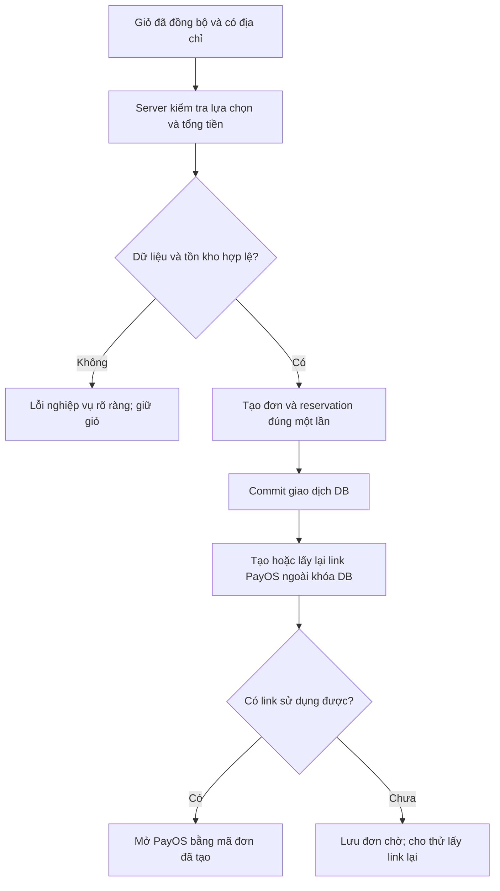

# Flow Nhóm 1 — Khôi phục checkout, thiết kế, file, địa chỉ và danh mục

Ngày: 02/11/2026.

**Phạm vi:** F25, F01–F05 (6 vấn đề). Đây là đặc tả sửa và nghiệm thu, chưa phải kết quả các lỗi nghiệp vụ đã được sửa. Bulk order ngoài phạm vi; F24 đã rút do prototype được bỏ.

**Tài liệu chung:** [Mục lục, quy tắc và thứ tự triển khai](./FLOW_FIX_LIVE_UX_4_PHASES_2026-11-02.md) · [Báo cáo audit](./REVIEW_LIVE_WEBSITE_UX_2026-11-02.md).

## Điều kiện bắt đầu và phụ thuộc

1. Đọc quy tắc chung và định nghĩa trạng thái trong mục lục trước khi đổi DTO/API. Với F25 phải lấy exception gốc từ log, không chốt nguyên nhân chỉ từ HTTP 500.
2. Chốt contract file sản xuất ở 1.3 để [Nhóm 2](./FLOW_FIX_LIVE_UX_GROUP_02_BUSINESS_2026-11-02.md) áp dụng validation và [Nhóm 4](./FLOW_FIX_LIVE_UX_GROUP_04_FILES_PAYMENT_QA_2026-11-02.md) hoàn thiện tên tải xuống; chốt địa chỉ/tổng tiền ở 1.4–1.5 trước khi các nhóm khác dùng.
3. Nhánh thanh toán checkout cần tương thích với reconcile purchase ở [Nhóm 4](./FLOW_FIX_LIVE_UX_GROUP_04_FILES_PAYMENT_QA_2026-11-02.md); không tạo một payment engine khác. Dọn danh mục QA ở 1.6, ghi kết quả để Nhóm 4 chỉ kiểm kê lại.

## Flow sửa và tiêu chí nghiệm thu

**Điều kiện hoàn tất nhóm:** F25 và F01–F05 có bằng chứng kiểm thử lại; không còn giá/địa chỉ/file khác nhau giữa các màn hình liên quan. Chưa coi sửa xong nhóm này là đã hoàn tất đối soát hủy hội viên ở [Nhóm 4](./FLOW_FIX_LIVE_UX_GROUP_04_FILES_PAYMENT_QA_2026-11-02.md).

### 1.1. F25 — Điều tra và sửa checkout 500 trước tiên

**Hiện trạng đã chứng minh:** một Thước Kẹp Mini 49.000đ, ship 30.000đ, PayOS, địa chỉ hợp lệ → `POST /api/checkout-orders` trả 500 hai lần. Không có checkout/order mới, stock vẫn 48, dòng hàng còn trong giỏ.

**File cần đọc/sửa:**

- FE [CartPage.tsx](../exe-fe/src/pages/CartPage.tsx), [useCart.ts](../exe-fe/src/features/cart/hooks/useCart.ts), [api.ts](../exe-fe/src/services/api.ts).
- BE [CheckoutOrderServiceImpl.java](../../PrintHub_3D/src/main/java/com/fpt/printhub_3d/service/impl/CheckoutOrderServiceImpl.java), [CheckoutOrderController.java](../../PrintHub_3D/src/main/java/com/fpt/printhub_3d/controller/CheckoutOrderController.java), DTO checkout, mapper trả Order/ShippingInfo và `GlobalExceptionHandler`.
- BE [InventoryServiceImpl.java](../../PrintHub_3D/src/main/java/com/fpt/printhub_3d/service/impl/InventoryServiceImpl.java), [PaymentServiceImpl.java](../../PrintHub_3D/src/main/java/com/fpt/printhub_3d/service/impl/PaymentServiceImpl.java) khi stack trace chỉ tới giữ kho hoặc tạo link.

**Bước sửa:**

1. Lấy server log đúng hai timestamp `2026-11-02T00:07:20.997875350Z` và `2026-11-02T00:08:01.406714649Z`. Ghi exception gốc và câu lệnh/mapper gây lỗi; chưa có log thì chưa chốt nguyên nhân.
2. Tái hiện cùng giỏ và shape request trong môi trường test. Đối chiếu `selectedLineIds` với `CartItem.clientLineId`; mọi dòng được chọn phải thuộc giỏ của principal đang đăng nhập.
3. Kiểm tra lần lượt DTO/validation → lấy giỏ → tạo checkout → tạo order/items/shipping → reservation → tạo payment/link → mapper response. Chèn log bước và mã đối chiếu, không log token hoặc nguyên địa chỉ/số điện thoại.
4. Nếu lỗi DB: đối chiếu schema production với migration và các field bắt buộc. Nếu lỗi mapper: xử lý đúng dữ liệu có/không có shipping; không trả DTO giả thành công. Nếu lỗi provider: phân biệt lỗi tạo link với lỗi tạo đơn.
5. Sửa đúng nhánh đã xác định. Tránh bắt mọi exception rồi tiếp tục trong transaction đã bị đánh dấu rollback; tránh xóa dòng giỏ trước khi biết phần tạo đơn cần thiết đã commit.
6. Bảo đảm một lần bấm và lần thử lại của cùng thao tác không tạo hai checkout. **Đề xuất:** thêm operation/idempotency key ổn định cho một lần xác nhận; server trả lại kết quả cũ với cùng key/payload, trả conflict khi cùng key nhưng payload khác.
7. Tách gọi PayOS khỏi transaction giữ khóa DB nếu hiện đang gọi HTTP bên trong. Commit phần đơn/giữ kho trước, tạo/reuse link sau; lưu trạng thái có thể tiếp tục khi provider gián đoạn. Không dựng lại đơn mới chỉ vì tạo link bị timeout.
8. FE giữ giỏ khi backend chưa tạo đơn; khi đơn đã tạo nhưng chưa có link, cho tiếp tục từ mã đơn đó. Lỗi hiển thị tiếng Việt, có mã đối chiếu và hành động phù hợp; không chỉ ghi “Unexpected error”.

**Flow đích:**



**Nghiệm thu:**

- Cùng dữ liệu audit tạo được một checkout và đúng order con, tổng tiền khớp snapshot server; không còn 500.
- Thiếu địa chỉ, dòng giỏ không thuộc user, sản phẩm ngừng bán hoặc thiếu kho trả lỗi 4xx nghiệp vụ; không để lại order/reservation nửa chừng.
- Double click hoặc timeout/retry cùng thao tác không nhân đôi đơn, không giữ kho hai lần.
- Provider lỗi sau khi đơn đã commit: có mã đơn và đường tiếp tục, không báo “chưa có đơn” trong khi DB đã có.
- Nếu transaction tạo đơn thất bại thật sự: giỏ và tồn kho như trước, không có payment mồ côi.

**Giới hạn:** số 79.000đ là tổng quan sát ở audit, không phải quyết định đóng cứng phí ship. Nguồn tính phí được hợp nhất ở 1.5.

### 1.2. F01 — Khôi phục vòng xuất JSON → nhập JSON

**File:** [RulerStudio.tsx](../exe-fe/src/features/ruler-studio/RulerStudio.tsx), [model.ts](../exe-fe/src/features/ruler-studio/model.ts), [migrate.ts](../exe-fe/src/features/ruler-studio/design/migrate.ts), [useDesign.ts](../exe-fe/src/features/ruler-studio/useDesign.ts), export `buildExport.ts`.

**Bước sửa:**

1. Xác định danh sách version được hỗ trợ: file cũ v1 và file hiện tại v2; không nhận version tương lai bằng cách bỏ luôn kiểm tra.
2. Tách bộ đọc `parseDesignFile` dùng chung: kiểm tra dung lượng → JSON parse → object/version → kiểm tra cấu trúc tối thiểu → migration v1 nếu cần → normalize/validate thiết kế.
3. Sửa điều kiện `raw.version !== 1` hiện tại. v2 phải được đọc trực tiếp qua normalize; v1 phải qua migration có kiểm thử. Kiểm tra thêm kiểu mảng/lớp/nét vẽ/số hữu hạn để file JSON bất kỳ không thành thiết kế rỗng có vẻ hợp lệ.
4. Chỉ thay bản nháp sau khi toàn bộ bước đọc thành công. File lỗi giữ nguyên thiết kế hiện có và lịch sử undo.
5. Nếu có thay thế thiết kế chưa lưu, dùng xác nhận rõ ràng. Sau nhập thành công cho undo về bản trước và báo tên file/thiết kế đã nhập.
6. Bộ xuất và bộ nhập dùng cùng hằng version/schema; thông báo lỗi lấy từ hệ thống ngôn ngữ, phân biệt sai JSON, quá dung lượng và version chưa hỗ trợ.

**Nghiệm thu:** file v2 đã xuất trong audit nhập lại giữ tên, rulerId, chiều dài, vật liệu, infill, chữ tiếng Việt, layer/surface/mode/depth và nét vẽ; v1 vẫn nhập được; version tương lai bị từ chối rõ; file hỏng không làm mất bản đang sửa.

Không sửa bằng cách bắt khách tự đổi `version: 2` thành `1`, vì migration có thể thay đổi ngữ nghĩa của các trường.

### 1.3. F02 — Tách ảnh preview và file sản xuất

**File:** [RulerStudio.tsx](../exe-fe/src/features/ruler-studio/RulerStudio.tsx), [CustomOrderPage.tsx](../exe-fe/src/pages/CustomOrderPage.tsx), [CartPage.tsx](../exe-fe/src/pages/CartPage.tsx), [CustomRequests.tsx](../exe-fe/src/features/custom/CustomRequests.tsx), `QuoteRequestModal.tsx`, `AdminCustomOrdersPage.tsx`, DTO/entity CustomOrder và checkout BE.

**Bước sửa:**

1. Rà tất cả nơi tạo yêu cầu: gửi file, gửi báo giá trực tiếp từ Studio, từ giỏ Custom và nhánh checkout còn được hỗ trợ. Hiện có đường lấy `imageUrl/thumbnailUrl` gán thành attachment; phải bỏ sự nhập nhằng này.
2. Chốt hợp đồng asset **đề xuất**:

   ```text
   previewImageUrl                         ảnh minh họa, có thể không có
   productionAsset:
     assetId, downloadUrl, originalFilename
     format, byteSize, checksumSha256
   ```

   Không bắt buộc tạo bảng mới nếu mô hình hiện tại có thể thêm metadata phù hợp. Nhưng backend phải xác định được file nào là file sản xuất và quyền của người gửi.
3. Studio dựng STL bằng pipeline xuất có sẵn → upload raw/model → nhận metadata → gửi production asset vào yêu cầu. Ảnh thumbnail upload riêng. Upload file thất bại thì không thông báo đã gửi đủ hồ sơ.
4. BE kiểm tra asset tồn tại, định dạng hỗ trợ và liên kết hợp lệ với người gửi; không tin loại file chỉ vì FE ghi `format: STL`. Kiểm tra cấu trúc/nội dung hợp lý theo định dạng.
5. FE render hai tác vụ: “Xem ảnh thiết kế” và “Tải file sản xuất (.STL/.OBJ/.STEP)”. Chỉ hiện STL khi thực sự là STL; định dạng khác phải có nhãn đúng.
6. Với dữ liệu cũ: phân loại ảnh/raw/chưa xác định. Nếu chỉ có PNG, giữ ảnh nhưng đánh dấu thiếu file sản xuất; không đổi đuôi PNG sang STL, không gán một file mẫu cho hàng loạt đơn.
7. Đơn cũ thiếu file cần yêu cầu bổ sung hoặc tái tạo từ Design JSON hợp lệ có đối chiếu. Không tự đưa vào sản xuất trong lúc migration.

**Tương thích API:** nếu cần endpoint upload trả metadata mới, có thể bổ sung **đề xuất** `POST /api/upload/model`, giữ `/api/upload/raw` trả URL cho các client cũ trong giai đoạn chuyển đổi. Cập nhật tất cả nơi gọi rồi mới loại đường legacy. Chốt một helper FE cho upload model, tránh mỗi form tự đoán shape response.

**Nghiệm thu:** tất cả đường gửi Custom có file thật; file tải từ phía user/admin parse được theo định dạng, checksum khớp file tạo/upload; bản ghi cũ PNG không còn nút tải STL gây hiểu nhầm. Giữ tên/đuôi file là phần hoàn thiện chung với F26 ở [Nhóm 4](./FLOW_FIX_LIVE_UX_GROUP_04_FILES_PAYMENT_QA_2026-11-02.md).

### 1.4. F03 — Một nguồn trạng thái địa chỉ cho toàn ứng dụng

**File:** [App.tsx](../exe-fe/src/App.tsx), [AddressBookPage.tsx](../exe-fe/src/pages/AddressBookPage.tsx), [ProfilePage.tsx](../exe-fe/src/pages/ProfilePage.tsx), [AddressModal.tsx](../exe-fe/src/features/address/components/AddressModal.tsx), `addressService.ts`, CartPage/CartDrawer.

**Quy tắc đích:** phân biệt địa chỉ mặc định của tài khoản với địa chỉ người dùng chủ động chọn cho checkout.

```text
AUTO_DEFAULT: checkout đang theo mặc định
  -> đổi mặc định thành công -> checkout cập nhật địa chỉ mới

MANUAL: người dùng đã chọn riêng một địa chỉ cho checkout
  -> giữ lựa chọn đó khi đổi mặc định, hiển thị rõ đây là địa chỉ đang chọn
  -> nếu địa chỉ bị xóa/không còn hợp lệ -> chọn lại hoặc về mặc định có thông báo
```

**Bước sửa:**

1. Tạo context/hook địa chỉ dùng chung **đề xuất** `AddressProvider/useShippingAddress`, hoặc một cache chung tương đương. Trạng thái gồm danh sách, default ID, selected ID, nguồn chọn và trạng thái tải/lỗi.
2. AddressBook/Profile/Modal gọi cùng service. Sau thêm/xóa/đặt mặc định thành công, cập nhật/invalidate danh sách và selected address trong cùng nguồn; không phụ thuộc effect chỉ chạy khi `user.id` thay đổi.
3. BE đặt mặc định bằng transaction để một tài khoản chỉ có một địa chỉ mặc định; kiểm tra ownership. Trả trạng thái chuẩn sau cập nhật hoặc cho FE refetch.
4. Tải lại tổng tiền khi selected address thay đổi. Trong lúc địa chỉ/tổng tiền đang làm mới, khóa xác nhận checkout.
5. **Đề xuất** gửi `addressId` cho backend để kiểm tra quyền và chụp snapshot địa chỉ vào đơn. Nếu tạm giữ field địa chỉ hiện tại, vẫn phải kiểm tra/chuẩn hóa thay vì tin chuỗi có sẵn từ browser.
6. Đăng xuất/đổi user xóa selection/cache tương ứng và bỏ qua response đến muộn của tài khoản cũ.

**Nghiệm thu:** địa chỉ A mặc định → đổi B → đi sang giỏ bằng menu, không reload → drawer/checkout cùng B khi đang AUTO_DEFAULT. Thử thêm trường hợp lựa chọn MANUAL, xóa địa chỉ đang chọn, đổi user và backend cập nhật thất bại.

### 1.5. F04 — Dùng cùng bản tổng tiền ở drawer, giỏ và payment

**File:** `useCart.ts`, CartDrawer, CartPage, CustomOrderCheckoutPage, BE CheckoutOrderService/StoreSettingService và phần áp dụng quyền lợi hội viên.

**Bước sửa:**

1. Chốt quy tắc phí đang áp dụng với chủ website: phí tiêu chuẩn, khu vực, điều kiện miễn/giảm ship, cộng dồn ưu đãi. Form admin mặc định 15.000đ chưa lưu không phải bằng chứng phải đổi mức thực thu thành 15.000đ.
2. Đưa phép tính có thẩm quyền về một service backend. Loại các hằng ship độc lập ở drawer, CartPage và checkout BE.
3. **Đề xuất** `POST /api/checkout-orders/preview` nhận selected line IDs, address ID, phương thức thanh toán và những lựa chọn được hỗ trợ; không nhận totalAmount do khách tự quyết định.
4. Response **đề xuất**: `summaryVersion/quoteId`, item subtotal, discount, shippingFee, totalAmount, currency, thời hạn áp dụng nếu cần; kèm giải thích ưu đãi/ship.
5. FE dùng một hook đọc preview cho cả drawer và trang giỏ. Nếu drawer tính tất cả dòng còn checkout chỉ một số dòng, phải hiển thị rõ phạm vi; cùng lựa chọn thì tổng phải giống nhau.
6. Nếu chưa có địa chỉ hoặc đang fetch, hiển thị “Đang tính phí/Chọn địa chỉ để tính phí”; không dùng 0đ để thay cho giá trị chưa biết.
7. Khi tạo đơn, server tính/kiểm tra lại snapshot. Nếu giá/stock/quyền lợi đổi, trả conflict và summary mới để khách xác nhận lại; không âm thầm thu số tiền khác.
8. Payment dùng đúng totalAmount đã chốt trong đơn. Giá/xu/ship không được tính lại từ FE khi tạo link.

**Nghiệm thu:** cùng lựa chọn không có trường hợp drawer 0đ, checkout 30.000đ. Kiểm tra chọn một phần giỏ, thay quantity/address, thiếu địa chỉ, API lỗi, giá thay đổi, quyền lợi hết hạn và reload. Đối chiếu snapshot đơn với số tiền PayOS; chỉ thử tiền thật trong phạm vi riêng được cho phép.

### 1.6. F05 — Hoàn thiện CRUD danh mục rồi dọn QA ID 5

**File:** [CategoryController.java](../../PrintHub_3D/src/main/java/com/fpt/printhub_3d/controller/CategoryController.java), CategoryRepository, ProductRepository; **đề xuất** CategoryService/DTO update; FE AdminCategoriesPage/categoryService.

**Bước sửa:**

1. Bổ sung `PUT /api/categories/{id}` và `DELETE /api/categories/{id}` đúng với FE đang gọi. Chỉ admin được mutation; giữ quyền đọc hiện tại nếu vẫn chủ đích công khai.
2. Update: lấy bản ghi theo ID, validate tên trim/không rỗng/độ dài, áp dụng quy tắc trùng tên đã chốt, lưu bằng service transaction. ID không có trả 404 nghiệp vụ.
3. Delete: kiểm tra danh mục còn sản phẩm/tham chiếu hay không. Nếu còn, trả 409 kèm hướng dẫn chuyển sản phẩm hoặc dùng trạng thái ẩn nếu hệ thống có hỗ trợ. Không cascade xóa sản phẩm thật.
4. FE hiện lỗi trong modal, giữ nội dung đã nhập, khóa nút trong lúc gửi; mutation thành công refetch danh mục và invalidate bộ lọc liên quan.
5. Chuẩn hóa response theo helper FE hiện dùng; không đổi riêng GET sang shape mới mà bỏ quên các nơi đang đọc plain array.
6. Sau khi kiểm thử trên danh mục dùng một lần: xác nhận ID 5 vẫn tên `QA AUDIT 20261102`, không được gắn sản phẩm → xóa bằng API đã sửa → kiểm tra không còn trong catalog/admin.

**Nghiệm thu:** tạo/sửa/xóa danh mục rỗng thành công; sửa ID không tồn tại 404; xóa danh mục đang dùng 409; user/guest mutation bị chặn; lỗi không làm mất form. Chỉ xóa ID 5 khi các điều kiện nhận diện vẫn đúng.

### 1.7. Cổng nghiệm thu Nhóm 1

- [ ] Tạo được checkout Marketplace, retry không tạo trùng, dữ liệu/stock nhất quán.
- [ ] JSON v1/v2 nhập đúng; file xuất hiện tại nhập lại được.
- [ ] Các đường Custom không dùng PNG làm STL; legacy thiếu file được ghi rõ.
- [ ] Đổi địa chỉ mặc định phản ánh đúng vào checkout theo quy tắc AUTO_DEFAULT/MANUAL.
- [ ] Một nguồn tổng tiền, không có khác biệt ngoài phạm vi lựa chọn đã giải thích.
- [ ] PUT/DELETE danh mục hoạt động và QA ID 5 đã được dọn có xác nhận.

## Bàn giao khi hoàn tất nhóm

Bàn giao nguyên nhân checkout đã xác định bằng log, contract API/asset/address/summary đã chốt, kết quả 1.7 và tình trạng danh mục QA ID 5.

Với mỗi ID, ghi file/schema đã đổi, bằng chứng kiểm thử, môi trường và trạng thái: đã sửa và đã kiểm thử / đã sửa chưa kiểm thử live / chưa sửa. Giữ nguyên ID để đối chiếu báo cáo; không đánh dấu ca chưa chạy là pass.

Quay lại [mục lục và kế hoạch phối hợp](./FLOW_FIX_LIVE_UX_4_PHASES_2026-11-02.md) trước khi chuyển sang nhóm tiếp theo.
