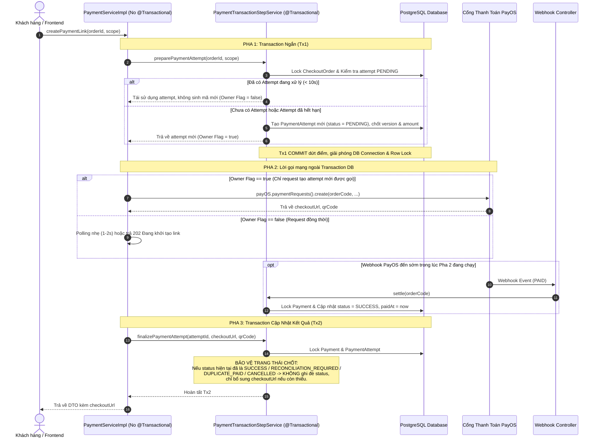

# BẢN ĐẶC TẢ VÀ PHƯƠNG ÁN KỸ THUẬT TỔNG THỂ VÒNG 2 (FE & BE)
### Hệ Thống PrintHub 3D — Kiến Trúc Giao Dịch, Thanh Toán PayOS, Idempotency & Đồng Bộ Nghiệp Vụ

---

## MỤC LỤC
1. [Tổng Quan & Mục Tiêu Kiến Trúc](#1-tổng-quan--mục-tiêu-kiến-trúc)
2. [Bốn (04) Nguyên Tắc Kiến Trúc Cốt Lõi](#2-bốn-04-nguyên-tắc-kiến-trúc-cốt-lõi)
   - [2.1. Concurrency Thanh Toán PayOS & Xử Lý Webhook Đến Sớm](#21-concurrency-thanh-toán-payos--xử-lý-webhook-đến-sớm)
   - [2.2. Kiểm Soát Phiên Bản Báo Giá Độc Lập Theo Scope](#22-kiểm-soát-phiên-bản-báo-giá-độc-lập-theo-scope)
   - [2.3. Khóa Ví Thống Nhất & Tích Điểm Lũy Kế Toàn Checkout](#23-khóa-ví-thống-nhất--tích-điểm-lũy-kế-toàn-checkout)
   - [2.4. Idempotency Độc Lập Với Trạng Thái Giỏ Hàng](#24-idempotency-độc-lập-với-trạng-thái-giỏ-hàng)
3. [Chi Tiết 11 Hạng Mục Kỹ Thuật Cần Giải Quyết](#3-chi-tiết-11-hạng-mục-kỹ-thuật-cần-giải-quyết)
   - [3.1. Tách Rời Hoàn Chỉnh Transaction và Network Call PayOS](#31-tách-rời-hoàn-chỉnh-transaction-và-network-call-payos-p1)
   - [3.2. Quản Lý Retry PayOS & Phục Hồi Tiến Trình Gián Đoạn](#32-quản-lý-retry-payos--phục-hồi-tiến-trình-gián-đoạn-p1)
   - [3.3. Snapshot & Version Riêng Cho Từng Nhóm Thanh Toán (SEPARATE)](#33-snapshot--version-riêng-cho-từng-nhóm-thanh-toán-separate-p1)
   - [3.4. Cho Phép Duyệt Báo Giá Custom Khi Hàng Có Sẵn Đang Giao](#34-cho-phép-duyệt-báo-giá-custom-khi-hàng-có-sẵn-đang-giao-p1)
   - [3.5. Hợp Nhất Giỏ Hàng Guest Bền Vững Với Batch ID](#35-hợp-nhất-giỏ-hàng-guest-bền-vững-với-batch-id-p1)
   - [3.6. Khóa Bi Quan Bảo Vệ Ví Điểm & Kiểm Soát Nguồn Thanh Toán](#36-khóa-bi-quan-bảo-vệ-ví-điểm--kiểm-soát-nguồn-thanh-toán-p1)
   - [3.7. Xác Nhận Thu COD Giữ Nguyên Tiến Độ Giao Hàng](#37-xác-nhận-thu-cod-giữ-nguyên-tiến-độ-giao-hàng)
   - [3.8. Xử Lý Đúng Đơn Hủy Toàn Bộ & Tracking Thanh Toán Theo Scope Trên FE](#38-xử-lý-đúng-đơn-hủy-toàn-bộ--tracking-thanh-toán-theo-scope-trên-fe)
   - [3.9. Hoàn Thiện Idempotency Tại Transaction Boundary & Bổ Sung DTO](#39-hoàn-thiện-idempotency-tại-transaction-boundary--bổ-sung-dto)
   - [3.10. Cấu Hình Quyền Lợi Subscription Giảm/Miễn Ship Có Cấu Trúc](#310-cấu-hình-quyền-lợi-subscription-giảmmiễn-ship-có-cấu-trúc)
   - [3.11. Đồng Bộ Hiển Thị Giá Legacy & Nhãn Admin Toàn Hệ Thống](#311-đồng-bộ-hiển-thị-giá-legacy--nhãn-admin-toàn-hệ-thống)
4. [Kế Hoạch Database Migration Lũy Kế (Supabase/PostgreSQL)](#4-kế-hoạch-database-migration-lũy-kế-supabasepostgresql)
5. [Ma Trận Đối Chiếu File & Tiêu Chí Nghiệm Thu (Traceability Matrix)](#5-ma-trận-đối-chiếu-file--tiêu-chí-nghiệm-thu)

---

## 1. TỔNG QUAN & MỤC TIÊU KIẾN TRÚC

Tài liệu này tổng hợp toàn bộ các phát hiện kỹ thuật, phản biện và phương án xử lý chi tiết cho hệ thống **PrintHub 3D** (Backend Java Spring Boot & Frontend React TypeScript). 

Mục tiêu cốt lõi:
- **Triệt tiêu hoàn toàn tắc nghẽn tài nguyên và deadlock**: Không bao giờ giữ Transaction Database hay row-level lock trong thời gian chờ cuộc gọi mạng (HTTP client) sang đối tác thứ ba (PayOS).
- **Đảm bảo tính nhất quán dữ liệu (Data Integrity)**: Xử lý dứt điểm các kịch bản race condition, concurrency khi hai request đến cùng lúc, webhook phản hồi sớm, hoặc tiến trình bị gián đoạn giữa chừng.
- **Thống nhất nghiệp vụ FE–BE**: Phân tách tường minh giữa trạng thái vận hành đơn hàng (fulfillment) và trạng thái thanh toán (payment); loại bỏ toàn bộ các suy đoán cứng ở phía Client.

---

## 2. BỐN (04) NGUYÊN TẮC KIẾN TRÚC CỐT LÕI

### 2.1. Concurrency Thanh Toán PayOS & Xử Lý Webhook Đến Sớm
Mọi luồng tạo liên kết thanh toán phải được điều phối qua **Mô hình 3 Pha** sử dụng Spring Proxy Bean riêng biệt (`PaymentTransactionStepService`):



- **Quy tắc điều phối**: Chỉ duy nhất request tạo attempt mới được gọi `payOS.create()`. Request thứ hai cùng vào sẽ chờ hoặc tái sử dụng mã, không tạo hai mã mở song song.
- **Phục hồi tiến trình chết**: Nếu attempt ở `PENDING` quá 30 giây mà không có URL, request tiếp theo gọi `payOS.get(orderCode)`. Nếu PayOS đã tạo link thì lưu lại; nếu PayOS không có thì hủy attempt cũ và cấp mã mới.

---

### 2.2. Kiểm Soát Phiên Bản Báo Giá Độc Lập Theo Scope
Phiên bản báo giá phải được phân tách tường minh cho từng nhóm sản phẩm:

```
┌────────────────────────────────────────────────────────────────────────┐
│ CHECKOUT ORDER (Đơn hàng cha)                                          │
│ ├─ summaryVersion: Toàn cục cho đơn COMMON                             │
│ ├─ marketplacePricingVersion = 1L (Bất biến sau khi tạo đơn)           │
│ └─ customPricingVersion: Tăng mỗi khi bất kỳ dòng custom nào đổi giá   │
└────────────────────────────────────────────────────────────────────────┘
                                    │
                                    ▼
┌────────────────────────────────────────────────────────────────────────┐
│ PAYMENT ATTEMPT (Lần thanh toán)                                       │
│ ├─ scope: MARKETPLACE | CUSTOM | ALL                                   │
│ ├─ scopeVersion: Snapshot version tại thời điểm tạo link               │
│ └─ expectedAmount: Số tiền chính xác của nhóm thanh toán               │
└────────────────────────────────────────────────────────────────────────┘
```

1. **Custom Standalone (Đơn in 3D lẻ không qua giỏ)**:
   - Thêm cột `quoteVersion` (Long, default 1) trên entity `CustomOrder`. Mỗi lần Admin sửa giá dưới lock dòng custom: `quoteVersion++`.
   - `PaymentAttempt.scopeVersion = customOrder.getQuoteVersion()`.
2. **Custom Trong Giỏ (`CheckoutOrder`)**:
   - Thêm cột `customPricingVersion` (Long, default 1) trên entity `CheckoutOrder`.
   - Bất kỳ thao tác báo giá/sửa giá dòng custom con nào đều phải thực hiện **dưới khóa bi quan đơn cha (`checkoutOrderRepository.findLockedById(parent.getId())`)** để đảm bảo hai Admin sửa giá hai dòng custom khác nhau không làm mất lần tăng version.
3. **Tính Bất Biến Nhóm Marketplace**:
   - Sau khi tạo đơn, sản phẩm, số lượng, giá và phí ship phân bổ của Marketplace là bất biến. `marketplacePricingVersion` = 1L.
4. **Đối Soát Webhook (`settle`)**:
   - Khách trả mã Marketplace: So sánh `attempt.scopeVersion` với `marketplacePricingVersion` (1L). Việc Admin báo giá Custom (làm tăng `customPricingVersion` và `summaryVersion`) **hoàn toàn không làm ảnh hưởng hay đẩy đơn Marketplace vào đối soát**.
   - Khách trả mã Custom: So sánh `attempt.scopeVersion` với `customPricingVersion`. Nếu Admin đã sửa giá sau khi khách lấy QR cũ -> Đưa vào `RECONCILIATION_REQUIRED`.
   - Webhook Marketplace vẫn phải kiểm tra nghiêm ngặt: Đơn không bị hủy, giữ kho khả dụng, số tiền khớp 100%, và chưa thanh toán trùng (`DUPLICATE_PAID`).

---

### 2.3. Khóa Ví Thống Nhất & Tích Điểm Lũy Kế Toàn Checkout
1. **Chuẩn Hóa Thứ Tự Khóa (Lock Ordering)**:
   - Vì bản ghi `PointWallet` có thể chưa được tạo, việc gọi `SELECT ... FOR UPDATE` trên bảng `point_wallets` sẽ không khóa được dòng nào và gây race condition khi tạo mới.
   - **Quy tắc bắt buộc**: Mọi thao tác điểm thưởng (Cộng thưởng đơn hàng, Thưởng custom, Đổi điểm gói hội viên) đều phải khóa dòng User trước:
     ```java
     User user = userRepository.findLockedById(userId)
             .orElseThrow(() -> new ApiException(CommonErrorCode.RESOURCE_NOT_FOUND));
     PointWallet wallet = pointWalletRepository.findById(userId)
             .orElseGet(() -> createInitialWallet(user));
     ```
   - Bản ghi `User` luôn tồn tại trong DB -> Khóa User đảm bảo tuần tự hóa 100% mọi luồng truy cập ví của user đó và loại trừ nguy cơ Deadlock.
2. **Công Thức Tích Điểm Cộng Dồn Toàn Checkout**:
   - `CheckoutOrder` lưu cột `rewardPointsAwarded` (Integer, default 0).
   - Khi bất kỳ đơn con nào hoàn tất và thanh toán thành công (`Payment.status == SUCCESS`):
     $$\text{Tổng tiền hàng hợp lệ} = \sum (\text{Đơn con } \text{COMPLETED} \land \text{Payment } \text{SUCCESS})$$
     *(Lưu ý: Chỉ tính tiền sản phẩm, không tính phí vận chuyển).*
     $$\text{Tổng điểm lũy kế được hưởng} = \left\lfloor \frac{\text{Tổng tiền hàng hợp lệ}}{10.000} \right\rfloor$$
     $$\text{Số điểm cấp thêm lần này} = \text{Tổng điểm lũy kế được hưởng} - \text{checkoutOrder.getRewardPointsAwarded()}$$
   - Nếu $\text{Số điểm cấp thêm} > 0$:
     - Cộng điểm vào ví.
     - Lưu `PointTransaction` với event key duy nhất chống cộng trùng.
     - Cập nhật `checkoutOrder.setRewardPointsAwarded(Tổng điểm lũy kế)`.
   - **Ưu điểm**: Khách mua nhiều đơn con lẻ (ví dụ 6.000đ hàng sẵn + 6.000đ custom = 12.000đ) vẫn nhận đủ 1 điểm thưởng, không bị làm tròn mất điểm lẻ từng đơn.

---

### 2.4. Idempotency Độc Lập Với Trạng Thái Giỏ Hàng
1. **Nguyên Tắc Lưu Snapshot**:
   - Tạo đơn và lưu bản ghi `IdempotencyRecord` (`status = COMPLETED`, `requestHash`, `responseBody`) thực hiện **trong cùng một Database Transaction**.
   - Khi tạo đơn thành công, các dòng sản phẩm trong giỏ bị xóa. Vì vậy, các lần gọi retry sau này **tuyệt đối không được đọc lại giỏ hàng** để tránh lỗi `EMPTY_SELECTION`.
2. **Xử Lý Concurrency Tại Transaction Boundary**:
   - Unique Index trên bảng `idempotency_records`: `(user_id, action_key, idempotency_key)`.
   - Nếu hai request cùng key chạy đồng thời:
     - Request 1 tạo đơn và commit transaction thành công.
     - Request 2 gặp lỗi `DataIntegrityViolationException` (do đụng unique constraint) -> Transaction Tx1 của nó bị rollback.
     - Bắt lỗi này ở **bên ngoài boundary của transaction đã rollback**, sau đó mở một **Transaction mới (Tx2)** để đọc lại bản ghi `IdempotencyRecord` do Request 1 vừa tạo và trả về kết quả DTO hợp lệ.
3. **Nâng Cấp DTO Tạo Đơn**:
   - `CheckoutOrderCreateRequestDTO` nhận mảng các dòng kèm số lượng: `items: [{ clientLineId: string, quantity: number }]`.
   - Chuỗi hash chuẩn hóa: `userId + "|" + sortedItems(lineId:qty) + "|" + shippingMode + "|" + shippingAddress + "|" + paymentMethod`.
   - BE hoàn toàn tự định giá lại từ database (sản phẩm, giá quoted custom), không tin tưởng giá client gửi lên.

---

## 3. CHI TIẾT 11 HẠNG MỤC KỸ THUẬT CẦN GIẢI QUYẾT

### 3.1. Tách Rời Hoàn Chỉnh Transaction và Network Call PayOS (P1)
* **Vấn đề**: `@Transactional` cấp class ở `PaymentServiceImpl` khiến Transaction Tx1 và khóa đơn PostgreSQL bị giữ suốt cuộc gọi mạng HTTP sang PayOS (dòng 311).
* **Giải pháp**:
  - Gỡ bỏ `@Transactional` ở cấp class của `PaymentServiceImpl`.
  - Tạo Spring Bean riêng `PaymentTransactionStepService`:
    - Method 1: `preparePaymentAttempt(...)` với `@Transactional` ngắn để validate kho, chốt snapshot, tạo attempt `PENDING` và commit ngay.
    - Method 2: `finalizePaymentAttempt(...)` với `@Transactional` ngắn để cập nhật URL sau khi gọi mạng xong.
  - Kiểm tra và đảm bảo các method khác trong `PaymentServiceImpl` (như `settle`, `cancel`) được gắn `@Transactional` rõ ràng ở cấp method.

---

### 3.2. Quản Lý Retry PayOS & Phục Hồi Tiến Trình Gián Đoạn (P1)
* **Vấn đề**: Khi lệnh tra cứu `payOS.get()` hoặc hủy `payOS.cancel()` bị timeout/lỗi, code cũ catch exception rồi tiếp tục sinh mã `orderCode` mới, dẫn đến tồn tại song song nhiều link thanh toán mở trên PayOS.
* **Giải pháp**:
  - Khi tra cứu attempt cũ: Nếu PayOS bị lỗi mạng/timeout, trả về lỗi `503 Service Unavailable`: *"Hệ thống đang đồng bộ với cổng thanh toán, vui lòng thử lại sau giây lát"*, tuyệt đối không tự ý sinh mã mới.
  - Chỉ tạo mã mới khi PayOS xác nhận link cũ đã `CANCELLED` hoặc `EXPIRED`.
  - Nếu lệnh `cancel()` thất bại, ghi nhận trạng thái `CANCEL_FAILED` vào attempt cũ để theo dõi đối soát.
  - Request chỉ được dùng lại URL cũ khi attempt đó khớp đúng `scope`, đúng phiên bản giá, đúng số tiền và còn thời hạn thanh toán.

---

### 3.3. Snapshot & Version Riêng Cho Từng Nhóm Thanh Toán (SEPARATE) (P1)
* **Vấn đề**: So sánh `attempt.getPriceVersion()` với `checkoutOrder.summaryVersion` khiến webhook của đơn hàng sẵn bị đẩy vào đối soát oan khi Admin vừa báo giá xong hàng Custom.
* **Giải pháp**:
  - Entity `PaymentAttempt` lưu thêm `scope` (`MARKETPLACE`, `CUSTOM`, `ALL`) và `scope_version` (Long).
  - Entity `CheckoutOrder` lưu thêm `custom_pricing_version` (Long, default 1).
  - Khi Admin báo giá dòng custom: Khóa đơn cha và tăng `custom_pricing_version++`.
  - Khi đối soát webhook `settle`:
    - Nhóm `MARKETPLACE`: Kiểm tra `attempt.scopeVersion == 1L`.
    - Nhóm `CUSTOM`: Kiểm tra `attempt.scopeVersion == checkoutOrder.getCustomPricingVersion()`.
    - Nhóm `ALL`: Kiểm tra `attempt.scopeVersion == checkoutOrder.getSummaryVersion()`.
  - Kiểm tra khớp số tiền: Số tiền webhook phải khớp chính xác với `attempt.amount` đã cam kết của nhóm đó.

---

### 3.4. Cho Phép Duyệt Báo Giá Custom Khi Hàng Có Sẵn Đang Giao (P1)
* **Vấn đề**: Khi đơn hàng sẵn chuyển sang `SHIPPING`, đơn cha bị đổi thành `SHIPPING`. Hàm `confirmCheckoutOrder` kiểm tra cứng trạng thái đơn cha phải là `PENDING_QUOTE` hoặc `PARTIALLY_PAID`, dẫn đến khách bị chặn không thể duyệt báo giá Custom.
* **Giải pháp**:
  - Sửa điều kiện trong [CheckoutOrderServiceImpl.java:391](file:///D:/semester%207/EXE/PrintHub_3D/src/main/java/com/fpt/printhub_3d/service/impl/CheckoutOrderServiceImpl.java#L391):
    - Với đơn `SEPARATE`: Điều kiện đủ để duyệt báo giá Custom là:
      `"QUOTED".equals(checkoutOrder.getCustomStatus()) || "PENDING_QUOTE".equals(checkoutOrder.getCustomStatus())` và toàn bộ các dòng custom chưa hủy đều có `quotedPrice != null`.
    - Cho phép duyệt bất kể đơn cha đang là `PROCESSING`, `PARTIALLY_PAID`, hay `SHIPPING`.
  - Khi khách xác nhận báo giá Custom:
    - Cập nhật `customOrder.setStatus("ACCEPTED")`.
    - Cập nhật `checkoutOrder.setCustomStatus("CONFIRMED")`.
    - Giữ nguyên trạng thái vận hành của nhóm hàng sẵn (`marketplaceStatus` không bị lùi về).

---

### 3.5. Hợp Nhất Giỏ Hàng Guest Bền Vững Với Batch ID (P1)
* **Vấn đề**: `useCart.ts` gọi `localStorage.removeItem(guestKey)` trước khi server trả lời PUT giỏ hàng. Nếu request lỗi mạng hoặc server 500, dữ liệu guest bị mất sạch vĩnh viễn. Ngược lại, nếu server đã lưu mà response bị rớt mạng, retry sẽ cộng dồn số lượng lần thứ hai.
* **Giải pháp**:
  - Phía FE:
    - Sinh một `clientMergeBatchId` (UUID) đại diện cho đợt merge guest hiện tại.
    - Giữ nguyên dữ liệu trong `localStorage`.
    - Gửi request `PUT /cart/merge-guest` kèm `mergeBatchId` và danh sách guest items.
    - **Chỉ xóa `localStorage` khi và chỉ khi server phản hồi HTTP 200 OK.**
  - Phía BE:
    - Kiểm tra `mergeBatchId` đã xử lý cho User chưa (lưu trong cache hoặc `idempotency_records`).
    - Nếu đã xử lý rồi -> Trả về giỏ hiện tại ngay, không cộng dồn thêm lần nữa.
    - Nếu chưa xử lý -> Cộng dồn số lượng an toàn và ghi nhận `mergeBatchId`.

---

### 3.6. Khóa Bi Quan Bảo Vệ Ví Điểm & Kiểm Soát Nguồn Thanh Toán (P1)
* **Vấn đề**: Không khóa dòng trên bảng ví; `OrderServiceImpl.completeRewards` bỏ qua kiểm tra khi `payment == null` dẫn đến đơn COD chưa thu tiền vẫn được cấp điểm.
* **Giải pháp**:
  - Thêm phương thức khóa bi quan vào [PointWalletRepository.java](file:///D:/semester%207/EXE/PrintHub_3D/src/main/java/com/fpt/printhub_3d/repository/PointWalletRepository.java).
  - Chuẩn hóa thứ tự khóa: Khóa `User` trước -> Khởi tạo/Đọc `PointWallet`.
  - Trong `completeRewards` và `awardCustomOrderRewards`:
    - Bắt buộc kiểm tra có bản ghi `Payment` hợp lệ với `status == "SUCCESS"`. Nếu không có hoặc chưa `SUCCESS` (kể cả COD hay PayOS) -> Tuyệt đối không cấp điểm.
    - Đơn phải ở trạng thái hoàn tất chính thức (`COMPLETED`).
    - Ghi nhận `PointTransaction` với mã giao dịch duy nhất trong cùng transaction khóa.

---

### 3.7. Xác Nhận Thu COD Giữ Nguyên Tiến Độ Giao Hàng
* **Vấn đề**: [OrderServiceImpl.java:568](file:///D:/semester%207/EXE/PrintHub_3D/src/main/java/com/fpt/printhub_3d/service/impl/OrderServiceImpl.java#L568) gán `order.setStatus("PAID")` cho mọi đơn chưa `COMPLETED`. Khi shipper giao hàng xong và Admin xác nhận thu COD, đơn đang `SHIPPING` bị lùi trạng thái về `PAID`.
* **Giải pháp**:
  - Không tự thêm field `paymentStatus` vào entity `Order` khi schema DB chưa có. Sử dụng bản ghi `Payment.status = "SUCCESS"` làm nguồn chân lý cho trạng thái tài chính.
  - Về trạng thái vận hành (`order.status`):
    - Nếu đơn đang `PENDING` hoặc `CONFIRMED`: Chuyển sang `PAID` / `PREPARING`.
    - Nếu đơn đang `PREPARING`, `SHIPPING`, hoặc `DELIVERED`: **Giữ nguyên trạng thái hiện tại**, không can thiệp lùi tiến độ.
  - Cập nhật `checkoutOrder.setMarketplaceStatus("PAID")`.
  - Nếu đơn đã ở `DELIVERED` hoặc `COMPLETED`, tự động kích hoạt cấp điểm thưởng tích lũy.

---

### 3.8. Xử Lý Đúng Đơn Hủy Toàn Bộ & Tracking Thanh Toán Theo Scope Trên FE
* **Vấn đề**:
  - Hàm `syncParentCheckoutOrder` coi `CANCELLED` là hoàn tất; nếu toàn bộ đơn con hủy thì đơn cha bị gán thành `COMPLETED`.
  - Trên FE [CheckoutDetailPage.tsx:597](file:///D:/semester%207/EXE/exe202-printhub3d-fe/exe-fe/src/pages/CheckoutDetailPage.tsx#L597), điều kiện ẩn thanh toán thiếu `SHIPPING` và `COMPLETED`, khiến nút thanh toán giao chung hiện lại khi đơn đang giao. Ngoài ra, đơn `SEPARATE` khi marketplace `SHIPPING` không được làm ẩn nút thanh toán của custom.
* **Giải pháp**:
  - Phía BE (`syncParentCheckoutOrder`):
    - Đếm số đơn con thực tế.
    - **Nếu 100% đơn con là `CANCELLED`**: Gán `parent.setStatus("CANCELLED")`.
    - **Nếu tất cả đơn con không bị hủy đều đã `COMPLETED` (và có ít nhất 1 đơn `COMPLETED`)**: Gán `parent.setStatus("COMPLETED")`.
  - Phía FE (`CheckoutDetailPage.tsx`):
    - Tách biệt hiển thị thanh toán theo **nghĩa vụ của từng scope**:
      - Nhóm Marketplace: Nút thanh toán ẩn khi `marketplaceStatus === 'PAID'` hoặc `paymentMethod === 'COD'` hoặc đơn hàng sẵn đã `SHIPPING`/`COMPLETED`.
      - Nhóm Custom: Luôn hiển thị nút thanh toán Custom khi các dòng custom đã báo giá (`customStatus === 'QUOTED'`) và chưa thanh toán (`customStatus !== 'PAID'`), bất kể Marketplace đang ở trạng thái nào.
      - Nhóm Giao chung (COMMON): Ẩn nút thanh toán khi trạng thái đơn cha thuộc `['PAID', 'PROCESSING', 'SHIPPING', 'DELIVERED', 'COMPLETED']`.

---

### 3.9. Hoàn Thiện Idempotency Tại Transaction Boundary & Bổ Sung DTO
* **Vấn đề**: Hash request create chỉ chứa ID dòng (không có số lượng); khi va chạm unique constraint, việc bắt lỗi trong cùng transaction PostgreSQL sẽ làm hỏng transaction (`current transaction is aborted`).
* **Giải pháp**:
  - Nâng cấp `CheckoutOrderCreateRequestDTO`: Bổ sung danh sách chi tiết các dòng đặt mua gồm `clientLineId` và `quantity`.
  - Hash được tính từ payload chuẩn hóa: `items(lineId:qty)`, phương thức giao hàng, địa chỉ, phương thức thanh toán.
  - Xử lý va chạm: Thực hiện tạo đơn và lưu `IdempotencyRecord` trong một Service Method riêng. Nếu xảy ra `DataIntegrityViolationException`, transaction đó rollback hoàn toàn. Service ngoài bắt exception và mở một Transaction mới đọc lại bản ghi `IdempotencyRecord` đã tạo để trả về kết quả cho client.

---

### 3.10. Cấu Hình Quyền Lợi Subscription Giảm/Miễn Ship Có Cấu Trúc
* **Vấn đề**: FE tự suy freeship theo regex tên `VIP`/`PRO`, BE tự suy theo text `benefits`. Thời hạn fix cứng 30 ngày. Chưa hỗ trợ cấu hình giảm phí ship theo số tiền.
* **Giải pháp**:
  - **Entity `SubscriptionPlan`**:
    - `free_shipping` (BOOLEAN, default false): Cờ miễn phí vận chuyển 100%.
    - `shipping_discount_amount` (DECIMAL(18,2), default 0): Mức giảm phí vận chuyển cố định (ví dụ: giảm 10.000đ).
    - `duration_days` (INTEGER, default 30): Thời hạn hiệu lực của gói dịch vụ do Admin cấu hình.
  - **Giao Diện Admin**: Cập nhật Form quản lý gói hội viên có ô nhập "Số ngày hiệu lực", "Số tiền giảm ship", và switch "Miễn phí vận chuyển toàn bộ".
  - **Quy Tắc Ảnh Hưởng**: Khi Admin sửa gói, chỉ áp dụng cho người mua mới hoặc gia hạn mới. Người đang dùng giữ nguyên quyền lợi theo snapshot lúc kích hoạt đến hết hạn.
  - **Tính Phí Ship Khi Checkout**:
    $$\text{Phí ship thực tế} = \max\left(0, \text{Phí ship gốc} - \text{Mức giảm của gói active}\right)$$
    (Nếu `free_shipping == true` -> Phí ship = 0đ).
    Lưu snapshot `shippingDiscount` và `appliedShippingFee` trên `CheckoutOrder`.
  - **API `/subscriptions/me`**: Trả về `freeShippingEligible: boolean` và `shippingDiscountAmount: number` để FE hiển thị chuẩn xác 100% mà không cần regex text.

---

### 3.11. Đồng Bộ Hiển Thị Giá Legacy & Nhãn Admin Toàn Hệ Thống
* **Vấn đề**: `CustomRequests.tsx:1045` nhân `quotedPrice * quantity` vô điều kiện ở trạng thái `ACCEPTED`. Với đơn cũ (`priceVersion < 2`), `quotedPrice` vốn là giá trọn gói nên bị nhân vọt giá. Form Admin dòng 1140 vẫn còn placeholder "Nhập giá trọn gói".
* **Giải pháp**:
  - Tại [CustomRequests.tsx](file:///D:/semester%207/EXE/exe202-printhub3d-fe/exe-fe/src/features/custom/CustomRequests.tsx):
    ```ts
    const isV2 = c.priceVersion && c.priceVersion >= 2;
    const totalPayment = isV2 ? (c.quotedPrice || 0) * (c.quantity || 1) : (c.quotedPrice || 0);
    ```
    - Nếu `isV2 && (c.quantity || 1) > 1`: Hiển thị `money(totalPayment)` kèm chú thích `(Đơn giá: {money(c.quotedPrice)} / chiếc × {c.quantity})`.
    - Nếu đơn cũ (`isV2 == false`): Hiển thị trực tiếp `money(c.quotedPrice)` với nhãn `Giá trọn gói`.
  - Tại [AdminCustomOrdersPage.tsx](file:///D:/semester%207/EXE/exe202-printhub3d-fe/exe-fe/src/pages/admin/AdminCustomOrdersPage.tsx) và [CustomRequests.tsx:1140](file:///D:/semester%207/EXE/exe202-printhub3d-fe/exe-fe/src/features/custom/CustomRequests.tsx#L1140):
    - Đổi toàn bộ nhãn và placeholder thành: *"Đơn giá cho 1 sản phẩm (VND) *"*.
    - Thêm preview thành tiền động ngay dưới ô nhập: `Thành tiền tạm tính: {đơn giá × số lượng}đ`.

---

## 4. KẾ HOẠCH DATABASE MIGRATION LŨY KẾ (SUPABASE/POSTGRESQL)

Vì database Supabase hiện tại mới áp dụng script `01`, toàn bộ thay đổi từ script `02`, `03` và các trường bổ sung mới của đợt này sẽ được đóng gói thành một file migration lũy kế duy nhất:
* **Đường dẫn**: `scripts/migrations/02_to_04_cumulative_supabase.sql`
* **Nguyên tắc an toàn (Preflight / Idempotent)**:
  - Sử dụng `CREATE TABLE IF NOT EXISTS`, `ALTER TABLE ... ADD COLUMN IF NOT EXISTS`.
  - Tạo bảng `payment_attempts`, `inventory_reservations`, `idempotency_records` (nếu chưa có).
  - Bổ sung các cột mới:
    - `checkout_orders.custom_pricing_version BIGINT DEFAULT 1`
    - `checkout_orders.reward_points_awarded INTEGER DEFAULT 0`
    - `payment_attempts.scope VARCHAR(30) DEFAULT 'ALL'`
    - `payment_attempts.scope_version BIGINT`
    - `custom_orders.quote_version BIGINT DEFAULT 1`
    - `subscription_plans.free_shipping BOOLEAN DEFAULT FALSE`
    - `subscription_plans.shipping_discount_amount NUMERIC(18,2) DEFAULT 0`
    - `subscription_plans.duration_days INTEGER DEFAULT 30`
  - **Xử lý dữ liệu Legacy**:
    - Với các bản ghi `payment_attempts` cũ: Giữ nguyên `scope_version = NULL` (không gán bừa = 1).
    - Trong code Java `settle`: Nếu gặp attempt legacy có `scope_version == null` mà đơn hàng hiện tại đã có version chốt -> Đưa vào `RECONCILIATION_REQUIRED` để Admin đối soát thủ công an toàn, không tự động xác nhận hợp lệ.
* File SQL này sẽ được chuẩn bị sẵn và bàn giao để bạn chủ động chạy trên Supabase SQL Editor.

---

## 5. MA TRẬN ĐỐI CHIẾU FILE & TIÊU CHÍ NGHIỆM THU

| STT | File Liên Quan | Thay Đổi Chính | Tiêu Chí Nghiệm Thu |
|---|---|---|---|
| 1 | [PaymentServiceImpl.java](file:///D:/semester%207/EXE/PrintHub_3D/src/main/java/com/fpt/printhub_3d/service/impl/PaymentServiceImpl.java) | Gỡ `@Transactional` class, tách 3 pha, điều phối gọi PayOS, đối soát `scopeVersion` | 0 DB connection bị giữ trong khi gọi mạng; không sinh mã trùng khi retry; webhook marketplace thành công độc lập |
| 2 | [PaymentTransactionStepService.java](file:///D:/semester%207/EXE/PrintHub_3D/src/main/java/com/fpt/printhub_3d/service/impl/PaymentTransactionStepService.java) | Bean Spring mới phụ trách Pha 1 và Pha 3 của payment | Chạy qua Spring AOP Proxy; commit Tx1 trước khi gọi mạng; bảo vệ trạng thái đã chốt |
| 3 | [CheckoutOrderServiceImpl.java](file:///D:/semester%207/EXE/PrintHub_3D/src/main/java/com/fpt/printhub_3d/service/impl/CheckoutOrderServiceImpl.java) | Bỏ chặn duyệt custom khi marketplace `SHIPPING`, hash DTO đầy đủ, quản lý `customPricingVersion` | Khách duyệt được báo giá custom khi hàng sẵn đang giao; idempotency không đọc lại giỏ sau khi đặt |
| 4 | [OrderServiceImpl.java](file:///D:/semester%207/EXE/PrintHub_3D/src/main/java/com/fpt/printhub_3d/service/impl/OrderServiceImpl.java) | COD không lùi `status` về `PAID`, tính điểm lũy kế checkout, khóa User trước | Xác nhận COD khi `SHIPPING` vẫn giữ `SHIPPING`; đơn hủy toàn bộ ra `CANCELLED`; điểm cấp đúng số dư lũy kế |
| 5 | [CustomOrderServiceImpl.java](file:///D:/semester%207/EXE/PrintHub_3D/src/main/java/com/fpt/printhub_3d/service/impl/CustomOrderServiceImpl.java) | Quản lý `quoteVersion` cho đơn lẻ, tăng version dưới lock đơn cha, tích điểm lũy kế | 2 Admin sửa giá 2 dòng custom không mất lần tăng version; thưởng điểm an toàn |
| 6 | [UserSubscriptionServiceImpl.java](file:///D:/semester%207/EXE/PrintHub_3D/src/main/java/com/fpt/printhub_3d/service/impl/UserSubscriptionServiceImpl.java) | Đọc quyền lợi có cấu trúc (`free_shipping`, `shipping_discount_amount`, `duration_days`) | Không regex chuỗi text; trả về `freeShippingEligible` và mức giảm ship chuẩn hóa |
| 7 | [PointWalletRepository.java](file:///D:/semester%207/EXE/PrintHub_3D/src/main/java/com/fpt/printhub_3d/repository/PointWalletRepository.java) | Thêm `findLockedByUserId` với bi quan `PESSIMISTIC_WRITE` | Khóa dòng tuần tự, loại trừ lost update khi cộng/trừ điểm đồng thời |
| 8 | [useCart.ts](file:///D:/semester%207/EXE/exe202-printhub3d-fe/exe-fe/src/features/cart/hooks/useCart.ts) | Merge guest kèm `mergeBatchId`, chỉ xóa `localStorage` khi HTTP 200 OK | Mất mạng không mất giỏ guest; retry không bị cộng dồn số lượng 2 lần |
| 9 | [CartPage.tsx](file:///D:/semester%207/EXE/exe202-printhub3d-fe/exe-fe/src/pages/CartPage.tsx) | Gửi DTO kèm số lượng từng dòng, đọc mức giảm ship động từ API | Idempotency key thay đổi khi đổi số lượng/chọn món; phí ship hiển thị đồng bộ 100% với BE |
| 10 | [CheckoutDetailPage.tsx](file:///D:/semester%207/EXE/exe202-printhub3d-fe/exe-fe/src/pages/CheckoutDetailPage.tsx) | Tách biệt ẩn/hiện thanh toán theo từng scope, hỗ trợ trạng thái `SHIPPING`/`COMPLETED` | Nút thanh toán ẩn đúng khi hàng sẵn đã giao; đơn custom vẫn hiện nút thanh toán khi có giá chốt |
| 11 | [CustomRequests.tsx](file:///D:/semester%207/EXE/exe202-printhub3d-fe/exe-fe/src/features/custom/CustomRequests.tsx) | Xử lý giá legacy (`priceVersion < 2`), đổi placeholder nhập đơn giá | Đơn legacy hiển thị đúng giá trọn gói; đơn mới hiển thị rõ đơn giá × số lượng |
| 12 | [AdminCustomOrdersPage.tsx](file:///D:/semester%207/EXE/exe202-printhub3d-fe/exe-fe/src/pages/admin/AdminCustomOrdersPage.tsx) | Nhãn đơn giá cho 1 sản phẩm, preview thành tiền động | Admin nhập đơn giá rõ ràng, xem được tổng tiền tạm tính trực tiếp |
| 13 | `02_to_04_cumulative_supabase.sql` | Kịch bản migration tổng hợp có preflight checks | Chạy thành công trên Supabase SQL Editor mà không phát sinh lỗi xung đột bảng/cột |
