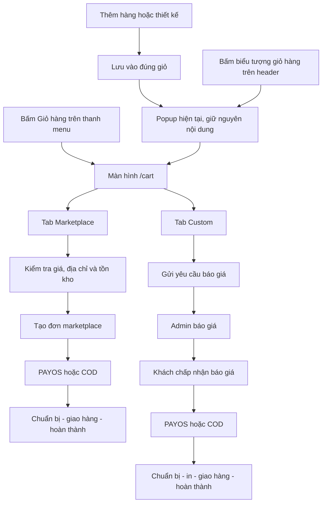

# Kế hoạch tách giỏ hàng và đơn hàng Marketplace / Custom

Ngày lập: 26/10/2026.

Làm rõ theo yêu cầu bổ sung: màn hình mới dùng chung dữ liệu và cơ chế lưu/đồng bộ với popup; có hai tab Custom/Marketplace; nút vào màn hình nằm trên thanh menu. Giữ nguyên nút và các điểm mở popup hiện tại.

Trạng thái: đặc tả luồng và kế hoạch triển khai, chưa phải chức năng đã được sửa.

Phạm vi mã nguồn: frontend `D:/semester 7/EXE/exe202-printhub3d-fe/exe-fe`; backend `D:/semester 7/EXE/PrintHub_3D`.

Tài liệu liên quan: [Báo cáo rà soát lỗi hiện tại](./REVIEW_ORDER_SUBSCRIPTION_BULK_2026-10-26.md).

## 1. Mục tiêu và các quyết định đã chốt

1. Marketplace và custom có hai giỏ độc lập về dữ liệu, thao tác và luồng gửi đơn.
2. Thêm mục/nút **Giỏ hàng** trên thanh menu điều hướng người dùng để mở màn hình chi tiết `/cart`, có đúng hai tab: **Marketplace** và **Custom**. Nút biểu tượng trên header đang mở popup tiếp tục mở popup như hiện tại.
3. Tab Marketplace chỉ mua hàng marketplace; tab Custom chỉ gửi yêu cầu báo giá custom. Không có nút đặt cả hai loại cùng lúc.
4. Custom luôn phải đợi admin báo giá, kể cả thiết kế từ configurator đã có giá ước tính.
5. Không tạo đơn thanh toán cha chứa đồng thời marketplace và custom cho các đơn mới. Bỏ lựa chọn “nhận trước / nhận cùng lúc” và `COMMON / SEPARATE` khỏi luồng mới.
6. Giữ nguyên nội dung, bố cục, nhãn, các phần thông tin và nút bấm bên trong popup giỏ hàng hiện tại. Không thêm hai tab vào popup.
7. Popup tiếp tục hoạt động ở các điểm mở popup đang có, đặc biệt sau khi thêm sản phẩm. Nút tiếp tục bên trong popup giữ cách điều hướng sang `/cart` như hiện tại.
8. Hai loại đơn thanh toán, giao hàng, hủy, theo dõi tiến trình và tính phí độc lập. Không tự gom đơn giữa hai tab.
9. Bulk order thuộc nhánh custom, bắt buộc báo giá; không xây thêm một hệ thống thanh toán riêng cho bulk.
10. Giá, tồn kho, quyền sở hữu, quyền thao tác và trạng thái thanh toán đều phải kiểm tra phía backend.
11. Trang chi tiết và popup là hai cách hiển thị của cùng dữ liệu giỏ. Cùng dùng một CartProvider/facade được khởi tạo ở cấp ứng dụng, cùng nguồn lưu server/localStorage và cùng actions; không tạo một bộ giỏ hoặc cơ chế lưu riêng cho trang mới.
12. Màn hình chi tiết kế thừa hình thức thẻ hàng, ảnh/preview, thông tin sản phẩm/thiết kế, số lượng và địa chỉ của popup, mở rộng không gian cho hai tab và chi tiết nghiệp vụ; không thiết kế thành một giỏ khác dữ liệu.

### 1.1. Phân biệt yêu cầu người dùng và lựa chọn triển khai trong tài liệu

Các yêu cầu về tách loại đơn, custom bắt buộc báo giá, hai tab trên trang riêng, dùng chung dữ liệu/lưu/đồng bộ với popup, nút vào trang nằm trên menu và giữ nguyên popup là ràng buộc của bản sửa. Các chi tiết bên dưới như URL có `tab`, cấu trúc API, thời hạn giữ tồn, cách tổ chức bảng và lịch triển khai là phương án đề xuất để có thể triển khai nhất quán; đây không phải mô tả API hiện đã tồn tại.

Mặc định cho bản sửa này:

- Một lần mua marketplace có thể tạo nhiều đơn marketplace nếu có nhiều seller; thanh toán và phí giao hàng tính cho từng đơn, hiển thị rõ trước khi đặt.
- Một dòng custom đã chọn tạo một yêu cầu custom độc lập; nhiều dòng được gửi trong cùng một thao tác nhưng không tạo một đơn cha thanh toán.
- Một file trong bulk tương ứng một dòng custom; số lượng là số bản in của chính file đó.
- Báo giá custom gồm **đơn giá × số lượng**, phần điều chỉnh được ghi rõ, phí giao hàng và tổng cuối cùng.
- Giỏ hỗ trợ khách chưa đăng nhập; tạo đơn/gửi yêu cầu báo giá bắt buộc đăng nhập.

## 2. Hiện trạng cần lưu ý trước khi sửa

| Vị trí hiện tại | Hành vi đã đối chiếu | Thay đổi cần thiết |
| --- | --- | --- |
| `src/App.tsx` | `openCart` mở popup; `handleAddToCart` cũng mở popup | Giữ callbacks mở popup; cung cấp một nguồn dữ liệu giỏ chung cho popup và trang chi tiết |
| `src/layouts/Header.tsx` | Nút giỏ dùng `onOpenCart` | Giữ nút mở popup như hiện tại, không đổi callback này thành điều hướng |
| `src/layouts/UserSidebar.tsx` và menu tương ứng trên mobile | Menu người dùng có nhóm Mua sắm & Dịch vụ | Thêm mục **Giỏ hàng** dẫn `/cart`, có active state và badge cùng nguồn dữ liệu |
| `src/routes/index.tsx` | Đã có route `/cart` | Giữ URL, thay nội dung trang thành hai tab độc lập |
| `src/pages/CartPage.tsx` | Chọn lẫn hai loại và gọi `/checkout-orders` | Bỏ checkout trộn, dùng hai luồng riêng |
| `src/features/cart/components/CartDrawer.tsx` | Popup có danh sách, địa chỉ, tổng, CTA sang `/cart` | Giữ nguyên JSX, nội dung và hành vi bên trong |
| `src/features/cart/components/CartItem.tsx` | Thành phần dòng hàng dùng cả trong popup | Tránh sửa làm thay đổi popup; tạo row riêng cho trang mới nếu cần |
| `src/features/cart/hooks/useCart.ts` | Một mảng hàng, một hàng đợi, `PUT /cart` thay toàn giỏ | Tách state/lệnh ghi theo loại trong cùng store dùng chung cho popup và trang; không ghi đè giỏ còn lại |
| `src/features/cart/hooks/cartPayload.ts` | Serialize `customPrice` từ frontend | Không còn coi giá này là giá được phép thu tiền |
| `src/pages/CustomOrderPage.tsx` | Sửa/thêm custom rồi chuyển `/cart` | Chuyển đúng tab custom, giữ bản thiết kế và revision |
| `src/pages/CustomOrderCheckoutPage.tsx` | Có luồng custom riêng, giá ước tính/phương thức thanh toán | Hợp nhất vào quy trình gửi báo giá, không tạo đường tắt thanh toán |
| `src/features/custom/CustomRequests.tsx` | Upload, bulk, báo giá và admin custom chung một feature | Cùng dùng hợp đồng giá và trạng thái custom mới |
| `src/pages/PaymentResultPage.tsx` | Có logic khôi phục toàn giỏ từ sessionStorage khi cancel | Bỏ tự ghi đè hai giỏ; xác minh trạng thái giao dịch từ server |
| Backend `Cart` | `@OneToOne` với user | Cần đổi quan hệ nếu dùng hai Cart vật lý cho mỗi user |
| Backend `CheckoutOrderServiceImpl` | Tạo cha/con và xử lý chung | Ngừng tạo đơn mới qua luồng này; xử lý riêng dữ liệu cũ |

## 3. Điều hướng và ranh giới giữ nguyên popup

### 3.1. Bảng hành vi điều hướng

| Tác động của khách | Kết quả mong muốn |
| --- | --- |
| Bấm mục/nút **Giỏ hàng** trên thanh menu người dùng | Đi đến `/cart`, hiển thị hai tab; đây là lối vào riêng của màn hình mới |
| Mở menu trên mobile rồi bấm **Giỏ hàng** | Đóng menu điều hướng và đi `/cart`; không mở popup |
| Bấm biểu tượng giỏ hàng đang có trên header | Tiếp tục mở popup như hiện tại; không chuyển thành nút của màn hình mới |
| Thêm một sản phẩm marketplace | Thêm vào giỏ marketplace; popup hiện như hiện tại |
| Thêm một thiết kế custom | Thêm vào giỏ custom; popup hiện như hiện tại |
| Bấm nút tiếp tục trong popup | Đóng popup, đi `/cart` hoặc đăng nhập như hành vi hiện tại |
| Mở `/cart?tab=marketplace` | Hiện tab Marketplace |
| Mở `/cart?tab=custom` | Hiện tab Custom |
| Lưu chỉnh sửa thiết kế từ màn custom | Đi `/cart?tab=custom`, cập nhật đúng dòng |
| Bấm thông báo đã có báo giá | Mở chi tiết yêu cầu custom tương ứng, không chỉ mở giỏ |

Quy tắc tab khi URL chỉ có `/cart`: ưu tiên marketplace nếu giỏ marketplace có hàng; nếu chỉ có custom thì chọn custom; nếu cả hai trống thì chọn marketplace. Sau khi chọn tab, ghi `tab` vào URL để refresh, back/forward và link trực tiếp giữ đúng tab. Không tự nhảy tab khi số lượng hàng thay đổi; chỉ áp dụng quy tắc mặc định khi chưa có tab hợp lệ.

Vị trí đề xuất theo layout hiện có: thêm **Giỏ hàng** vào nhóm **Mua sắm & Dịch vụ** của `UserSidebar.tsx`, dùng cùng menu này khi hiển thị mobile. Bổ sung `/cart` vào nhóm route mua sắm; tính active theo pathname để cả hai query `tab` đều cùng active mục **Giỏ hàng**. Dùng Link điều hướng thật để giữ cơ chế đóng menu mobile của AppShell. Mục menu phải tồn tại rõ ràng, không ghi “nếu có” rồi chỉ dựa vào CTA trong popup để mở trang. Khi route là `/cart`, bảo đảm nhóm chứa mục giỏ nhìn thấy được; không reset lựa chọn đóng/mở các nhóm khác không liên quan. Người dùng chưa đăng nhập vẫn vào được trang giỏ qua menu, chỉ cần login khi đặt/gửi yêu cầu.

### 3.2. Popup được bảo toàn như thế nào?

- Không sửa `CartDrawer.tsx`, không thay modal dùng chung và không chỉnh CSS/component dùng chung theo cách làm thay đổi popup.
- Không đổi nhãn CTA, các section địa chỉ/tổng tiền/cam kết, cách tăng giảm số lượng, cách đóng hoặc thứ tự hiển thị hiện có.
- Không chèn hai tab vào popup; hai tab chỉ có ở màn hình chi tiết.
- Có thể viết adapter bên ngoài popup để cung cấp `items` tổng hợp từ hai giỏ và giữ giao diện props cũ. Đây là lớp xem nhanh tương thích, không phải một giỏ có thể checkout trộn.
- Badge tổng trên header/popup vẫn là tổng số lượng của hai giỏ. Badge trên từng tab là số dòng, diễn đạt riêng để tránh nhầm số dòng và tổng số lượng.
- Callback tăng/giảm của popup phải xác định đúng `clientLineId` và loại giỏ rồi gọi đúng thao tác; không gửi một bản thay thế toàn bộ hai giỏ.
- Các số tiền ước tính sẵn có trong popup chỉ là dữ liệu hiển thị tương thích. Không persist chúng thành báo giá hoặc dùng chúng làm số tiền thanh toán. Trang chi tiết và màn báo giá thể hiện rõ custom đang chờ xưởng xác nhận.
- Nếu cần truyền các trường `subtotal/total` cũ cho popup, chỉ dùng adapter hiển thị hiện có; không tạo một `combinedCheckoutTotal` trong domain/backend.
- Không tự phát minh mức giá custom mặc định 35.000/45.000đ làm giá có thể thanh toán. Giá ước tính chỉ giữ nếu có nguồn ước tính hiện hữu; trạng thái chưa báo giá được biểu diễn riêng.

Ranh giới chấp nhận: popup có thể vẫn nhìn thấy cả hai loại trong danh sách xem nhanh do yêu cầu giữ nguyên giao diện; **dữ liệu hai giỏ và mọi thao tác tạo đơn luôn tách biệt**. Không thể dùng popup để xác nhận mua/gửi cả hai loại trong một request.

### 3.3. Sơ đồ tổng quan



## 4. Màn hình giỏ hàng chi tiết

### 4.1. Khung trang

```text
GIỎ HÀNG
Marketplace và custom được đặt/gửi yêu cầu riêng.

[ Marketplace (3 dòng) ] [ Custom (2 dòng) ]

Nội dung của tab đang chọn              Tóm tắt riêng của tab
Chọn tất cả trong tab                   Số dòng / số lượng
Các dòng hàng                          Giá hoặc thông tin báo giá
Sửa số lượng / xóa / xem chi tiết       Địa chỉ nhận hàng
                                       CTA riêng của tab
```

Trang mới phải nhìn nhất quán với popup: dùng cùng màu, font, kiểu card, preview, định dạng số tiền/số lượng và thông tin địa chỉ. Nội dung trong mỗi tab lấy đúng các dòng mà popup đang hiển thị cho loại đó; không dựng danh sách mẫu, bản sao dữ liệu hoặc số lượng mặc định riêng. Khác biệt có chủ đích chỉ gồm không gian trang rộng hơn, hai tab phân loại và các chi tiết/CTA theo từng luồng.

Desktop: danh sách bên trái, summary bên phải. Mobile: tab luôn truy cập được; summary dưới danh sách hoặc thanh CTA cố định không che dòng cuối và không che điều khiển bàn phím. Tận dụng design system hiện có, không thay theme toàn ứng dụng. Có thể tái sử dụng formatter, selector và phần hiển thị không đổi; nếu cần row mới cho trang thì vẫn đọc cùng model/action, không chỉnh row dùng trong popup làm popup thay đổi.

Tab dùng `role=tablist/tab/tabpanel`, có trạng thái active rõ, focus bàn phím và badge dễ đọc. Loading/error của một tab không làm mất nội dung tab kia. Việc gửi đơn độc lập có thể tiếp tục ở tab còn lại nếu dữ liệu tab đó đã đồng bộ.

### 4.2. Tab Marketplace

Mỗi dòng hiển thị ảnh, tên sản phẩm, seller, biến thể nếu có, đơn giá hiện tại, số lượng, thành tiền và thông tin hết hàng/ngừng bán. Cho phép chọn dòng, tăng giảm số lượng, xóa dòng, mở chi tiết sản phẩm.

Khối tóm tắt:

- Tạm tính của các dòng được chọn trong tab marketplace.
- Ưu đãi được server xác nhận, nếu hiện có; không tự suy ra VIP từ role ADMIN.
- Phí giao theo từng đơn/seller và tổng phí.
- Tổng cần trả và danh sách đơn dự kiến nếu có nhiều seller.
- Địa chỉ đầy đủ và chọn COD/PAYOS.
- CTA **Đặt hàng Marketplace**; bị khóa khi chưa chọn hàng, đang lưu, dữ liệu không hợp lệ hoặc request đang chạy.

Không có thiết kế custom, trạng thái chờ báo giá hay lựa chọn giao chung/giao riêng trong tab này.

### 4.3. Tab Custom

Mỗi dòng hiển thị preview thiết kế hoặc tên file, mẫu/kích thước, vật liệu, màu, tên khắc/font/thông số liên quan, số lượng và ghi chú. Có nút **Xem thiết kế**, **Sửa thiết kế**, **Xóa**, và sửa số lượng. File upload cũng phải được xem là một loại dòng custom hợp lệ, không dựa duy nhất vào `rulerDesign`.

Giá:

- Mặc định hiển thị **Chờ báo giá**.
- Nếu có estimate hợp lệ, hiển thị “Ước tính … — giá chính thức do xưởng báo”; không có tổng phải thanh toán hoặc QR.
- Không chọn PAYOS/COD tại bước giỏ custom; chọn khi khách chấp nhận báo giá chính thức.
- Địa chỉ nhận hàng được nhập để xưởng tính phí; backend lưu snapshot có cấu trúc.

CTA **Gửi yêu cầu báo giá**. Trước khi gửi cho biết “Bạn đang gửi N yêu cầu. Mỗi thiết kế/file được báo giá và thanh toán riêng.” Sau gửi thành công hiển thị mã từng yêu cầu và link xem tại **Báo giá của tôi**.

### 4.4. Chọn dòng và cập nhật số lượng

- Có hai tập lựa chọn độc lập `selectedMarketplaceIds` và `selectedCustomIds`.
- “Chọn tất cả”, “Bỏ chọn”, “Xóa đã chọn” chỉ áp dụng tab hiện tại.
- Chuyển tab không làm mất lựa chọn tab trước; reload có thể đặt lại lựa chọn nhưng giữ nguyên dữ liệu giỏ.
- Không có thao tác “xóa cả hai giỏ” gắn với thành công của một tab.
- Đồng bộ số lượng thành công trước khi gửi. Nếu có revision conflict, tải lại dòng và yêu cầu khách xem thay đổi; không âm thầm dùng số lượng cũ.
- Với trang chi tiết, nút giảm tại 1 bị khóa và thao tác xóa là nút riêng. Popup giữ hành vi tăng/giảm hiện tại; adapter xử lý cập nhật/xóa đúng giỏ.
- Nếu hết hàng hoặc thiết kế lỗi, giữ dòng để khách sửa/xóa, hiển thị lý do và không cho gửi dòng đó.

## 5. Luồng Marketplace đầy đủ

### 5.1. Chọn và xem trước đơn

1. Khách thêm sản phẩm vào giỏ marketplace; giữ đúng biến thể/khắc tên nếu sản phẩm hỗ trợ.
2. Mở tab Marketplace, chọn các dòng muốn mua và địa chỉ.
3. Backend trả bản xem trước: giá server, tổng theo seller, phí ship, ưu đãi hợp lệ, số lượng và phiên bản giỏ.
4. Nếu giá/tồn đã thay đổi, hiển thị chênh lệch. Khách phải bấm xác nhận lại bản mới, không tự thu số tiền mới khác màn đã xem.
5. Khách chọn COD hoặc PAYOS, bấm đặt hàng. Frontend tạo một `idempotencyKey` cho chính lần xác nhận này và giữ khóa đó khi retry.

### 5.2. Tạo đơn và giữ tồn

Trước khi kiểm tra dòng/phiên bản giỏ, server tra idempotency key theo user và loại thao tác: nếu đã hoàn tất và payload hash trùng thì trả kết quả cũ ngay, kể cả dòng giỏ đã bị tiêu thụ; nếu hash khác thì trả conflict. Nếu hai request cùng key đến đồng thời, unique claim bảo đảm chỉ một request thực hiện, request còn lại nhận trạng thái đang xử lý hoặc kết quả đã lưu.

Với một thao tác mới, trong một transaction database:

1. Khóa giỏ marketplace/phiên bản cần dùng; xác thực chủ giỏ và tất cả ID được chọn.
2. Yêu cầu tất cả dòng tồn tại, thuộc MARKETPLACE, quantity nguyên dương và revision đúng. Nếu bất kỳ dòng không hợp lệ thì trả lỗi toàn request, không bỏ qua âm thầm.
3. Khóa các Product theo thứ tự ID ổn định; kiểm tra ACTIVE, seller còn hoạt động, giá và tồn kho.
4. Cộng số lượng của cùng product qua mọi biến thể/dòng trước khi kiểm tra tồn.
5. Tạo từng Order theo seller; snapshot item, đơn giá, phí giao, ưu đãi, tổng, người nhận, điện thoại, địa chỉ, phương thức và trạng thái thanh toán.
6. Giữ/trừ tồn đúng một lần cho từng product, lưu reservation gắn với order. Lưu lịch sử thao tác để release đúng một lần khi hủy/hết hạn.
7. Xóa đúng những dòng đã chọn từ giỏ marketplace; giỏ custom không thay đổi.
8. Lưu kết quả theo idempotency key cùng hash request để request lặp trả đúng các order cũ. Cùng key nhưng payload khác trả conflict.

Sau commit: tạo link PAYOS qua service có thể retry, hoặc hiển thị xác nhận COD. Không hủy transaction đơn vì dịch vụ tạo link tạm lỗi; đơn PENDING vẫn có nút thanh toán lại.

### 5.3. PAYOS

- Mỗi order marketplace có tổng riêng và link riêng. Nhiều seller phải hiển thị danh sách cần thanh toán và trạng thái từng đơn; không gửi lại checkout chỉ vì link của một đơn lỗi.
- Bản đầu đề xuất giữ tồn tối đa 15 phút cho order PAYOS chưa thanh toán. Thời hạn do server trả; tạo lại link không kéo dài reservation vô hạn.
- Chỉ tạo link cho order còn hiệu lực, chưa thanh toán và thuộc khách. Số tiền lấy từ snapshot server.
- Browser quay về chỉ mở màn đối chiếu. Webhook hoặc verify server-to-server có xác minh mới được ghi SUCCESS.
- Khi có SUCCESS: xác nhận reservation và cho phép admin chuẩn bị hàng. Thanh toán thành công không tự in/giao và không kéo lùi trạng thái đang xử lý.
- Tới hạn: khóa order/reservation và kiểm tra với gateway trước khi release tồn. Nếu chưa giải quyết được trạng thái payment thì giữ ở trạng thái đối soát, không tự release rồi coi là an toàn.
- Tiền đến trễ sau khi đơn thực sự hủy/hết hạn: ghi giao dịch và đưa vào đối soát/hoàn tiền, không tự hồi sinh đơn hoặc bán vượt tồn.

### 5.4. COD

- Order đã được khách xác nhận COD có thể đi PREPARING dù payment còn PENDING.
- Reservation được giữ cho đơn đang xử lý; không áp quy tắc hết hạn 15 phút của PAYOS cho COD.
- Admin hoàn thành phải xác nhận đã thu tiền, server ghi payment SUCCESS và audit cùng transaction chuyển trạng thái.
- Không tự tạo PayOS cho đơn COD. Nếu cần đổi phương thức, dùng thao tác chuyển phương thức có guard riêng trước khi xử lý, không sửa field tùy ý.

### 5.5. Hủy và mua lại

- Khách/admin hủy đơn chưa trả tiền và chưa bắt đầu xử lý theo bảng trạng thái ở mục 9.
- Hủy phải hủy/đối chiếu payment attempt, release reservation đúng một lần và lưu lý do.
- Đơn đã thanh toán không đi nhánh hủy đơn giản; vào quy trình hỗ trợ/hoàn tiền được kiểm soát.
- Sau hủy, không tự restore toàn giỏ. Nút **Thêm lại vào giỏ Marketplace** dùng snapshot dòng nhưng kiểm tra lại product/giá/tồn, không ghi đè các dòng đang có.

## 6. Luồng Custom đầy đủ

### 6.1. Từ thiết kế/file đến yêu cầu

1. Khách tạo thiết kế ở studio, chọn file trong vault hoặc tải file ở trang custom/bulk.
2. Thêm vào giỏ custom với `source=DESIGN` hoặc `source=FILE`, số lượng, thông số và revision.
3. Studio có estimate vẫn chỉ là estimate. Đổi hình, kích thước, vật liệu hoặc số lượng trước khi gửi làm tăng revision.
4. Khách mở `/cart?tab=custom`, chọn dòng, bổ sung ghi chú và địa chỉ.
5. Bấm **Gửi yêu cầu báo giá**; không tạo payment, không có QR và không chọn COD/PAYOS.
6. Server kiểm tra/claim idempotency trước khi validate revision hoặc sự tồn tại của dòng; nếu request đã thành công thì trả các yêu cầu cũ ngay. Với thao tác mới, khóa giỏ, kiểm tra ownership/revision/file, snapshot đầy đủ từng dòng, tạo từng CustomOrder ở REQUESTED rồi xóa đúng dòng đã gửi trong cùng transaction.
7. Request lặp dùng cùng idempotency key trả đúng danh sách yêu cầu đã tạo; không tạo bản sao.
8. Màn kết quả có mã yêu cầu, trạng thái chờ báo giá và link mở chi tiết. Thông tin vẫn xem được sau reload/đăng nhập lại.

Không chấp nhận một request tạo CustomOrder gửi sẵn `quotedPrice`, `status=QUOTED/ACCEPTED`, payment SUCCESS hoặc giá có thẩm quyền từ phía khách.

### 6.2. Admin báo giá

1. Admin mở danh sách REQUESTED, xem được file/thiết kế chính xác, số lượng và địa chỉ.
2. File riêng tư cần quyền tải phục vụ order; không chỉ đưa một link vault mà admin thực tế không có quyền truy cập.
3. Admin nhập đơn giá, ghi chú gia công, thời gian dự kiến và phí giao. Form hiển thị tự tính thành tiền và tổng.
4. Server kiểm tra role, trạng thái, version; tính tổng bằng BigDecimal, lưu revision báo giá và snapshot thông số.
5. Chuyển REQUESTED → QUOTED, lưu người báo giá và gửi thông báo cho khách sau commit.
6. Giá trị mặc định đề xuất: báo giá hiệu lực 7 ngày, cấu hình ở backend; DTO trả `quoteValidUntil` theo ISO UTC để UI đổi sang giờ địa phương.
7. Admin có thể sửa khi còn QUOTED và chưa được chấp nhận; mỗi sửa tạo quoteVersion mới, vô hiệu màn xem cũ của khách. Không sửa trực tiếp báo giá đã ACCEPTED/đã thanh toán.
8. Không báo thành công khi API lỗi. Nội dung thông báo phải phản ánh dữ liệu đã lưu.

### 6.3. Khách duyệt báo giá

Trang chi tiết yêu cầu hiển thị:

- Thiết kế/file và số lượng đã gửi, thông tin xưởng/admin, ghi chú, ngày dự kiến.
- Đơn giá × số lượng, điều chỉnh có lý do, ưu đãi hợp lệ, phí ship, tổng phải trả.
- Hạn hiệu lực, quoteVersion và địa chỉ sẽ giao.
- Nút **Chấp nhận báo giá**, **Yêu cầu chỉnh sửa**, **Hủy yêu cầu** theo trạng thái.

Khi chấp nhận:

1. Khách chọn PAYOS/COD và xác nhận tổng cuối.
2. Gửi quoteVersion, orderVersion và idempotency key; không gửi số tiền để server tin theo.
3. Server khóa CustomOrder; yêu cầu QUOTED, đúng chủ đơn, báo giá còn hạn và version khớp.
4. Snapshot báo giá được khóa. Chuyển ACCEPTED, lưu acceptedAt và phương thức; cùng một thao tác accept chỉ có hiệu lực một lần.
5. PAYOS: lưu payment PENDING rồi cung cấp bước tạo link/retry. COD: lưu payment COD/PENDING và hiển thị đã xác nhận in.

Nếu sửa thiết kế/số lượng/địa chỉ có ảnh hưởng đến phí trước khi accept, phải trở lại REQUESTED và báo giá lại. Sau accept không sửa các dữ liệu ảnh hưởng tiền một cách trực tiếp; yêu cầu thay đổi phải qua xử lý hỗ trợ, hủy/hoàn nếu cần và tạo yêu cầu mới.

### 6.4. PAYOS / COD và bắt đầu sản xuất

- ACCEPTED + PAYOS chỉ được chuẩn bị/in khi payment SUCCESS.
- ACCEPTED + COD được chuẩn bị/in sau xác nhận của khách, payment PENDING đến khi thu tiền.
- Link PAYOS đề xuất hiệu lực 15 phút. Yêu cầu ACCEPTED chờ thanh toán có deadline riêng, mặc định 24 giờ sau accept; link mới không đổi giá đã chốt hoặc kéo dài deadline đó.
- Nếu quá deadline và xác minh chưa nhận tiền: chuyển EXPIRED, đóng attempts; khách có thể sao chép yêu cầu để báo giá lại. Không âm thầm mất thiết kế.
- Webhook chỉ cập nhật payment và nhật ký; không đổi PRINTING/SHIPPING/COMPLETED về PAID.
- Admin: ACCEPTED → PREPARING → PRINTING → SHIPPING → COMPLETED. Khi COD hoàn thành phải xác nhận thu đúng tổng đã chốt.
- Khách xem tiến trình tại đơn custom; màn giỏ chỉ chứa bản nháp chưa gửi.

### 6.5. Chỉnh sửa, từ chối và hủy

- REQUESTED: khách có thể hủy hoặc gửi bản điều chỉnh, tăng version và lưu lịch sử; admin chưa được dùng báo giá cũ.
- QUOTED: hủy hoặc yêu cầu chỉnh sửa; yêu cầu chỉnh sửa chuyển REQUESTED, báo giá hiện tại mất hiệu lực.
- ACCEPTED + chưa trả tiền + chưa sản xuất: có thể yêu cầu hủy. Backend claim thao tác hủy dưới khóa để chặn bắt đầu sản xuất/tạo link mới; gọi verify/cancel gateway ngoài transaction; sau đó khóa lại để kiểm tra payment và finalize. Nếu trạng thái đã đổi hoặc tiền đến đồng thời thì chuyển đối soát, không chốt hủy mù.
- Đã trả tiền hoặc đã bắt đầu sản xuất: không dùng thao tác hủy đơn giản, chuyển hỗ trợ/hoàn tiền theo quy trình.
- Khách từ chối báo giá và không muốn chỉnh sửa thì CANCELLED với reason `QUOTE_REJECTED`.
- Admin không hoàn thành đơn REQUESTED/QUOTED bằng cách nhảy trạng thái.

## 7. Bulk order đi vào giỏ Custom

### 7.1. Giao diện gửi nhiều file

1. Trang `/bulk-order` tiếp tục là nơi nhập file/yêu cầu số lượng lớn.
2. Chọn nhiều file tạo danh sách bản nháp với từng file, quantity riêng, thông số và ghi chú. Cho phép áp dụng vật liệu/ghi chú chung nhưng vẫn nhìn thấy giá trị của từng dòng.
3. Nút chính **Thêm vào giỏ Custom**. Sau lưu có thể mở popup như luồng thêm hàng; link **Xem giỏ Custom** dẫn `/cart?tab=custom`.
4. Nút gửi trực tiếp nếu còn giữ phải gọi đúng service gửi báo giá chung của giỏ custom; không có đường thanh toán/báo giá tự động khác. Ưu tiên một luồng giỏ rồi gửi cho bản sửa này.
5. Nói rõ quantity là số bản in mỗi file. Ví dụ A.stl × 20 và B.stl × 30 là hai yêu cầu, tổng 50 sản phẩm.

### 7.2. Upload và tạo yêu cầu

- Upload từng file lên vùng staging trước; validate loại, nội dung có thể kiểm tra, dung lượng theo cấu hình server và quyền sở hữu. Không chỉ tin thuộc tính `accept` phía browser hoặc URL client gửi.
- Chỉ cho gửi dòng đã upload hoàn tất. Nếu một file upload lỗi, giữ các file thành công dưới dạng draft, đánh dấu file lỗi để retry; chưa tự tạo CustomOrder cho phần đã upload.
- Thao tác gửi các dòng được chọn tạo toàn bộ yêu cầu trong một transaction database hoặc thất bại toàn bộ. Tránh vòng lặp HTTP tạo từng yêu cầu khiến gửi nửa lô nhưng UI báo toàn bộ thành công.
- File staging và database không cùng transaction: có cleanup tài nguyên mồ côi khi upload thành công nhưng người dùng bỏ draft hoặc transaction tạo đơn lỗi.
- Có thể gắn `submissionGroupId` để lọc các yêu cầu cùng lần gửi; đây chỉ là metadata, không có tổng tiền chung, trạng thái thanh toán cha hoặc giao chung với marketplace.
- Mỗi yêu cầu custom có báo giá, phí ship, accept và thanh toán riêng. UI phải nói rõ điều này trước khi khách gửi nhiều file; không hiển thị một QR cho cả lô.

### 7.3. Quy ước giá chung cho custom thường và bulk

```text
lineSubtotal = quotedUnitPrice × quantity
productionTotal = lineSubtotal + adjustmentAmount - discountAmount
grandTotal = productionTotal + shippingFee
```

Server không cho số tiền thành phần làm tổng âm; mọi khoản điều chỉnh có mô tả. Nếu xưởng muốn báo 200.000đ cho 10 cái, nhập đơn giá 20.000đ; không nhập 200.000đ vào trường đơn giá. Ưu tiên số tiền nguyên VND và quy tắc làm tròn thống nhất phía server.

Trong bản mới không dùng cùng tên `quotedPrice` với hai ý nghĩa vừa đơn giá vừa trọn lô. Nếu giữ cột legacy, phải có mapping tường minh và không tự suy đoán giá cũ theo quantity.

## 8. Dữ liệu và API đề xuất

### 8.1. Mô hình hai giỏ

Đề xuất dùng bảng `carts` chung nhưng có hai bản ghi độc lập cho mỗi user:

```text
Cart
  id
  userId
  type: MARKETPLACE | CUSTOM
  version
  createdAt / updatedAt
  UNIQUE(userId, type)

CartItem
  id / clientLineId
  cartId
  revision
  quantity
  productId + variantSnapshot                 nếu MARKETPLACE
  customSource + designSnapshot/fileAssetId    nếu CUSTOM
  notes / previewUrl
```

- Đổi Cart.user từ OneToOne sang ManyToOne; thay unique user đơn lẻ bằng unique `(user_id, type)` qua migration.
- Một dòng phải đúng một loại; custom không giả làm product marketplace để lách validation và ngược lại.
- Kiểm tra invariant bằng service và constraint phù hợp với database. Client gửi type không đủ để được tin; đối chiếu cart/type/payload thật.
- MARKETPLACE không chấp nhận customDesign/customPrice/file tùy ý; CUSTOM không lấy productId làm giá bán sẵn.
- File được tham chiếu bằng fileAssetId có chủ sở hữu và trạng thái sử dụng, không chỉ lưu URL tùy ý.
- Mọi số lượng có min/max phía server. Mặc định đề xuất marketplace/design thường 1–999, bulk 1–10.000 mỗi dòng; thêm giới hạn số dòng và tổng payload. UI lấy cùng cấu hình, không tự nới bằng thay HTML.
- Dòng đã gửi có snapshot ở order, không dùng quan hệ đến một bản thiết kế sống có thể thay sau khi admin báo giá.

### 8.2. Hợp đồng cart API mới

Tất cả endpoint bên dưới đều có prefix `/api`; frontend API wrapper có thể đã thêm prefix nên cần thống nhất khi triển khai.

| Endpoint đề xuất | Mục đích / ràng buộc |
| --- | --- |
| `GET /carts/marketplace` | Trả giỏ marketplace, version, từng dòng và trạng thái hợp lệ |
| `GET /carts/custom` | Trả draft custom, không trả estimate như giá được phép thanh toán |
| `POST /carts/{type}/items` | Thêm dòng vào đúng giỏ; có idempotency nếu retry |
| `PATCH /carts/{type}/items/{clientLineId}` | Sửa quantity/design/notes đúng loại, bắt buộc revision |
| `DELETE /carts/{type}/items/{clientLineId}` | Xóa đúng dòng/chủ giỏ, idempotent |
| `DELETE /carts/{type}/items` | Xóa danh sách ID trong chính giỏ đó, version check; không xóa cả hai loại |
| `POST /carts/{type}/merge` | Merge guest với merge token chống lặp, không thay thế giỏ server |
| `POST /carts/marketplace/preview` | Kiểm tra và trả snapshot tổng/giá/phí trước tạo đơn |
| `POST /carts/marketplace/checkout` | Tạo Order marketplace theo seller và tiêu thụ đúng dòng đã chọn |
| `POST /carts/custom/submit` | Tạo CustomOrder REQUESTED và tiêu thụ đúng draft đã chọn |

`type` là enum được validate, không phải tên bảng động. Giá trị khác hai loại bị từ chối. Giỏ lấy chủ từ phiên đăng nhập; không cho client truyền userId để thao tác giỏ người khác.

### 8.3. Ví dụ payload nghiệp vụ

Tạo marketplace:

```json
{
  "idempotencyKey": "uuid-cua-lan-xac-nhan",
  "cartVersion": 12,
  "previewVersion": "snapshot-do-server-cap",
  "selectedLines": [
    { "clientLineId": "uuid-dong-marketplace", "revision": 3 }
  ],
  "addressId": "uuid-dia-chi",
  "paymentMethod": "PAYOS"
}
```

Gửi custom:

```json
{
  "idempotencyKey": "uuid-cua-lan-gui-bao-gia",
  "cartVersion": 8,
  "selectedLines": [
    { "clientLineId": "uuid-dong-custom", "revision": 2 }
  ],
  "addressId": "uuid-dia-chi",
  "customerNotes": "Lien he truoc khi giao"
}
```

Accept báo giá custom:

```json
{
  "idempotencyKey": "uuid-cua-lan-chap-nhan",
  "orderVersion": 5,
  "quoteVersion": 2,
  "paymentMethod": "COD"
}
```

Server đối chiếu ownership addressId, snapshot địa chỉ và xác nhận phần phí trong preview/quote. Không chấp nhận addressId đã đổi nội dung làm thay đổi tiền mà không cập nhật preview/quote.

Response checkout/submit trả danh sách ID đã tạo, `consumedLineIds`, cartVersion mới và lỗi/hướng tiếp tục có cấu trúc. Frontend refresh giỏ theo response; không tự xóa thêm dòng dựa trên state cũ.

### 8.4. API order/quote/payment

- Tái sử dụng danh sách/chi tiết Order và CustomOrder hiện có nhưng đồng nhất DTO và kiểm tra quyền.
- Endpoint quote dành riêng ADMIN, accept dành chủ CustomOrder, tiến trình dành ADMIN; đọc chi tiết chỉ chủ đơn hoặc người có quyền vận hành.
- `POST /custom-orders/{id}/accept` đề xuất riêng cho accept có quoteVersion; không gộp accept vào endpoint update status tùy ý.
- `POST /custom-orders/{id}/request-revision` ghi lý do và chuyển về REQUESTED khi được phép.
- Quote payload có quotedUnitPrice, adjustmentAmount/reason, shippingFee, validUntil và orderVersion; server tự tính totals.
- `POST /payments/create-link` mới chỉ nhận `ORDER` hoặc `CUSTOM_ORDER` có snapshot hợp lệ, payment method phù hợp và đủ guard.
- `GET /payments/verify/{code}` trả status của payment và liên kết đúng loại đơn; browser không tự xác nhận payment từ query string.
- Link RETURN/CANCEL chỉ là tín hiệu điều hướng, không phải bằng chứng thành công hay hủy.
- `CHECKOUT_ORDER` chỉ còn trong đường tương thích xử lý đơn cũ, không được tạo mới từ frontend mới.
- `/orders` và `/custom-orders` nếu vẫn cho tạo trực tiếp phải gọi chung service validation/idempotency. Không giữ một đường API cũ cho phép bypass giỏ hoặc tự chốt giá custom.

### 8.5. Lỗi nghiệp vụ cần trả rõ

| Mã gợi ý | Khi xảy ra | UI xử lý |
| --- | --- | --- |
| `CART_TYPE_MISMATCH` | Có dòng khác loại trong request | Dừng toàn request, không âm thầm bỏ dòng |
| `CART_VERSION_CONFLICT` | Giỏ/dòng đã thay đổi ở tab khác | Tải lại, giữ ID còn hợp lệ và yêu cầu xác nhận lại |
| `LINE_NOT_FOUND` | Dòng đã gửi/xóa hoặc không thuộc chủ | Không tạo đơn một phần |
| `PRICE_CHANGED` | Preview khác giá hiện tại | Hiện giá mới và chờ khách xác nhận |
| `OUT_OF_STOCK` | Không đủ tổng số lượng product | Hiện sản phẩm/số lượng tối đa còn lại |
| `QUOTE_REQUIRED` | Custom chưa có báo giá được chấp nhận | Chuyển khách đến chi tiết yêu cầu |
| `QUOTE_VERSION_CONFLICT` | Admin đã sửa báo giá | Tải báo giá mới; không accept bản cũ |
| `QUOTE_EXPIRED` | Báo giá đã hết hạn | Yêu cầu báo giá lại |
| `PAYMENT_REQUIRED` | Admin định xử lý PAYOS chưa trả | Dừng ở backend và hiển thị lý do |
| `INVALID_TRANSITION` | Chuyển trạng thái sai | Giữ trạng thái server, tải lại allowedActions |
| `IDEMPOTENCY_CONFLICT` | Cùng key nhưng nội dung khác | Yêu cầu thao tác mới; không tự retry vô hạn |

## 9. Trạng thái, thanh toán và quyền thao tác admin

### 9.1. Tách trạng thái thực hiện đơn và trạng thái thanh toán

Đối với **đơn mới**, `orderStatus` mô tả công việc; `paymentStatus` mô tả tiền. Không dùng `PAID` làm bước công việc xen giữa PREPARING/PRINTING.

```text
Marketplace orderStatus:
  PENDING -> PREPARING -> SHIPPING -> COMPLETED
  PENDING -> CANCELLED hoặc EXPIRED, khi đủ điều kiện

Custom orderStatus:
  REQUESTED -> QUOTED -> ACCEPTED -> PREPARING -> PRINTING -> SHIPPING -> COMPLETED
  QUOTED -> REQUESTED nếu yêu cầu chỉnh sửa
  REQUESTED / QUOTED / ACCEPTED -> CANCELLED, khi đủ điều kiện
  QUOTED / ACCEPTED -> EXPIRED theo hạn và điều kiện thanh toán

paymentStatus:
  NONE trước khi có xác nhận thanh toán
  PENDING -> SUCCESS / FAILED / CANCELLED / EXPIRED
  SUCCESS -> REFUND_PENDING -> REFUNDED, qua quy trình hoàn tiền
```

Marketplace ở đây là hàng bán sẵn nên không bắt buộc bước PRINTING trong luồng mới. Đơn marketplace cũ đang PRINTING vẫn được phục vụ theo mapper legacy; không tự chuyển dữ liệu đó về trạng thái khác. Nếu có sản phẩm làm theo yêu cầu cần in thì phải phân loại sang custom hoặc có loại fulfillment riêng được đặc tả trước.

### 9.2. Bảng guard cốt lõi

| Loại / chuyển trạng thái | Ai được làm | Điều kiện bắt buộc |
| --- | --- | --- |
| Marketplace PENDING → PREPARING | ADMIN | COD đã xác nhận, hoặc PAYOS SUCCESS; reservation hợp lệ |
| Marketplace PREPARING → SHIPPING | ADMIN | Đã chuẩn bị, thông tin giao hàng đầy đủ, ghi đơn vị/mã theo dõi nếu dùng |
| Marketplace SHIPPING → COMPLETED | ADMIN | Xác nhận giao xong; COD thu đúng tiền |
| Custom REQUESTED → QUOTED | ADMIN | Snapshot thiết kế/file hợp lệ, quote mới có giá và hạn |
| Custom QUOTED → ACCEPTED | Chủ đơn | Đúng quoteVersion, chưa hết hạn, chọn COD/PAYOS |
| Custom ACCEPTED → PREPARING | ADMIN | COD đã xác nhận, hoặc PAYOS SUCCESS |
| Custom PREPARING → PRINTING | ADMIN | Đã kiểm tra file/thông số đã chốt |
| Custom PRINTING → SHIPPING | ADMIN | Hoàn tất gia công/đóng gói, địa chỉ đầy đủ |
| Custom SHIPPING → COMPLETED | ADMIN | Giao xong; COD thu đúng grandTotal |
| Hủy order | Chủ đơn/ADMIN theo policy | Chưa sản xuất/xử lý, chưa nhận tiền hoặc payment được đối chiếu để bảo đảm hủy an toàn |
| Ghi payment SUCCESS | Webhook/verify đã xác minh; COD service | Khớp attempt, amount, currency, loại đơn và quyền sở hữu liên kết |

Không cho admin nhảy qua PREPARING/PRINTING của custom trong bản sửa mới. Không cho khách gọi API tiến trình dù có thể tự sửa request từ browser.

### 9.3. Chống cập nhật trùng và ngược trạng thái

- Cập nhật trạng thái dưới khóa/version; cùng request lặp trả trạng thái hiện tại nếu đó là cùng thao tác hợp lệ, không thực hiện side effect hai lần.
- Webhook lặp không cộng tiền, đổi tiến trình hoặc thưởng điểm lại.
- Webhook thành công sau hủy phải đi đối soát; không đặt đơn CANCELLED thành PAID.
- Payment attempt có lịch sử riêng. Tạo link mới không ghi đè transactionId cũ khiến tiền về link cũ không còn truy ra được đơn.
- Cùng một đơn có hai attempt thành công phải ghi nhận tiền dư/đối soát, không xác nhận hai lần giá trị order.
- Không giữ transaction database/khóa order xuyên suốt HTTP call đến gateway. Tạo attempt/claim dưới transaction, gọi ngoài transaction, rồi finalize dưới khóa; idempotency/unique constraint ngăn tạo attempt song song.
- Chốt một thứ tự khóa nhất quán cho cancel, checkout, webhook, expire job; không giữ khóa cart rồi chờ order trong đường ngược có thể gây deadlock.
- Side effect thông báo thực hiện sau commit hoặc outbox. Thông báo lỗi không khiến order đã lưu bị tạo lại khi khách retry.

## 10. Trải nghiệm theo dõi đơn và admin

### 10.1. Người dùng

- **Giỏ hàng**: bản nháp marketplace và custom chưa gửi, nằm trong hai tab.
- **Báo giá của tôi**: REQUESTED/QUOTED và các yêu cầu đang chờ khách quyết định; có chi tiết, lịch sử báo giá và nút accept.
- **Đơn hàng của tôi**: hai nhóm Marketplace/Custom, hoặc hai tab; luôn có loại đơn, orderStatus, paymentStatus và tổng thật từ server.
- **Lịch sử**: COMPLETED/CANCELLED/EXPIRED và trạng thái hoàn tiền nếu có; không mất custom chỉ vì trước đây OrderList chỉ lấy marketplace ở user view.
- **Chi tiết đơn**: URL có thể mở trực tiếp/reload được, không phụ thuộc location.state hoặc state trang giỏ. Route đề xuất `/orders/:id` và `/custom-orders/:id`.
- Thành công tạo đơn khác với thành công thanh toán. Hiển thị “Đã tạo đơn, chờ thanh toán” khi chưa có SUCCESS.

### 10.2. Admin

- Dùng cùng định nghĩa trạng thái và cùng component hành động cho trang tổng đơn và trang custom/báo giá.
- DTO trả `allowedActions`, version, paymentStatus và paymentMethod; UI chỉ hiển thị action được phép, backend vẫn kiểm tra lại.
- Lọc marketplace/custom, COD/PAYOS, chờ tiền, chờ báo giá, đang sản xuất và các yêu cầu cần đối soát.
- Mỗi lần quote/accept/chuyển trạng thái/thu COD/hoàn tiền lưu actor, trạng thái trước/sau, timestamp và lý do.
- Admin xem đầy đủ người nhận, điện thoại, địa chỉ và snapshot thiết kế, không đọc một field địa chỉ ghép không ổn định.
- Khi API trả conflict, tải trạng thái mới và giải thích; không hiện toast thành công vô điều kiện.

## 11. State frontend, guest và callback popup

### 11.1. Cấu trúc đề xuất

```text
useCart facade / CartProvider
  Một instance dữ liệu ở cấp App, tồn tại khi chuyển route
  marketplaceCart: items, version, loading, saving, error, actions
  customCart: items, version, loading, saving, error, actions
  tổng số lượng phục vụ badge
  sharedShippingAddress / address actions như luồng hiện tại
  -> adapter props cũ cho CartDrawer
  -> selector theo type cho CartPage
  -> badge cho menu/header

CartPage
  CartTabs, activeTab lấy từ URL
  MarketplaceCartPanel + MarketplaceCartRow + MarketplaceSummary
  CustomCartPanel + CustomCartRow + CustomSummary
```

- Không dùng một state `selectedIds` hoặc một `total` để checkout cả hai loại.
- Hàng đợi và rollback theo loại; mutation một tab không lấy snapshot cũ của cả hai giỏ rồi PUT lại.
- Facade có thể giữ `addToCart/updateQuantity` phục vụ popup, nhưng bên trong phân loại và gọi service đúng loại. Domain dùng discriminated union thay vì suy đoán chỉ từ ID `custom-*` hoặc tên sản phẩm.
- Định danh thao tác là ID dòng ổn định kèm loại/cartId; sửa thiết kế không tạo một dòng khác trừ khi người dùng chọn “Lưu thành bản sao”.
- Không dùng chung React row có thay đổi layout/logic làm popup bị đổi ngoài ý muốn.

### 11.1a. Hợp đồng lưu và đồng bộ giữa trang với popup

**Nguồn dữ liệu:** cả hai dùng cùng instance facade ở cấp App. Hiện `App.tsx` đã gọi `useCart()` một lần và truyền cùng giỏ xuống popup/routes; ưu tiên giữ cách sở hữu state này khi tách hai loại. Context/CartProvider chỉ là lựa chọn tổ chức nếu cần, không bắt buộc viết lại. Không mount một `useCart` độc lập trong CartPage trong khi popup đọc instance khác. Tab đang chọn và selectedIds là state giao diện được phép riêng của trang; items, revision, trạng thái lưu và đồng bộ phải dùng chung.

**Nguồn lưu:** tài khoản đã đăng nhập dùng cùng typed cart API và cùng dữ liệu server; khách dùng cùng hai key lưu theo loại của facade. Không tạo các key `page_cart_*`, backend cart dành riêng cho trang hoặc bản backup trang được coi là giỏ thật. Hai loại giỏ độc lập nhau, nhưng mỗi loại có duy nhất một dữ liệu dùng chung cho hai giao diện.

| Thao tác | Kết quả bắt buộc ở giao diện còn lại | Cách lưu/đồng bộ |
| --- | --- | --- |
| Thêm hàng từ catalogue/studio | Popup và tab đúng loại đều có dòng mới, cùng ID/quantity/design | Gọi shared action; lưu đúng server cart hoặc guest key |
| Tăng/giảm số lượng ở popup | Trang đang mở phản ánh ngay quantity/summary/badge tương ứng | Cùng state/queue theo loại, nhận revision server sau khi lưu |
| Sửa số lượng/xóa dòng ở trang | Popup lần mở tiếp theo, hoặc đang mở, có đúng dữ liệu mới | Không chờ thao tác copy/reload riêng từ trang sang popup |
| Sửa thiết kế custom rồi quay lại giỏ | Preview, tên khắc, màu, thông số và revision khớp ở cả hai nơi | Update một dòng chung, không tạo thêm dòng do khác giao diện |
| Đổi địa chỉ ở trang hoặc popup | Nơi còn lại dùng cùng địa chỉ hiện chọn | Dùng shared address state/modal hiện có; snapshot đơn được tạo riêng khi xác nhận |
| Đặt marketplace / gửi custom thành công | Cả hai bỏ đúng consumedLineIds và badge giảm đúng | Apply response vào shared store, invalidate/refetch cùng giỏ |
| Reload hoặc đóng/mở lại trang | Dữ liệu phục hồi theo cùng quy trình popup đang dùng | Hydrate server khi login hoặc guest storage khi chưa login |
| Lưu thất bại | Cả hai biết trạng thái chưa lưu; không có một nơi báo thành công | Rollback/refetch theo revision hoặc giữ pending có thông báo và retry |

- Điều hướng menu, chuyển tab hoặc đóng popup không được xóa state hay làm mất mutation đang chờ. Chặn tạo đơn/gửi báo giá của chính giỏ chưa đồng bộ; không khóa vô cớ giỏ còn lại.
- Preview/draft đã lưu thành công phải mở lại được sau refresh. Những thay đổi chưa được server xác nhận không được trình bày như đã lưu bền vững.
- Loading/error/pending có một nguồn theo loại; không để popup và trang cùng ghi hai request cập nhật khác nhau cho một lần bấm.
- Chặn response GET cũ ghi đè mutation mới bằng generation/request token và phiên bản server; rollback lỗi cũng không được ghi đè các thay đổi mới hơn đã thành công. Kết quả kiểm tra từ server phải cập nhật cùng store để cả popup và trang thấy thống nhất.
- Tổng ở tab chỉ tính các dòng được chọn của loại đó; tổng xem nhanh popup vẫn giữ phạm vi hiện tại. Sự khác nhau về phạm vi tính không có nghĩa là hai bộ dữ liệu khác nhau.
- Đăng nhập, logout, đổi tài khoản và guest merge thực hiện một lần ở facade; mọi consumer cùng nhận kết quả, không tự merge thêm lần nữa khi vào trang mới.
- Nếu ứng dụng mở ở nhiều browser tab, guest nhận `storage` event và login cart revalidate khi focus theo revision. Không khẳng định có realtime đa thiết bị nếu chưa có cơ chế server push; khi quay lại trang phải đối chiếu server trước khi gửi đơn.

### 11.2. Khách chưa đăng nhập

- Key gợi ý: `printhub_guest_cart_marketplace_v2` và `printhub_guest_cart_custom_v2`.
- Khách xem/sửa cả hai tab không cần login. CTA tạo đơn/gửi báo giá dẫn đến login với redirect an toàn `/cart?tab=...`, giữ draft.
- Sau login, merge theo từng loại, line ID và merge token; thao tác merge lặp không cộng quantity lần nữa.
- Không gộp hai thiết kế khác nội dung chỉ vì cùng tên hoặc cùng productId giả. Với marketplace chỉ gộp khi cùng product và cùng variant/options hợp lệ.
- Đọc key cũ, phân loại bằng payload, lưu hai giỏ mới thành công rồi mới đánh dấu migration/clear key cũ. Có journal để refresh giữa chừng vẫn resume idempotent.
- Đổi tài khoản/logout hủy hoặc bỏ qua response cũ theo identity/generation; không để dữ liệu tài khoản A ghi vào giỏ B.
- Không copy giỏ đã đăng nhập sang guest khi logout. Draft chưa gửi/merge lỗi phải được giữ theo đúng tài khoản, có thông báo để retry.

### 11.3. PaymentResultPage

- Loại bỏ đường `PUT /cart` restore toàn giỏ từ backup. Payment bị cancel không tự làm đơn hủy; cần server verify và thao tác cancel có guard.
- Không đưa các dòng custom đã gửi yêu cầu trở lại giỏ chỉ vì khách thoát trang PayOS.
- Màn return hiển thị loading/pending/success/failed/cancelled/needs-reconciliation từ server, có nút tiếp tục thanh toán khi phù hợp.
- Không hiện số tiền, tên khách, mã đơn hoặc điểm thưởng giả dự phòng. Hiển thị thiếu dữ liệu và nút tải lại.
- Không tự cộng điểm trên trang kết quả thanh toán; thưởng khi đơn hoàn thành và xử lý đúng một lần phía server.

## 12. Tương thích và di chuyển dữ liệu cũ

### 12.1. Giỏ cũ

1. Thêm schema mới theo hướng additive; chưa drop cột/bảng cũ.
2. Thêm loại MARKETPLACE/CUSTOM và version, tạo giỏ mới theo user/type.
3. Phân loại dòng cũ: có customDesign hợp lệ hoặc tham chiếu file custom rõ ràng → CUSTOM; có product hợp lệ và không có payload custom → MARKETPLACE.
4. Dòng vừa có product vừa có customDesign là custom legacy, giữ snapshot để kiểm tra; không lấy product làm giá cuối. Payload không phân loại được hoặc JSON lỗi đưa vào danh sách cần sửa, không tự xóa hoặc chuyển thành marketplace.
5. Giữ nguyên clientLineId, quantity và revision có thể; xử lý trùng có audit. Kiểm chứng trước/sau theo user: tổng số dòng/số lượng và khả năng mở thiết kế.
6. Chuyển `customPrice` cũ sang dữ liệu estimate không có thẩm quyền; không tạo quote mới từ trường đó.
7. Cutover có version/feature flag, ngăn client cũ PUT toàn giỏ ghi đè schema mới. Compatibility endpoint nếu còn phải tách đúng loại hoặc từ chối ghi bằng lỗi nâng phiên bản.

### 12.2. Đơn cha CheckoutOrder đã tạo

- Ngừng tạo mới checkout trộn sau cutover; giữ đọc/đối soát/tiếp tục phục vụ các checkout cũ bằng đường legacy có kiểm soát.
- Không tự tách đơn đã trả tiền thành hai đơn cần trả tiền lại. Giữ quan hệ payment gốc, số tiền nhận và lịch sử giao hàng.
- Đơn cũ chưa trả tiền/chưa xử lý: lập danh sách xem xét hủy an toàn và tạo draft/yêu cầu mới nếu thích hợp, có liên kết `migratedFrom` và không làm mất nội dung custom.
- Đơn cũ có trạng thái/giá không rõ: đối soát riêng, không dùng migration suy đoán `quotedPrice` là đơn giá hay tổng.
- Callback PayOS đến từ link cũ vẫn nhận diện được; bảo đảm giao dịch đến sau cutover không bị mồ côi.
- Không xóa CheckoutOrder, cột FK hoặc loại CHECKOUT_ORDER khỏi hệ thống trong cùng đợt phát hành khi còn đơn/giao dịch đang hoạt động.
- Map PAID legacy thành biểu diễn trạng thái + payment đã xác minh ở API tương thích, không chỉ đổi string hàng loạt mà không kiểm tra payment thật.

### 12.3. Điểm thưởng và subscription

- Thay luồng checkout không tự sửa lỗi đổi gói A/B hoặc tự triển khai quyền lợi subscription bằng văn bản; các việc đó cần bản sửa riêng.
- Trong đợt này, mọi ưu đãi nếu dùng phải được server xác nhận và snapshot; không dùng `role===ADMIN` làm VIP.
- Mọi đường hoàn đơn ghi điểm qua service chung, khóa wallet/order và chống trùng giao dịch thưởng. Nếu thưởng cho custom chưa có chính sách thì không tự bổ sung công thức.

## 13. Danh sách file cần thay đổi khi thực sự triển khai

Đây là danh sách định hướng, không phải các file đã sửa trong lần viết tài liệu này.

### 13.1. Frontend

| File / vùng | Công việc |
| --- | --- |
| `exe-fe/src/App.tsx` | Một nguồn dữ liệu giỏ chung; giữ mounted CartDrawer và các callback mở popup; adapter hai giỏ |
| `exe-fe/src/layouts/UserSidebar.tsx`, `UserLayout.tsx` và menu mobile tương ứng | Thêm mục **Giỏ hàng** trên menu dẫn `/cart`; badge/active state cùng nguồn dữ liệu |
| `exe-fe/src/layouts/Header.tsx`, các layout đang truyền onOpenCart | Giữ biểu tượng/callback mở popup hiện có; không đổi thành điều hướng vì thêm trang mới |
| `exe-fe/src/routes/index.tsx` | Giữ `/cart`, thêm chi tiết custom/order có thể reload; rà redirect |
| `exe-fe/src/pages/CartPage.tsx` | Viết lại thành hai tab, bỏ CheckoutOrderDTO/shippingMode/checkout trộn |
| `exe-fe/src/features/cart/hooks/useCart.ts` | Facade hai loại giỏ, mỗi loại chung state/mutation/identity/merge cho popup và trang |
| `exe-fe/src/features/cart/hooks/cartPayload.ts` | Payload theo type, bỏ giá custom có thẩm quyền |
| File mới trong `features/cart/components/` | CartTabs, panel/row/summary riêng cho từng loại |
| `exe-fe/src/types/index.ts` | Domain cart union, order/payment status rõ ràng |
| `exe-fe/src/services/orderService.ts`, `paymentService.ts`, `quotationService.ts` | Hợp đồng mới, nhận version/idempotency và status thật |
| `exe-fe/src/pages/CustomOrderPage.tsx`, `CustomOrderCheckoutPage.tsx` | Không còn đường bỏ qua báo giá; điều hướng tab custom |
| `exe-fe/src/features/custom/CustomRequests.tsx`, `pages/BulkOrderPage.tsx` | File drafts, gửi báo giá chung, quoteUnitPrice/lineTotal rõ |
| `exe-fe/src/features/orders/OrderList.tsx`, trang admin/user liên quan | Chung allowedActions, tách tiền/tiến trình, bỏ đoán từ null |
| `exe-fe/src/pages/PaymentResultPage.tsx` | Verify từ server, bỏ restore ghi đè, không dữ liệu giả |
| `exe-fe/src/features/cart/components/CartDrawer.tsx` | **Giữ nguyên**, kiểm tra diff bằng 0 |
| `exe-fe/src/components/Modal.tsx` | **Không sửa để phục vụ thiết kế màn giỏ mới** |

### 13.2. Backend

Các đường bên dưới tương đối với `PrintHub_3D/src/main/java/com/fpt/printhub_3d/`:

| Vùng | Công việc |
| --- | --- |
| `entity/Cart.java`, `CartItem.java`, repositories và schema migration | Hai cart/user, version, constraints, typed payload |
| `dto/cart/*`, `controller/CartController.java`, API và `service/impl/CartServiceImpl.java` | Mutation theo loại, ownership/revision/idempotent merge |
| `dto/order/*`, `service/impl/OrderServiceImpl.java` | Checkout marketplace, snapshot tiền/phí/địa chỉ, reservation và guard |
| `dto/custom_prints/*`, `service/impl/CustomOrderServiceImpl.java` | REQUESTED bắt buộc, quoteVersion, accept và file access |
| `entity/Payment.java`, `service/impl/PaymentServiceImpl.java`, payment DTO/API | Attempts có lịch sử, amount từ server, webhook idempotent/đối soát |
| `service/impl/CheckoutOrderServiceImpl.java` và API liên quan | Chặn tạo mới trộn, duy trì đường legacy cần thiết |
| Enum trạng thái và DTO response | Order/payment tách biệt; allowedActions và version nhất quán |
| Notification/Reward/File service và job scheduler nếu có | Sau commit, quyền file order, thưởng đúng một lần, expire/cleanup |

## 14. Trình tự triển khai đề nghị

### Giai đoạn A — Đóng các đường sai hiện tại

1. Chặn giá custom từ client làm giá cuối, chặn thanh toán custom chưa accept và checkout cha PENDING_QUOTE.
2. Chặn chuyển sản xuất PAYOS chưa SUCCESS, confirm lặp và webhook hồi sinh/kéo lùi trạng thái.
3. Bổ sung test hồi quy cho các guard này trước khi chuyển UI.

### Giai đoạn B — Backend và dữ liệu

1. Thêm migration hai giỏ, constraints, version, idempotency và reservation/payment attempt.
2. Thực hiện API cart theo loại, preview/checkout marketplace và custom submit/quote/accept.
3. Đồng nhất trạng thái, payment, allowedActions, lịch sử và access file.
4. Bổ sung expire/đối soát/cleanup, kiểm thử transaction và concurrency.
5. Duy trì legacy chỉ cho đơn cũ; chỉ bật mục menu/trang giỏ mới khi backend và nguồn dữ liệu chung đã sẵn sàng. Header tiếp tục mở popup.

### Giai đoạn C — Màn hình và đồng bộ

1. Facade hai loại giỏ và migration guest; một instance chung cho popup/trang/menu, giữ cùng persistence và adapter popup.
2. Xây hai tab tại `/cart`, hình thức nhất quán với popup, summary/selection/mutation theo loại trên cùng dữ liệu.
3. Thêm mục **Giỏ hàng** trên thanh menu dẫn trang chi tiết; giữ nút header mở popup và auto-popup sau thêm hàng.
4. Chuyển studio/upload/bulk về giỏ custom và gửi yêu cầu báo giá.
5. Hoàn thiện báo giá, accept, payment result, theo dõi đơn và action admin.

### Giai đoạn D — Cutover và nghiệm thu

1. Chạy migration thử trên bản sao dữ liệu, kiểm tra các bất biến và inventory/payment.
2. Bật backend/frontend mới theo feature flag đồng bộ; chặn old client write gây ghi đè.
3. Kiểm tra popup bằng diff và ảnh trước/sau trên desktop/mobile.
4. Kiểm tra đơn cũ, webhook cũ, retry và không mất draft.
5. Chỉ dọn schema/API legacy trong đợt sau khi không còn đơn/giao dịch cần xử lý.

## 15. Ma trận kiểm thử và tiêu chí nghiệm thu

### 15.1. Điều hướng và popup

- [ ] Có mục/nút **Giỏ hàng** trên thanh menu người dùng, truy cập được ở desktop/mobile; bấm mở `/cart` với hai tab đúng.
- [ ] Nút biểu tượng giỏ hàng trên header vẫn mở popup, không bị đổi sang trang mới.
- [ ] URL custom/marketplace, refresh, back/forward giữ đúng tab; tab không tự nhảy khi một giỏ trống.
- [ ] Thêm marketplace/custom vẫn có popup như trước; đóng, địa chỉ, tăng/giảm và CTA hoạt động.
- [ ] `CartDrawer.tsx` không có diff; shared Modal/CartItem/CSS không làm thay đổi popup ngoài ý muốn.
- [ ] Ảnh trước/sau popup với cùng dữ liệu: không đổi nội dung/bố cục.
- [ ] Trang chi tiết có cùng dữ liệu/preview/thông số của từng loại như popup và dùng cùng phong cách card/font/màu/địa chỉ.

### 15.1a. Lưu và đồng bộ giống popup

- [ ] Trang và popup dùng cùng một nguồn giỏ ở cấp App/provider, không có hai instance state độc lập.
- [ ] Thêm/sửa/xóa ở popup cập nhật đúng tab trên trang; sửa/xóa ở trang cập nhật popup và badge menu/header.
- [ ] Sửa thiết kế/quantity/address phản ánh qua lại, không nhân đôi dòng hoặc gửi thêm mutation do có hai giao diện.
- [ ] Reload, chuyển route, đóng/mở popup và login lại vẫn khôi phục dữ liệu đã lưu qua cùng server/storage.
- [ ] Mở trang từ menu không tạo key localStorage hoặc cart server riêng cho trang, không seed dữ liệu mẫu/giá mặc định.
- [ ] Lưu lỗi/pending được thể hiện nhất quán ở cả hai; chưa đồng bộ thì không tạo đơn bằng snapshot cũ.
- [ ] GET trả chậm hoặc request lỗi cũ không ghi đè quantity/design/revision đã cập nhật mới hơn ở popup/trang.
- [ ] Checkout/submit thành công xóa đúng dòng ở cả popup và trang, không làm mất loại còn lại.
- [ ] Login merge chỉ chạy một lần; logout/đổi tài khoản không lộ giỏ của tài khoản trước; nhiều browser tab được revalidate phù hợp.

### 15.2. Hai giỏ độc lập

- [ ] Checkout marketplace giữ nguyên custom về dòng/quantity/revision.
- [ ] Submit custom giữ nguyên marketplace về dòng/quantity/revision.
- [ ] Xóa/chọn tất cả chỉ tác động tab hiện tại.
- [ ] Popup sửa đúng dòng khi hai loại cùng tồn tại và không ghi đè giỏ khác.
- [ ] Dữ liệu sai type, dòng người khác, dòng đã xóa và revision cũ bị từ chối toàn request.
- [ ] Guest merge một lần, retry/refresh không tăng quantity hai lần; đổi user không rò dữ liệu.
- [ ] Upload/design lỗi giữ draft để sửa; không tự xóa dòng không parse được.

### 15.3. Marketplace

- [ ] Một/nhiều seller, quantity>1, giá thay đổi, ngừng bán và seller bị khóa.
- [ ] Hai người mua cùng stock=1: chỉ một giao dịch giữ tồn thành công.
- [ ] Double-click/retry checkout chỉ tạo một tập order và trừ tồn một lần.
- [ ] Mỗi order có shippingInfo, paymentMethod và tổng đúng; nhiều seller thấy phí/tổng từng đơn.
- [ ] Tạo link lỗi sau commit vẫn có order để retry, không mất dấu hoặc tạo thêm đơn.
- [ ] COD được chuẩn bị sau xác nhận; PAYOS chưa SUCCESS bị chặn cả UI và API.
- [ ] Hủy/hết hạn hoàn reservation đúng một lần; payment đến trễ được đối soát.

### 15.4. Custom và bulk

- [ ] Custom có estimate vẫn REQUESTED, không QUOTED/ACCEPTED tự động.
- [ ] Client giả `customPrice`, `quotedPrice`, `status`, `paymentStatus` không bypass báo giá.
- [ ] Admin quote; khách xem, request revision, accept đúng phiên bản, hủy/từ chối/hết hạn.
- [ ] Admin sửa quote trong lúc khách mở trang: accept cũ bị conflict và tải lại tổng mới.
- [ ] Khách đổi quantity/design/address ảnh hưởng phí thì bắt buộc báo giá lại.
- [ ] quantity>1: đơn giá × số lượng và số tiền PayOS/COD khớp grandTotal.
- [ ] Bulk nhiều file, số lượng từng file, upload lỗi giữa lô, submit rollback và retry không tạo trùng.
- [ ] File private vẫn truy cập được cho buyer/admin có quyền order, người ngoài bị chặn.
- [ ] Hai màn admin có cùng allowedActions; PREPARING không bị kẹt ở màn custom.

### 15.5. Thanh toán và dữ liệu cũ

- [ ] Webhook lặp, verify đồng thời, hai attempts, timeout và callback sau hủy không làm sai tiền/trạng thái.
- [ ] Payment return có query thành công giả không biến order thành đã trả tiền.
- [ ] Cancel trên browser không restore/ghi đè cả hai giỏ và không tự hủy đơn đã trả tiền.
- [ ] Hoàn thành/COD retry không cộng điểm hai lần; concurrent earn/redeem không mất balance.
- [ ] Đơn CheckoutOrder cũ có payment hoạt động tiếp tục đối soát được, không yêu cầu trả lại phần đã trả.
- [ ] Migration giữ số dòng/số lượng/thiết kế, có báo cáo các dòng cần xử lý thủ công.

### 15.6. Điều kiện hoàn thành toàn bộ bản sửa

Hoàn thành khi mục **Giỏ hàng** trên thanh menu mở được trang hai tab, trang này dùng chung dữ liệu/lưu/đồng bộ với popup, và người dùng thực hiện xuyên suốt cả hai luồng từ thêm giỏ → đặt/gửi báo giá → thanh toán → theo dõi → admin xử lý → hoàn thành/hủy hợp lệ. Hai loại giỏ không ảnh hưởng nhau, custom luôn qua báo giá, không còn checkout mới trộn hai loại; popup và các nút mở popup hiện tại được giữ nguyên.

Kiểm chứng kỹ thuật gồm TypeScript/build frontend, unit test guard/giá/trạng thái, integration test transaction và khóa trên database, cùng kiểm tra UI desktop/mobile. Không coi việc chỉ có hai tab hiển thị hoặc chỉ compile thành công là đã hoàn thành yêu cầu nghiệp vụ.

## 16. Phạm vi không tự mở rộng trong lần sửa này

- Không thiết kế lại nội dung popup giỏ hàng hoặc theme toàn ứng dụng.
- Không gom thanh toán/giao hàng giữa marketplace và custom, không khôi phục lựa chọn COMMON/SEPARATE dưới tên khác.
- Không xây payment cha cho bulk ở bản đầu; nếu sau này cần báo giá/giao cả lô thì đặc tả riêng ở phạm vi custom.
- Không tự thay chính sách subscription, công thức quyền lợi hoặc chính sách hoàn tiền chưa được xác định; chỉ bảo đảm integration mới không tin giá/quyền lợi do client tự khai.
- Không xóa dữ liệu đơn/thanh toán cũ để đơn giản hóa migration.
