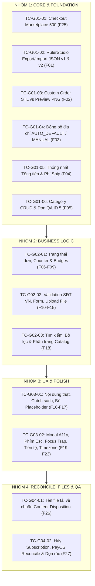

# Kế hoạch kiểm thử tổng thể sau triển khai (Post-Deployment E2E Verification Flow)
## Áp dụng chung cho toàn bộ 4 nhóm sửa (Nhóm 1 – Nhóm 4) — PrintHub 3D

- **Ngày lập:** 02/11/2026
- **Tài liệu căn cứ:** 
  - [Mục lục 4 nhóm ưu tiên](./FLOW_FIX_LIVE_UX_4_PHASES_2026-11-02.md)
  - [Báo cáo Audit Website Thật](./REVIEW_LIVE_WEBSITE_UX_2026-11-02.md)
  - [Flow Nhóm 1 (Core)](./FLOW_FIX_LIVE_UX_GROUP_01_CORE_2026-11-02.md)
  - [Flow Nhóm 2 (Business)](./FLOW_FIX_LIVE_UX_GROUP_02_BUSINESS_2026-11-02.md)
  - [Flow Nhóm 3 (Experience)](./FLOW_FIX_LIVE_UX_GROUP_03_EXPERIENCE_2026-11-02.md)
  - [Flow Nhóm 4 (Payment/Files/QA)](./FLOW_FIX_LIVE_UX_GROUP_04_FILES_PAYMENT_QA_2026-11-02.md)
- **Mục tiêu:** Cung cấp quy trình kiểm thử đầu-cuối (End-to-End) có thể thực thi ngay sau khi code được build và deploy lên môi trường Staging/Production thật, đảm bảo toàn bộ 26 lỗi phát hiện (F01–F23, F25–F27) được khắc phục triệt để và không có lỗi hồi quy (regression).

---

## I. Yêu cầu tiên quyết trước khi kiểm thử (Pre-requisites)

### 1. Chuẩn bị môi trường & Tài khoản kiểm thử
| Vai trò (Role) | Tài khoản mẫu (Username / Email) | Mục đích kiểm thử |
| --- | --- | --- |
| **Guest** | Không đăng nhập | Trải nghiệm duyệt Catalog, xem chi tiết, giỏ hàng tạm, chuyển hướng login khi checkout. |
| **Customer A** | `test_customer_a@printhub3d.com` | Luồng đặt hàng Marketplace, đổi địa chỉ, thiết kế Ruler Studio, gửi yêu cầu Custom. |
| **Customer B** | `test_customer_b@printhub3d.com` | Kiểm tra tính độc lập giỏ hàng, địa chỉ, đơn hàng giữa các tài khoản khác nhau. |
| **Seller** | `test_seller@printhub3d.com` | Quản lý sản phẩm, tiếp nhận đơn Marketplace, cập nhật trạng thái đơn hàng. |
| **Admin** | `admin@printhub3d.com` | CRUD danh mục, duyệt đơn Custom, đối soát thanh toán PayOS, kiểm tra log hệ thống. |

### 2. Thiết bị & Trình duyệt
- **Desktop:** Google Chrome (Latest), Mozilla Firefox, Microsoft Edge (Độ phân giải 1920x1080 và 1366x768).
- **Mobile / Tablet:** Responsive View trên Chrome DevTools (iPhone 14 Pro Max 430px, iPad Air 820px) và thiết bị Android/iOS thật.
- **Mạng:** Kết nối bình thường và chế độ mô phỏng mạng chậm (Slow 3G/Fast 3G) để kiểm tra trạng thái loading/retry.

---

## II. Ma trận luồng kiểm thử chi tiết theo từng nhóm

---

### Giai đoạn 1: Kiểm thử Nhóm 1 — Khôi phục luồng chính (Core & Foundation)

#### TC-G01-01 (F25): Luồng Checkout Marketplace & PayOS Integration
- **Mục tiêu:** Xác minh việc đặt hàng không còn bị HTTP 500 khi sản phẩm có/không có seller, trừ tồn kho chính xác, giỏ hàng giữ nguyên nếu lỗi.
- **Các bước thực hiện:**
  1. Đăng nhập bằng `Customer A`.
  2. Vào Catalog, chọn sản phẩm "Thước Kẹp Mini" (hoặc sản phẩm bất kỳ), bấm thêm vào giỏ.
  3. Mở Giỏ hàng (`/cart`), tích chọn sản phẩm, chọn địa chỉ nhận hàng hợp lệ.
  4. Bấm "Thanh toán với PayOS".
  5. *Trường hợp A (Thành công):* Chuyển hướng sang cổng PayOS, hiển thị đúng số tiền (ví dụ: 49.000đ + 30.000đ ship = 79.000đ).
  6. *Trường hợp B (Giả lập PayOS timeout/lỗi mạng):* Hệ thống báo lỗi rõ ràng bằng tiếng Việt, **giỏ hàng vẫn giữ nguyên**, không sinh đơn rác hay trừ kho sai.
  7. *Trường hợp C (Chặn Double Click):* Bấm liên tiếp 2 lần vào nút "Thanh toán", kiểm tra backend chỉ sinh đúng 1 order duy nhất nhờ Idempotency Key.
- **Tiêu chí nghiệm thu (Pass):**
  - Không xuất hiện mã lỗi `HTTP 500`.
  - Đơn hàng chuyển sang `PENDING_PAYMENT` với mã đơn cụ thể.
  - Số lượng tồn kho được giữ đúng với số lượng đặt.

#### TC-G01-02 (F01): Xuất & Nhập file JSON tại RulerStudio
- **Mục tiêu:** Đảm bảo file JSON xuất từ Studio (phiên bản hiện tại v2) và file cũ (v1) đều nhập lại được hoàn hảo.
- **Các bước thực hiện:**
  1. Mở trang `/ruler-studio`.
  2. Thiết kế một thước đo: chỉnh chiều dài 150mm, vẽ 2 vạch đo, thêm text tiếng Việt có dấu: "PrintHub 3D - Thước Kỹ Thuật".
  3. Bấm **Xuất JSON**. Mở file kiểm tra `version: 2`.
  4. F5 làm mới trang (về trạng thái mặc định ban đầu).
  5. Bấm **Nhập JSON**, chọn file vừa xuất.
  6. Kiểm tra: Bản vẽ khôi phục đúng chiều dài 150mm, đúng vạch đo và text tiếng Việt không bị lỗi font/mất dấu.
  7. Thử nhập một file mẫu có `version: 1` -> Hệ thống tự động migrate lên v2 và mở bản vẽ thành công.
  8. Thử nhập một file `.json` sai cấu trúc hoặc file rác -> Báo lỗi "File không đúng định dạng", **giữ nguyên bản vẽ hiện tại**, không làm trắng màn hình.
- **Tiêu chí nghiệm thu (Pass):**
  - Cả file v1 và v2 đều import thành công.
  - File hỏng bị từ chối an toàn, không mất dữ liệu đang làm việc.

#### TC-G01-03 (F02): Phân tách Ảnh Preview và File 3D Sản xuất (STL/STEP)
- **Mục tiêu:** Nút tải file 3D phải tải đúng file 3D thực tế, không tải về ảnh PNG thumbnail.
- **Các bước thực hiện:**
  1. Vào `/custom-order`, tạo yêu cầu in mẫu: tải lên 1 file `test_model.stl` (hoặc `.step`) và 1 ảnh thumbnail minh họa `preview.png`.
  2. Đăng nhập tài khoản `Admin` hoặc `Seller`, mở trang Quản lý yêu cầu in (`/admin/custom-orders` hoặc `/custom-requests`).
  3. Kiểm tra giao diện:
     - Nút "Xem ảnh thiết kế": Bấm vào mở Lightbox hiển thị ảnh PNG.
     - Nút "Tải file 3D (.STL)": Bấm vào tải đúng file `test_model.stl`, mở bằng phần mềm 3D (Cura / PrusaSlicer / 3D Viewer) xem được mô hình.
  4. Đối với các yêu cầu in cũ (legacy) chỉ có ảnh PNG: Nút tải STL phải bị ẩn hoặc hiển thị nhãn "Chưa có file 3D gốc".
- **Tiêu chí nghiệm thu (Pass):**
  - Không còn tình trạng bấm nút tải STL nhưng browser tải về file ảnh `.png`.

#### TC-G01-04 (F03): Đồng bộ trạng thái Địa chỉ giao hàng (Single Source of Truth)
- **Mục tiêu:** Đổi địa chỉ mặc định hoặc chọn địa chỉ nhận hàng phải cập nhật tức thì trên toàn ứng dụng mà không cần F5.
- **Các bước thực hiện:**
  1. Tài khoản có 2 địa chỉ: Địa chỉ A (Mặc định) và Địa chỉ B.
  2. Vào Giỏ hàng: Hệ thống tự động chọn Địa chỉ A (chế độ `AUTO_DEFAULT`).
  3. Mở menu, sang trang Sổ địa chỉ (`/addresses`), đặt Địa chỉ B làm mặc định.
  4. Quay lại trang Giỏ hàng bằng thanh điều hướng (không bấm F5 reload trang):
     - Địa chỉ nhận hàng tại Giỏ hàng và trong Cart Drawer tự động đổi sang Địa chỉ B.
  5. Tại Giỏ hàng, chủ động click chọn sang Địa chỉ A (chế độ `MANUAL`).
  6. Thử vào Sổ địa chỉ sửa thông tin -> Giỏ hàng vẫn giữ đúng lựa chọn Địa chỉ A mà người dùng đã chỉ định thủ công.
- **Tiêu chí nghiệm thu (Pass):**
  - Địa chỉ phản ánh đồng bộ 100% giữa Sổ địa chỉ, Cart Drawer và Trang Checkout.

#### TC-G01-05 (F04): Thống nhất Phí Ship & Tổng tiền trên mọi màn hình
- **Mục tiêu:** Không còn trường hợp Cart Drawer hiển thị ship 0đ trong khi Cart Page hiển thị 30.000đ.
- **Các bước thực hiện:**
  1. Thêm 1 sản phẩm 49.000đ vào giỏ.
  2. Mở Cart Drawer bên phải: Phí ship hiển thị 30.000đ (hoặc theo quy định rõ ràng), Tổng tiền = 79.000đ.
  3. Bấm "Xem chi tiết giỏ hàng" sang `/cart`: Phí ship hiển thị 30.000đ, Tổng tiền = 79.000đ.
  4. Chuyển sang màn hình thanh toán PayOS: Số tiền trên đơn thanh toán đúng 79.000đ.
- **Tiêu chí nghiệm thu (Pass):**
  - Số tiền khớp nhau tuyệt đối giữa Cart Drawer, Cart Page và Cổng thanh toán.

#### TC-G01-06 (F05): Kiểm thử CRUD Danh mục & Dọn dẹp Danh mục QA ID 5
- **Mục tiêu:** Admin có thể Sửa/Xóa danh mục; không cho xóa danh mục đang có sản phẩm (409); dọn dẹp sạch danh mục test ID 5.
- **Các bước thực hiện:**
  1. Đăng nhập bằng `Admin`, vào Quản lý danh mục (`/admin/categories`).
  2. Bấm Sửa 1 danh mục bất kỳ -> Lưu thành công (trả về HTTP 200, không bị 404).
  3. Thử Xóa 1 danh mục đang chứa sản phẩm -> Hệ thống hiện thông báo: "Không thể xóa danh mục đang có sản phẩm liên kết" (HTTP 409 Conflict).
  4. Tạo 1 danh mục rỗng mới "Danh mục Test Rỗng" -> Bấm Xóa -> Xóa thành công.
  5. Tìm danh mục `QA AUDIT 20261102` (ID 5):
     - Xác nhận không có sản phẩm nào thuộc danh mục này.
     - Bấm Xóa -> Danh mục biến mất khỏi danh sách Admin và menu Catalog người dùng.
- **Tiêu chí nghiệm thu (Pass):**
  - PUT / DELETE `/api/categories/{id}` hoạt động chuẩn.
  - Danh mục QA ID 5 bị xóa sạch hoàn toàn trên production.

---

### Giai đoạn 2: Kiểm thử Nhóm 2 — Đồng nhất nghiệp vụ (Business Logic)

#### TC-G02-01 (F06–F09): Trạng thái đơn hàng, Counters & Badges
- **Các bước thực hiện:**
  1. Tạo đơn hàng mới -> Kiểm tra badge trạng thái: `CHỜ THANH TOÁN` (màu vàng cam).
  2. Thanh toán thành công -> Trạng thái chuyển `ĐÃ THANH TOÁN` / `ĐANG XỬ LÝ` (màu xanh dương).
  3. Seller nhận đơn -> Chuyển sang `ĐANG IN 3D` / `ĐANG GIAO`.
  4. Đơn giao thành công -> Chuyển sang `HOÀN THÀNH` (màu xanh lá).
  5. Đăng nhập các role khác nhau:
     - User chỉ thấy đơn của mình.
     - Seller chỉ thấy đơn thuộc các sản phẩm của shop mình.
     - Admin thấy toàn bộ đơn hàng.
  6. Kiểm tra Notification Badge (chuông thông báo) và Cart Counter (số trên icon giỏ hàng): Tăng/giảm tức thì theo sự kiện (real-time/optimistic update), không bị lag hay hiển thị số âm.
- **Tiêu chí nghiệm thu (Pass):**
  - Trạng thái rõ ràng, phân quyền chuẩn, counter chính xác.

#### TC-G02-02 (F10–F15): Chuẩn hóa Validation, Upload & Form liên hệ
- **Các bước thực hiện:**
  1. Kiểm tra validation Số điện thoại tại trang Checkout và Hồ sơ cá nhân:
     - Nhập `0912345678` (10 số, đầu số VN hợp lệ 03x, 05x, 07x, 08x, 09x) -> Hợp lệ.
     - Nhập chữ, nhập thiếu số (`09123`), nhập số quốc tế sai định dạng -> Báo lỗi cụ thể ngay dưới ô input.
  2. Upload file 3D tại trang Custom Order:
     - Upload file `.stl` dung lượng 30MB -> Thành công, có thanh tiến trình upload trực quan.
     - Upload file `.exe` hoặc file vượt quá dung lượng quy định (ví dụ > 50MB) -> Chặn ngay lập tức phía client và báo lỗi tiếng Việt.
  3. Form Hỗ trợ / Liên hệ (`/contact`):
     - Gửi tin nhắn liên hệ -> Gửi thành công, có toast thông báo và xóa sạch form sau khi gửi.
- **Tiêu chí nghiệm thu (Pass):**
  - Dữ liệu rác bị chặn 100% trước khi gửi lên server.

#### TC-G02-03 (F18): Tìm kiếm & Bộ lọc Catalog
- **Các bước thực hiện:**
  1. Vào `/catalog`.
  2. Gõ từ khóa tìm kiếm tiếng Việt có dấu: "thước kẹp", "bánh răng", "mô hình".
  3. Kết quả tìm kiếm trả về chính xác sản phẩm có tên hoặc mô tả chứa từ khóa.
  4. Thử bộ lọc: Lọc theo Khoảng giá (từ 50.000đ đến 200.000đ), lọc theo Danh mục, sắp xếp theo Giá tăng dần / mới nhất.
  5. Kiểm tra phân trang: Chuyển sang trang 2, URL được cập nhật query param (`?page=2&q=...`), bấm nút Back trình duyệt quay lại đúng trang trước.
- **Tiêu chí nghiệm thu (Pass):**
  - Search & Filter mượt mà, không giật lag, URL phản ánh đúng trạng thái bộ lọc.

---

### Giai đoạn 3: Kiểm thử Nhóm 3 — Hoàn thiện trải nghiệm (Experience & Polish)

#### TC-G03-01 (F16–F17): Loại bỏ Placeholder, Cập nhật Nội dung & Chính sách thật
- **Các bước thực hiện:**
  1. Duyệt toàn bộ Landing Page (`/`):
     - Kiểm tra toàn bộ banner, ảnh minh họa dịch vụ in 3D: Phải là ảnh chất lượng cao của PrintHub 3D, không còn ảnh placeholder (Lorem Picsum, Unsplash vỡ hình).
     - Kiểm tra khối Giới thiệu, Đội ngũ, Đánh giá của khách hàng: Toàn bộ là text tiếng Việt thật, không còn chữ `Lorem Ipsum dolor sit amet...`.
  2. Duyệt các trang chân trang (Footer):
     - Trang Điều khoản dịch vụ (`/terms`).
     - Trang Chính sách bảo mật (`/privacy`).
     - Trang Chính sách đổi trả & hoàn tiền (`/refund-policy`).
     - Trang Hướng dẫn đặt hàng & in 3D.
  3. Toàn bộ nội dung chính sách đầy đủ thông tin pháp lý, địa chỉ liên hệ và quy trình giải quyết khiếu nại thật.
- **Tiêu chí nghiệm thu (Pass):**
  - 100% nội dung trên website là thông tin thật của PrintHub 3D.

#### TC-G03-02 (F19–F23): Accessibility, Phím Esc, Modal Focus, Tiền tệ & Timezone
- **Các bước thực hiện:**
  1. *Kiểm tra Modal Accessibility:*
     - Mở bất kỳ Modal nào (Modal Thêm địa chỉ, Modal Chi tiết đơn, Modal Đăng nhập).
     - Nhấn phím `Esc` trên bàn phím -> Modal đóng ngay lập tức.
     - Nhấn phím `Tab` -> Con trỏ chỉ di chuyển tuần hoàn bên trong Modal (Focus Trap), không nhảy ra ngoài nền web.
     - Click chuột vào vùng backdrop bên ngoài -> Modal đóng êm ái.
  2. *Kiểm tra hiển thị Tiền tệ:*
     - Toàn bộ giá trên web (Catalog, Giỏ hàng, Đơn hàng, Dashboard Admin) đều có format chuẩn: `xxx.xxx ₫` (ví dụ: `49.000 ₫`, `150.000 ₫`), không bị hiển thị dạng thô `49000` hay `49000 VND`.
  3. *Kiểm tra Timezone:*
     - Thời gian tạo đơn hàng, thời gian thanh toán hiển thị theo múi giờ Việt Nam `GMT+7` (ví dụ: `14:30 02/11/2026`), không hiển thị giờ UTC lệch 7 tiếng.
  4. *Kiểm tra Giao diện Mobile (Responsive):*
     - Xem web trên điện thoại: Không có hiện tượng vỡ layout ngang, chữ không bị tràn viền, menu mở mượt mà.
- **Tiêu chí nghiệm thu (Pass):**
  - Trải nghiệm mượt mà, đạt chuẩn Accessibility và hiển thị đồng nhất.

---

### Giai đoạn 4: Kiểm thử Nhóm 4 — File, Đối soát Giao dịch & Dọn dẹp QA (Reconcile & Cleanup)

#### TC-G04-01 (F26): Tên file tải về (Content-Disposition) & Lưu trữ
- **Các bước thực hiện:**
  1. Đăng nhập tài khoản Admin/Seller.
  2. Bấm tải xuống một file thiết kế 3D hoặc hóa đơn đơn hàng.
  3. Kiểm tra file được lưu trong máy:
     - Tên file giữ nguyên tên gốc có nghĩa (ví dụ: `banh-rang-tru-m4.stl` hoặc `DonHang_DH10023.pdf`).
     - Không bị đổi thành chuỗi hash vô nghĩa (như `cf4821a8-9b8c-4f12.bin`).
     - Đúng đuôi file định dạng (MIME type chuẩn `application/sla` cho STL, `application/pdf` cho hóa đơn).
- **Tiêu chí nghiệm thu (Pass):**
  - File tải về có tên đẹp, mở được ngay lập tức bằng đúng ứng dụng chuyên dụng.

#### TC-G04-02 (F27): Luồng Hủy Subscription, Đối soát PayOS & Dọn rác QA
- **Các bước thực hiện:**
  1. *Luồng Hủy Gói Hội viên (Subscription Cancellation):*
     - Vào trang Quản lý gói hội viên (`/membership`).
     - Bấm "Hủy gói hội viên" -> Hệ thống yêu cầu xác nhận lý do.
     - Sau khi xác nhận: Gói chuyển sang trạng thái `CANCELED` (hoặc giữ quyền lợi đến hết chu kỳ đã thanh toán).
     - Không tự động trừ tiền ở kỳ tiếp theo; lịch sử giao dịch cũ vẫn được lưu trữ đầy đủ để kế toán đối soát.
  2. *Đối soát Thanh toán PayOS:*
     - Kiểm tra Webhook từ PayOS: Khi khách quét mã QR thành công, backend nhận webhook và cập nhật đơn sang `PAID` trong vòng < 2 giây.
     - Khách bấm "Hủy giao dịch" tại cổng PayOS -> Hệ thống cập nhật trạng thái đơn thành `PAYMENT_FAILED` / `CANCELED`, hoàn lại tồn kho đã giữ.
  3. *Dọn dẹp dữ liệu QA:*
     - Quét cơ sở dữ liệu các giao dịch test cũ có trạng thái `PENDING` bị treo qua 24h -> Chuyển sang trạng thái `EXPIRED` để giải phóng kho.
- **Tiêu chí nghiệm thu (Pass):**
  - Luồng tài chính chính xác tuyệt đối, dữ liệu đối soát minh bạch, không có giao dịch treo vô thời hạn.

---

## III. Kế hoạch Quản lý Rủi ro & Rollback (Rollback Strategy)

Trong trường hợp sau khi deploy lên môi trường Staging/Production xảy ra sự cố nghiêm trọng (Blocker):

1. **Nguyên tắc Rollback:**
   - **Frontend:** Giữ bản build trước đó trên CDN/Vercel/Nginx. Nếu FE mới lỗi giao diện, revert commit và trigger deploy lại bản cũ trong vòng < 3 phút.
   - **Backend:** Các thay đổi DTO/Entity phải luôn tuân thủ nguyên tắc **Backward Compatibility** (Tương thích ngược). Thêm cột/bảng mới có giá trị default, không xóa cột cũ ngay lập tức để khi rollback code Java thì database không bị lỗi runtime.
2. **Kênh thông báo & Escalate:**
   - Nếu phát hiện lỗi thanh toán hoặc lệch tiền trên Production: Tạm thời chuyển cổng thanh toán sang chế độ "Bảo trì cổng thanh toán trực tuyến", cho phép khách đặt hàng qua hình thức COD/Chuyển khoản thủ công trong lúc đội dev xử lý hotfix.

---

## IV. Bảng Ký duyệt Nghiệm thu (Sign-off Matrix)

| Hạng mục kiểm thử | Người thực hiện | Môi trường test | Kết quả (PASS / FAIL) | Ghi chú & Mã đối chiếu |
| --- | --- | --- | --- | --- |
| **Nhóm 1 (F25, F01–F05)** | Senior QA / Dev | Staging / Prod | `[ Chờ test ]` | Sẽ ghi log đơn hàng & hash file |
| **Nhóm 2 (F06–F15, F18)** | Senior QA / Dev | Staging / Prod | `[ Chờ test ]` | Kiểm tra role & validation SĐT |
| **Nhóm 3 (F16–F17, F19–F23)**| Senior QA / Designer | Staging / Prod | `[ Chờ test ]` | Kiểm tra nội dung thật & mobile |
| **Nhóm 4 (F26–F27)** | Senior QA / Tech Lead | Staging / Prod | `[ Chờ test ]` | Đối soát PayOS & tên file |

---
*Tài liệu này được lập để áp dụng xuyên suốt quá trình nghiệm thu sau deploy của PrintHub 3D.*
